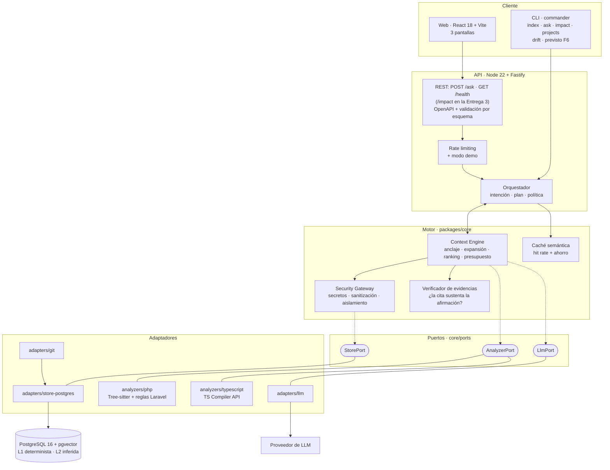
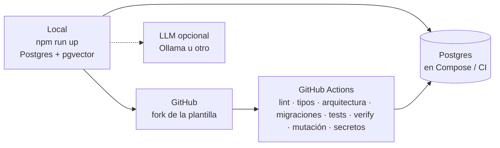
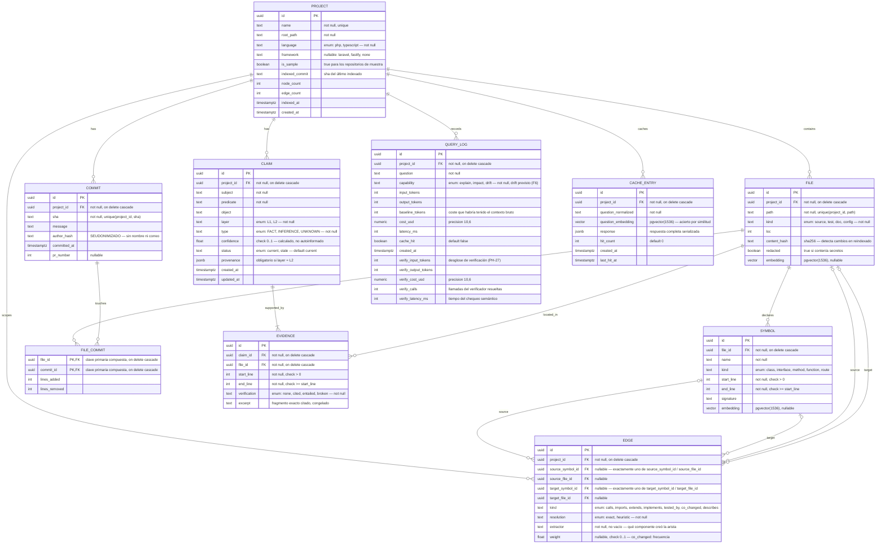
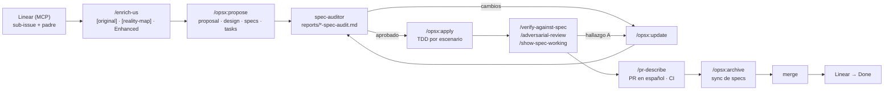

# CODEMIND

**Comprensión de repositorios de código con evidencia verificable**

Proyecto Final del Máster AI4Devs · Cristina Rodríguez Núñez

---

> **Estado de la entrega**
>
> Este documento corresponde a la **Entrega 2 — código funcional** (22 de octubre de 2026). Describe el sistema tal como está en la rama `feature/entrega-2-CRN`, y marca como *Entrega 3* lo que todavía no existe.
>
> - **Entrega 1** (24 de septiembre): documentación técnica.
> - **Entrega 2** (22 de octubre): flujo principal operativo por CLI y API — indexar un repositorio PHP/Laravel, preguntar con evidencia verificada, confianza calculada, uso y coste por consulta, caché de respuestas y `npm run verify` — y la web con las pantallas 1 (selección de proyecto) y 2 (consulta).
> - **Entrega 3** (12 de noviembre): pantallas web completas, análisis de impacto, analizador TypeScript, mediciones publicadas y despliegue reproducible cerrado.
>
> Las secciones marcadas con *(pendiente)* se completarán en la entrega que indican. La sección 7 recoge las pull requests reales de esta entrega, y la [sección 8](#8-flujo-de-trabajo-con-ia-y-sdd-harness-kit) el flujo de trabajo con IA con el que se han hecho.
>
> **Sobre la evidencia de funcionamiento:** el repositorio levantable en local (`npm run up`, el mismo comando en PowerShell y en Bash), el guion [`docs/DEMO.md`](docs/DEMO.md) con la salida real de cada paso y `npm run verify`. Los wireframes de las tres pantallas siguen en [1.3](#13-diseño-y-experiencia-de-usuario) como referencia visual de la web.
>
> **Recomendaciones de la revisión de la Entrega 1**
>
> | Recomendación | Estado | Dónde |
> |---|---|---|
> | Medir la latencia y las llamadas del verificador en cada consulta | Aplicado tras la revisión (14-10-2026) | `query_log.verify_latency_ms` y `verify_calls`, DIS-74 ([3.2](#32-descripción-de-entidades-principales)) |
> | Alinear el contrato OpenAPI con la decisión de indexar solo por CLI | Aplicado tras la revisión | [4](#4-especificación-de-la-api): `/index` sale del contrato |
> | Decidir qué pasa con los embeddings | Aplicado tras la revisión: se documenta el estado | Nota de [2.2](#22-descripción-de-componentes-principales); la decisión del puerto la tomará DIS-46 |
> | Mostrar la IA en las fases de Pruebas, Despliegue y Mantenimiento | Aplicado tras la revisión | [8.3](#83-ia-en-las-seis-fases-del-ciclo) |
> | Medir el verificador | Previsto | DIS-79 (Tabla 1 y Tabla 2 de [2.6](#26-tests)) |
> | Aristas con un extremo polimórfico sin clave foránea | Ya resuelto antes de la revisión | Dos FK por extremo y `CHECK` (ADR `20260928-edge-endpoints-as-fk-pairs`) |
> | Confinamiento de rutas con `startsWith` | Ya resuelto antes de la revisión | `path.relative` en `path-policy.ts` ([2.5](#25-seguridad)) |
> | Acceso a Git detrás de un puerto | Ya resuelto antes de la revisión | `GitPort` (DIS-35) |
> | Harness de trabajo con IA instalado en el repositorio | Ya resuelto antes de la revisión | `ai-specs/`, `.claude/`, `openspec/` ([8.1](#81-el-kit-sdd-harness-kit)) |
> | Que el servidor no acepte rutas de repositorio | Ya resuelto antes de la revisión | La API no recibe rutas: solo reindexa un proyecto creado por la CLI desde su raíz guardada |
> | Acotar el proyecto a un solo analizador | **No aplicado** | La planificación en Linear (hitos M1–M9) ya ordena las entregas: PHP en la Entrega 2 y TypeScript en la 3 |
>
> **Decisión (5 sep 2026).** Antes: evidencia = demo alojada + local. Ahora: **solo local**. Motivo: sin coste de hosting/dominio y un único entorno fiable el día de la revisión. Detalle en `proposal-codemind/05-propuesta-v4-evidencia-local-hibrido-ollama.md`.

---

## Índice

0. [Ficha del proyecto](#0-ficha-del-proyecto)
1. [Descripción general del producto](#1-descripción-general-del-producto)
2. [Arquitectura del sistema](#2-arquitectura-del-sistema)
3. [Modelo de datos](#3-modelo-de-datos)
4. [Especificación de la API](#4-especificación-de-la-api)
5. [Historias de usuario](#5-historias-de-usuario)
6. [Tickets de trabajo](#6-tickets-de-trabajo)
7. [Pull requests](#7-pull-requests)
8. [Flujo de trabajo con IA y `sdd-harness-kit`](#8-flujo-de-trabajo-con-ia-y-sdd-harness-kit)

---

## 0. Ficha del proyecto

### **0.1. Tu nombre completo:**

Cristina Rodríguez Núñez

### **0.2. Nombre del proyecto:**

CODEMIND

### **0.3. Descripción breve del proyecto:**

CODEMIND indexa un repositorio de código —PHP/Laravel o TypeScript— y construye un grafo de conocimiento a partir de cuatro fuentes que normalmente nadie mantiene relacionadas: el código, el historial de Git, los tests y la documentación. Sobre ese grafo responde dos preguntas: **cómo funciona una parte del proyecto** y **qué se rompería al cambiarla**.

Se diferencia de un asistente de código convencional en tres comportamientos verificables: **verifica que cada cita sustenta realmente lo que afirma** en lugar de limitarse a adjuntarla; **distingue explícitamente lo observado de lo inferido**; y **responde que no lo sabe** cuando no hay evidencia suficiente, en lugar de generar una explicación plausible. Además envía al modelo solo los fragmentos necesarios en lugar del repositorio completo, lo que reduce coste y latencia de forma medida.

### **0.4. URL del proyecto:**

La evidencia ejecutable es el propio repositorio público, levantado en local:

https://github.com/DisTinta/AI4Devs-finalproject — clonar y seguir [1.4](#14-instrucciones-de-instalación) (`npm run up`).

No hay URL de servicio web alojado: quien evalúa prueba en su máquina con Docker y Node.

> **Decisión (5 sep 2026).** Antes: §0.4 apuntaba a una demo alojada en servidor propio (pendiente Entrega 3). Ahora: la “URL del proyecto” es el **repo + arranque local**. Motivo: eliminar dependencia de un servidor el día de la revisión y evitar coste de hosting/dominio.

### 0.5. URL o archivo comprimido del repositorio

https://github.com/DisTinta/AI4Devs-finalproject — **público**. Fork de `LIDR-academy/AI4Devs-finalproject`.

En el proyecto intervienen **tres repositorios distintos**, y conviene no confundirlos:

| | Repositorio | Visibilidad | Papel |
|---|---|---|---|
| **1** | Este — `AI4Devs-finalproject` | Público | **Es la entrega:** CODEMIND, la herramienta que se evalúa |
| **2** | Un proyecto Laravel propio, ya existente | Privado | Se usa durante el desarrollo para comprobar que el analizador aguanta código real. Es **material de entrada** —como el fichero que se le pasa a un programa— y no forma parte de la entrega |
| **3** | `acme-shop` y `task-api` | Públicos, **incluidos dentro del 1** | Repositorios de muestra pequeños, con su grafo ya construido, en `fixtures/`. Son lo que permite reproducir la demo sin credenciales de nadie |

Que el número 2 sea privado **no obliga a que CODEMIND sea público o privado**: el repositorio analizado es dato de entrada, no el producto entregado. Pero tiene una consecuencia de diseño, y es la que explica el número 3: nadie ajeno puede abrir el número 2, así que no sirve para demostrar nada. Los repositorios de muestra existen para que la evaluación sea reproducible por cualquiera, y por eso viajan dentro de la entrega en lugar de enlazarse desde fuera.

**Kit de trabajo con IA:** el proyecto se construye con [`DisTinta/sdd-harness-kit`](https://github.com/DisTinta/sdd-harness-kit), un kit propio de Spec-Driven Development con hooks, skills y subagentes. Cómo se ha usado está en la [sección 8](#8-flujo-de-trabajo-con-ia-y-sdd-harness-kit).

---

## 1. Descripción general del producto

### **1.1. Objetivo:**

#### El problema

Cuando alguien se incorpora a un proyecto que no escribió —o vuelve a uno que no toca desde hace meses— la información que necesita existe, pero está repartida en cuatro sitios que nadie mantiene sincronizados:

- el **código** dice *qué* hace el sistema;
- los **tests** dicen *qué comportamiento se garantiza*;
- el **historial de Git** dice *por qué* se cambió algo;
- la **documentación** dice lo que alguien creyó cierto en su momento.

Los asistentes de código actuales recuperan fragmentos por similitud semántica. Eso funciona bien para «escríbeme una función parecida a esta» y falla para «explícame por qué este descuento se aplica antes de los impuestos», porque la respuesta no está en ningún fragmento: está en la **relación** entre un método, un test y un pull request de hace dos años.

Y falla de una forma concreta y difícil de detectar: cuando no encuentra la respuesta, la genera. Con una cita que parece válida.

#### Qué aporta CODEMIND

Cuatro comportamientos que un asistente convencional no tiene:

1. **Relaciona las cuatro fuentes** en un grafo consultable, en lugar de tratarlas como texto indiferenciado.
2. **Verifica sus propias citas.** No basta con adjuntar `PriceCalculator.php:42`: el sistema comprueba que ese fragmento sustenta la afirmación, y elimina o degrada lo que no pasa la comprobación.
3. **Sabe callarse.** Si no hay evidencia suficiente, responde `UNKNOWN` en lugar de producir una explicación plausible.
4. **Envía solo lo necesario.** Selecciona fragmentos guiándose por el grafo, no ficheros completos, y muestra cuánto contexto ha ahorrado.

#### Independencia del lenguaje

El núcleo no conoce ningún lenguaje: los analizadores son adaptadores que implementan un puerto. Para **demostrarlo y no solo afirmarlo**, el proyecto incluye dos analizadores completos —PHP/Laravel y TypeScript— y el criterio de aceptación del segundo es que su pull request **no modifique una sola línea del núcleo**. Es una afirmación comprobable con `git diff`, no una promesa de diseño.

#### Para quién

Desarrolladores que trabajan sobre código que no escribieron: incorporaciones a un equipo, mantenimiento de sistemas heredados, revisión de un módulo antes de modificarlo.

### **1.2. Características y funcionalidades principales:**

| # | Funcionalidad | Prioridad |
|---|---|---|
| **F1** | Indexar un repositorio **PHP/Laravel o TypeScript** y construir su grafo de conocimiento | must |
| **F2** | Explicar cómo funciona una parte del proyecto, con evidencia verificada por afirmación | must |
| **F3** | Analizar qué se vería afectado por un cambio, separando grafo determinista de señal histórica | must |
| **F4** | **Probar el sistema sin configurar nada**: dos repositorios de muestra ya indexados | must |
| **F5** | Mostrar tokens consumidos, coste y ahorro frente a enviar contexto bruto | must |
| **F6** | Detectar contradicciones entre la documentación y el código | should |
| **F7** | Caché semántica de consultas con métrica de acierto | should |

**F4 merece una nota**. Los wireframes de [1.3](#13-diseño-y-experiencia-de-usuario) muestran el diseño; F4 es la evidencia de que el sistema **funciona realmente**. Se concreta en un único camino garantizado:

- **Local, en cuatro comandos.** Se clona el repositorio, se copia `.env.example` a `.env` (sin obligar a una API key) y se levanta con `npm run up`, el mismo comando en PowerShell y en Bash (`make up` es su atajo en Git Bash o WSL). Los dos proyectos de muestra quedan consultables. **Sin PHP instalado, sin clonar repositorios ajenos, sin esperar ningún indexado**, porque los grafos y las respuestas de evaluación van versionados como semillas SQL / caché.

*Estado en la Entrega 2:* la semilla carga `acme-shop` (174 nodos y 170 aristas) y `task-api` (102 nodos y 100 aristas, analizador TypeScript, CM-HU-18), cada uno con tres respuestas *golden*. F1, F2, F4 y F5 funcionan por CLI y por `POST /ask`; F3 (impacto) y F6 (deriva documental) son de la Entrega 3, y F7 tiene hoy el acierto exacto por pregunta normalizada, sin similitud de embedding (CM-HU-19).

**Modo híbrido LLM (parte de F4):**

| Situación | Qué puede hacer quien evalúa |
|---|---|
| Sin endpoint LLM (`LLM_BASE_URL` y `LLM_API_KEY` vacías) | Preguntas sugeridas y `npm run verify` desde caché/golden (**0 $**, sin cuenta de proveedor) |
| Con LLM (p. ej. Ollama local o API cloud) | Pregunta libre e indexado de un repositorio propio |

> **Decisión (5 sep 2026).** Antes: Camino A (demo alojada) + Camino B (local). Ahora: solo el local, con evaluación sin key. Motivo: fricción cero para el evaluador y sin servidor propio.

#### Lo que el producto no hace

Declarado desde el principio: **no modifica código, no genera pull requests, no ejecuta comandos y no sustituye al IDE.** Es un sistema de solo lectura, y eso es una decisión de seguridad antes que una limitación de alcance — ver [2.5](#25-seguridad).

### **1.3. Diseño y experiencia de usuario:**

#### Evidencia de esta sección

Los wireframes de las tres pantallas muestran el flujo completo del producto. La evidencia ejecutable complementa las imágenes:

1. **El repositorio levantable en local** en cuatro comandos (ver [1.4](#14-instrucciones-de-instalación)).
2. **`docs/DEMO.md`**: guion de demostración con los comandos exactos y **la salida real de terminal** que producen. Se puede copiar, ejecutar y comparar con lo que uno obtiene.
3. **`npm run verify`**: prueba de humo ejecutable que consulta cada repositorio de muestra y compara con la salida esperada (**sin llamar al LLM**: golden/caché versionada).

> **Decisión (5 sep 2026).** Se eliminó la demo alojada de esta lista. La evidencia queda acotada a local + DEMO.md + verify.

**Estado de la web en la Entrega 2.** Los wireframes se mantienen como referencia visual y de textos de la web. La web ya cubre las pantallas 1 y 2; la 3 es de la Entrega 3:

| Pieza | Estado |
|---|---|
| Andamiaje web: Tailwind con los colores de los wireframes, rutas, cliente tipado de la API, puerta de accesibilidad `test:a11y` | Fusionado (DIS-58, PR #53) |
| Pantalla 1 — tarjetas de los proyectos de muestra desde `data/sample-projects.ts`, aviso de API caída y pantalla de error | Fusionado (DIS-60, PR #54) |
| Pantalla 2 — pregunta, preguntas sugeridas (las *golden*), afirmaciones tipadas con distintivos de tipo y de verificación, evidencia desplegable, panel de uso (confianza, tokens, coste, latencia, ahorro y caché), estados `UNKNOWN` y avisos de `429` y de error | Fusionado (DIS-65, PR #56; DIS-66, PR #57) |
| Pantalla 3 — impacto | Entrega 3 (la CLI `impact` es un stub) |

Con `npm run up` (web en http://localhost:5173), los pasos 1 a 3 del recorrido de abajo se hacen ya en el navegador; el 4 (impacto) y el 6 (`task-api`) siguen siendo de la Entrega 3. [`docs/DEMO.md`](docs/DEMO.md) ejecuta los seis pasos por la CLI contra `acme-shop`, dice en cada uno qué hace hoy el sistema y recorre las dos pantallas en [Recorrido por la web](docs/DEMO.md#recorrido-por-la-web).

#### Las tres pantallas

El principio de diseño es que **la fiabilidad y el coste sean legibles en la propia respuesta**, no un detalle escondido en un log.

**Pantalla 1 — Selección de proyecto**


```
┌────────────────────────────────────────────────────────────┐
│  CODEMIND                                                  │
├────────────────────────────────────────────────────────────┤
│  Elige un proyecto para explorar:                          │
│                                                            │
│  ┌──────────────────────────┐  ┌──────────────────────────┐│
│  │ 🐘 acme-shop             │  │ 📘 task-api              ││
│  │ PHP 8.2 / Laravel 11     │  │ TypeScript / Fastify     ││
│  │ 47 ficheros · 312 símb.  │  │ 38 ficheros · 264 símb.  ││
│  │ 1 840 aristas · 62 commits│  │ 2 110 aristas · 51 commits││
│  │ ✓ indexado · listo       │  │ ✓ indexado · listo       ││
│  └──────────────────────────┘  └──────────────────────────┘│
│                                                            │
│  + Indexar mi propio repositorio                           │
└────────────────────────────────────────────────────────────┘
```

**Pantalla 2 — Consulta**


```
┌────────────────────────────────────────────────────────────┐
│  ← acme-shop        PHP/Laravel  ·  1 840 aristas  ·  ⟳    │
├────────────────────────────────────────────────────────────┤
│  ¿Cómo se calcula el precio final de un pedido?      [→]   │
│                                                            │
│  Prueba:  · ¿Cómo se validan los cupones?                  │
│           · ¿Qué hace OrderObserver?                       │
│           · ¿Por qué existe el campo legacy_ref?           │
├────────────────────────────────────────────────────────────┤
│  RESPUESTA                                                 │
│                                                            │
│  El precio final se calcula en PriceCalculator::compute().  │
│                                                            │
│  1. Se obtiene el precio base del artículo.     ✓ verificado│
│  2. Se aplica el descuento del cliente.         ✓ verificado│
│  3. Se calculan los impuestos sobre el subtotal.✓ verificado│
│                                                            │
│  ⚠ El orden descuento-antes-de-impuestos no está           │
│    documentado. Se deduce del test y del PR #381. INFERIDO  │
│                                                            │
│  EVIDENCIA                                                 │
│  ▸ app/Services/PriceCalculator.php:42-58    entailed      │
│  ▸ tests/Unit/PricingTest.php:91-104         entailed      │
│  ▸ PR #381                                    entailed      │
│                                                            │
│  Confianza 0.71                                            │
│  4 812 tokens · $0.014 · 2.1 s · ahorro 88 % vs contexto   │
│  bruto (41 200 tokens)                          [caché ✓]  │
└────────────────────────────────────────────────────────────┘
```

El valor de confianza que aparece al pie de la respuesta **no lo autoinforma el modelo**: se calcula a partir de señales del grafo y del verificador, y se presenta como indicador ordinal, no como probabilidad. El cálculo está en [3.2](#32-descripción-de-entidades-principales).

**Pantalla 3 — Impacto**


```
┌────────────────────────────────────────────────────────────┐
│  IMPACTO DE: "cambiar el cálculo de descuentos"            │
├────────────────────────────────────────────────────────────┤
│  DIRECTO       PriceCalculator · DiscountService   [grafo] │
│  INDIRECTO     OrderService · OrdersController     [grafo] │
│  TESTS         PricingTest · OrderPricingTest      [grafo] │
│  DOCUMENTACIÓN docs/pricing.md         ⚠ desactualizada    │
│  HISTORIAL     PR #381 · PR #402 (co-cambian 80 %) [git]   │
│                                                            │
│  RIESGO  MEDIO                                             │
│  4 ficheros afectados, 2 tests que cubren el cambio,       │
│  1 documento desalineado desde el commit a3f9c21.          │
│                                                            │
│  3 140 tokens · $0.009                                     │
└────────────────────────────────────────────────────────────┘
```

Cada elemento del informe de impacto indica su **origen**: `[grafo]` para lo derivado del análisis determinista, `[git]` para la señal histórica de co-cambio. Mezclarlos sin distinguir haría el informe imposible de calibrar — quien lo lee no sabría cuánto confiar en cada línea y acabaría desconfiando de todas.

#### Recorrido de demostración

`docs/DEMO.md` lleva en unos cinco minutos a los momentos que definen el producto:

| Paso | Acción | Qué demuestra |
|---|---|---|
| 1 | Elegir `acme-shop` y preguntar por el cálculo del precio | Respuesta con evidencia verificada y ahorro de tokens visible |
| 2 | Pulsar una evidencia | La cita resuelve a un fragmento real del código |
| 3 | Preguntar algo que el repositorio no puede responder | **El sistema responde `UNKNOWN` en lugar de inventar** |
| 4 | Pedir el impacto de cambiar los descuentos | Separación entre grafo determinista y señal histórica |
| 5 | Repetir el paso 1 reformulando la pregunta | Acierto de caché por similitud, coste 0 |
| 6 | Cambiar a `task-api` y repetir el paso 1 | **El mismo núcleo sobre TypeScript**, con grafo más preciso |

El paso 3 es el más característico: un sistema que sabe callarse.

### **1.4. Instrucciones de instalación:**

Al ser el arranque local **la única evidencia de que el sistema funciona ante quien evalúa**, esta sección se trata como crítica. El camino corto no requiere nada más que **Docker y Node 22.12 o posterior**: ni PHP instalado, ni clonar repositorios ajenos, ni esperar un indexado, **ni una API key de LLM**. Para indexar un repositorio hace falta además **Git 2.45.1 o posterior** (o las versiones de mantenimiento de mayo de 2024 2.43.4 y 2.44.1): las anteriores ignoran `GIT_NO_LAZY_FETCH`, que impide que un *partial clone* ejecute el programa de su remoto al leer un objeto que falta, o no leen `attr.tree`, que hace que los atributos salgan siempre del `.gitattributes` de `HEAD`.

#### Camino corto — sistema operativo en cuatro comandos

```shell
git clone https://github.com/DisTinta/AI4Devs-finalproject
cd AI4Devs-finalproject
cp .env.example .env
npm run up
```

Los cuatro comandos son los mismos en PowerShell y en Bash. `.env.example` trae el `DATABASE_URL` del contenedor local y deja vacías las variables `LLM_*` (modo evaluación; ver las variables abajo). Si el puerto 5432 ya está ocupado, `docs/DEMO.md` → [Antes de empezar](docs/DEMO.md#antes-de-empezar) explica cómo cambiarlo (`POSTGRES_PORT`).

`npm run up` (`scripts/up.mjs`) carga `.env` y encapsula la secuencia completa, escribiendo una línea `[up] <comando>` antes de cada paso; `make up` hace lo mismo desde Git Bash o WSL:

```bash
docker compose up -d --wait        # PostgreSQL 16 + pgvector, esperando a que acepte conexiones
npm install
npm run db:migrate                 # esquema
npm run db:seed                    # ← el repositorio de muestra YA indexado (+ caché de evaluación)
node fixtures/build-history.mjs acme-shop   # historial de Git del fixture (~11 s), lo leen las respuestas en vivo
node fixtures/build-history.mjs task-api    # ídem para task-api (`npm run up` hace los dos)
npm run dev                        # API en :3000 · web en :5173
```

`npm run dev` arranca la API desde `packages/api/src/server.ts` y necesita `DATABASE_URL`, que `npm run dev` lee de `.env` (una variable ya definida en la terminal gana sobre `.env`); sin ella la API imprime una sola línea `INVALID_CONFIG` en stderr y no arranca, mientras la web sigue en marcha. La API escucha en `127.0.0.1:3000` (no en todas las interfaces: no tiene autenticación); su documentación OpenAPI se abre en `http://localhost:3000/docs` (el documento en `/docs/json`). Conviene abrirla en `localhost` y no en `127.0.0.1`: el servidor declarado en el documento es `http://localhost:3000` y, desde otro origen, «Try it out» fallaría (no hay CORS). Si `localhost` resuelve a `::1` y no conecta, `HOST=::1` o `HOST=0.0.0.0` lo exponen de otra forma, como decisión explícita.

Lo que imprime al terminar (extracto de la ejecución real del 20-10-2026, en PowerShell y en Bash; la salida completa está en el paso 0 de [`docs/DEMO.md`](docs/DEMO.md)):

```text
[up] docker compose up -d --wait
…
[up] npm install
…
[up] npm run db:migrate
…
### MIGRATION 0001_graph-l1 (UP) ###
### MIGRATION 0002_history-claims (UP) ###
### MIGRATION 0003_indexes-stale (UP) ###
### MIGRATION 0004_query-log-verification (UP) ###
[up] npm run db:seed
…
2 projects loaded
  acme-shop  php/laravel  174 nodes · 170 edges
  task-api  typescript/fastify  102 nodes · 100 edges
[up] node fixtures/build-history.mjs acme-shop
acme-shop: 32 commits, 3 authors -> <repo>\fixtures\acme-shop\.git
[up] node fixtures/build-history.mjs task-api
task-api: 28 commits, 3 authors -> <repo>\fixtures\task-api\.git
[up] npm run dev
…
[1]   ➜  Local:   http://localhost:5173/
[0] {"level":30,…,"msg":"Server listening at http://127.0.0.1:3000"}
```

`docker-compose.yml` solo levanta PostgreSQL 16 con pgvector; la API y la web corren en la máquina con `npm run dev`. No hay `Dockerfile`.

#### El mismo flujo por CLI

Sin necesidad de abrir la web (`projects` y `ask` leen `DATABASE_URL` de `.env`):

```shell
npm run cli -- projects
npm run cli -- ask acme-shop "¿Cómo se calcula el precio final de un pedido?"
npm run cli -- impact acme-shop "cambiar el cálculo de descuentos"
npm run cli -- ask task-api "¿Cómo valida taskRoutes las peticiones entrantes?"
```

**Estado en Entrega 2:** desde DIS-21, sin `LLM_*` (modo evaluación) `ask` responde desde la caché de respuestas del proyecto cualquier pregunta que ya tenga entrada (misma pregunta normalizada: sin distinguir mayúsculas, tildes, signos ni espacios), sin llamar al modelo y a coste 0. Desde DIS-26, `npm run db:seed` (y con él `npm run up`) carga además las respuestas *golden* versionadas en `seeds/cache/acme-shop.json` para tres preguntas de muestra de acme-shop: Q1 «¿Cómo se calcula el precio final de un pedido?», Q3 «¿Cómo se validan los cupones?» y Q4 «¿Qué hace OrderObserver al crear un pedido?». Esas tres responden al instante, sin modelo y a coste 0 (también escritas con otras mayúsculas, tildes o signos). Una pregunta sin entrada responde:

```text
UNKNOWN (llm-required)
evaluation mode (cache-only): set LLM_* to enable free-form asks
```

`impact` sigue siendo un stub. `task-api` está en la semilla con tres preguntas golden (la de arriba es la primera; las otras dos son «¿Qué hace buildPage con los resultados paginados?» y «¿Qué transiciones de estado son válidas?»), así que en modo evaluación `ask task-api …` las responde desde la caché; una pregunta sin ancla, como «¿Cómo se autentican los usuarios?», responde `UNKNOWN (no-anchor)`.

#### Camino completo — indexar tu propio repositorio o pregunta libre

**Indexar no necesita LLM ni PHP**: el analizador PHP usa Tree-sitter (WebAssembly) y solo lee los objetos de Git del repositorio, sin ejecutar nada de él. Hacen falta `ALLOWED_REPOS_DIR`, `AUTHOR_HASH_SALT` y `DATABASE_URL`, y el repositorio tiene que estar **dentro** de `ALLOWED_REPOS_DIR` (la ruta puede ser absoluta dentro de él o relativa a él). Se indexa PHP (`--language php`) y TypeScript (`--language typescript`), cada uno con su analizador. Preguntar (`ask`) sí requiere un LLM configurado (recomendado en desarrollo: **Ollama** local):

```bash
# Indexar: ALLOWED_REPOS_DIR=/ruta/a/repos  AUTHOR_HASH_SALT=…  DATABASE_URL=postgres://…
npm run cli -- index mi-repo --name mi-proyecto --language php            # informe en texto
npm run cli -- index mi-repo --name otro --language php --framework none --json   # informe en JSON

# Preguntar — Ollama (ejemplo, sin clave): DATABASE_URL=postgres://…  LLM_BASE_URL=http://localhost:11434/v1  LLM_MODEL=…
npm run cli -- ask mi-proyecto "¿Cómo funciona el módulo de pagos?"
```

`index` escribe el progreso por fase y los eventos de redacción de secretos (JSON por línea) en stderr, y solo el informe en stdout. Sale con `0` si todo va bien, `1` ante un error de dominio, configuración o ejecución (por ejemplo, ruta fuera de `ALLOWED_REPOS_DIR` o nombre de proyecto repetido) y `2` ante un uso incorrecto; el error es una línea `{"error":{"code","message","details"}}` en stderr.

`ask <proyecto> "<pregunta>"` busca el proyecto por su **nombre exacto** (sin recortar espacios ni ignorar mayúsculas) y escribe en stdout solo la respuesta: el texto del modelo, cada afirmación numerada y tipada (`[FACT]` o `[INFERENCE]`, más `[stale]` si está desactualizada) con sus evidencias `ruta:inicio-fin`, los extractos citados (como mucho 5 líneas cada uno), las afirmaciones previas sobre el mismo código si las hay y, al final, `note: claims not saved` si no pudieron guardarse. Por ejemplo:

```text
El precio final lo calcula PriceCalculator::compute.

statements:
1. [FACT] PriceCalculator::compute calcula el precio final.
   evidence: app/Services/PriceCalculator.php:16-44

evidence:
app/Services/PriceCalculator.php:16-44
    class PriceCalculator
    {
        public function __construct(
            private readonly DiscountService $discounts,
            private readonly TaxService $taxes,
    … (+24 lines)
```

Sin respuesta posible imprime `UNKNOWN (<reason>)` (`no-anchor`, `llm-required`, `over-budget`, `invalid-model-output` o `no-evidence`). Los eventos (JSON por línea) y los errores van a stderr y nunca contienen la pregunta. Sale con `0` ante una respuesta o un `UNKNOWN`, `1` ante un error de configuración, conexión o dominio (por ejemplo `PROJECT_NOT_FOUND`, `LLM_UNAVAILABLE`, `BUDGET_EXHAUSTED`) y `2` ante un uso incorrecto o una pregunta inválida.

#### Probar con un modelo real

Sin `LLM_*` (modo evaluación) no hace falta ningún modelo: las tres preguntas *golden* de `acme-shop` (Q1, Q3 y Q4) se sirven al instante desde la caché, con `cacheHit: true` y `costUsd: 0`, y cualquier otra pregunta responde `UNKNOWN (llm-required)` (ver [`docs/DEMO.md`](docs/DEMO.md), pasos 1 y 5). Para preguntar libremente hace falta un endpoint compatible con OpenAI, y conviene saber de antemano cuánto tarda:

| Modo | Tiempo por pregunta | Fuente |
|---|---|---|
| Modo evaluación, pregunta *golden* | Instantáneo (milisegundos) | `docs/DEMO.md` |
| Ollama en CPU, `qwen2.5-coder` (7B) | **≈ 3,5–9 min, medido** | Una pregunta completa: 211,8 s, de los que 68,1 s fueron el `verify` con 4 llamadas (`openspec/changes/archive/2026-10-16-query-usage-log/reports/2026-10-16-13-manual-interface-testing.md`). `npm run cache:build`: las 3 *golden* en 22 min 24 s, entre 4 y 9 min por intento (`openspec/changes/archive/2026-10-17-golden-cache-build/reports/`) |
| Ollama con GPU, modelo de 7B | ≈ 10–30 s | **Estimado, no medido en este proyecto** |
| API alojada compatible con OpenAI | ≈ 5–20 s | **Estimado, no medido en este proyecto** |

Los 2–3 min que cita la propuesta de DIS-74 no son el tiempo de una pregunta: son la cota del `verify` en CPU, limitada por el tope de 20 llamadas de verificación por respuesta (`MAX_VERIFY_CALLS_PER_ANSWER`).

La receta paso a paso, igual en PowerShell y en Bash, está en [`docs/DEMO.md` → Probar con un modelo real](docs/DEMO.md#probar-con-un-modelo-real): Ollama con GPU o en CPU, una API alojada compatible con OpenAI y Claude por el endpoint compatible con OpenAI de Anthropic (estos dos, no verificados). Lo esencial para Ollama:

- **El historial de `acme-shop` y de `task-api`.** Las respuestas en vivo leen el código del fixture desde `fixtures/<nombre>/.git`, que no viaja con el clon; `npm run up` construye los dos en cada arranque (`node fixtures/build-history.mjs acme-shop` y `… task-api` para quien no use `up`). Sin él, la pregunta termina con `SOURCE_UNAVAILABLE` (`not-a-repository`).
- **`OLLAMA_CONTEXT_LENGTH=16384`.** El prompt de `explain` ocupa entre 5 000 y 7 000 tokens. Con el contexto por defecto, Ollama lo recorta (`truncating input prompt` en su log), se pierde el *system prompt* y toda respuesta sale `UNKNOWN (invalid-model-output)`.
- **`LLM_TIMEOUT_MS=1200000` en CPU.** `LLM_TIMEOUT_MS` admite de 1 a 3 600 000 ms (una hora); el cliente envía con `node:http`, así que no hay otro límite por debajo (el `fetch` de Node cortaba a los 300 s). Con GPU o una API alojada basta el valor por defecto, 120 000 ms.
- **Reiniciar tras editar `.env`.** La API lee `.env` al arrancar: Ctrl+C en la terminal de `npm run up` y otra vez `npm run up`. `npm run cli` lo lee en cada ejecución.
- **Modelo:** `qwen2.5-coder` (7B). `llama3.2` (3B) no produce el JSON estricto que exige la cuarentena y responde `invalid-model-output`.
- **Salida con valla:** desde DIS-72 se acepta una única valla ```` ```json ```` que envuelva toda la salida, porque algunos modelos responden así ([2.5](#25-seguridad), práctica 2).

#### Verificación de la instalación

```bash
npm run verify
```

Hace cada pregunta golden de los repositorios de muestra (versionadas en `seeds/cache/`) y compara la estructura de la respuesta servida con la esperada: tipos de afirmación, verificación y citas, nunca el texto (**determinista: no llama al LLM**). Antes comprueba que la semilla y las golden corresponden al código actual (huellas). Necesita `DATABASE_URL` de una base cargada con `npm run db:seed` y sale con `0` solo si todas coinciden. Sirve como prueba de humo para quien evalúa y como test de integración en CI (job `verify`, con su propia base).

#### Variables de entorno

| Variable | Obligatoria | Descripción |
|---|---|---|
| `LLM_API_KEY` | no | Credencial del endpoint LLM; si está, se envía como `Authorization: Bearer …`. Opcional en modo vivo: con Ollama se deja **vacía**. Con clave pero sin `LLM_BASE_URL`, el arranque falla |
| `LLM_BASE_URL` | no | Base URL compatible OpenAI (`http`/`https`); **decide el modo**: con URL → modo vivo; sin URL ni clave → **modo evaluación** (solo caché / verify). En desarrollo: Ollama (`http://localhost:11434/v1`) |
| `LLM_MODEL` | sí en modo vivo | Modelo para generación; con `LLM_BASE_URL` y sin `LLM_MODEL`, el arranque falla |
| `LLM_MODEL_VERIFY` | no | Modelo económico para la verificación de evidencias en vivo; sin él se usa `LLM_MODEL` |
| `LLM_EMBED_MODEL` | no | Modelo de embeddings; sin él, los embeddings no están disponibles (sin usar `LLM_MODEL`). Sus vectores deben tener 1536 dimensiones, las de `vector(1536)` del esquema: `nomic-embed-text` (768) falla hasta que CM-HU-19 elija el modelo |
| `LLM_TIMEOUT_MS` | no | Tiempo máximo por petición al LLM, en ms (entero de 1 a 3600000). Por defecto `120000`, para el arranque en frío de Ollama; en CPU, `1200000` (ver [Probar con un modelo real](#probar-con-un-modelo-real)) |
| `DATABASE_URL` | **sí** (scripts `db:*`, `index` y la API) | Cadena de conexión de PostgreSQL. La API no arranca sin ella (`INVALID_CONFIG`). `.env.example` trae la del contenedor local. Los comandos `npm run` de la guía (`up`, `dev`, `db:*`, `cli`, `verify`, `cache:build`, `seed:build` y `demo:ask`) la leen de `.env`, y una variable ya definida en la terminal gana sobre `.env`; sin ella en ninguno de los dos sitios, `db:migrate` / `db:rollback` salen con error |
| `POSTGRES_PORT` | no | Puerto del host en el que `docker compose` publica PostgreSQL. Por defecto `5432`. Si lo cambias (otro programa ya usa el 5432), cambia también el puerto de `DATABASE_URL`: los dos van juntos |
| `PORT` | no | Puerto de la API: solo dígitos, de 1 a 65535. Por defecto `3000` |
| `HOST` | no | Dirección en la que escucha la API. Por defecto `127.0.0.1` (solo local); `0.0.0.0` la expone a la red, y la API no tiene autenticación |
| `RATE_LIMIT_MAX` | no | Peticiones por IP dentro de la ventana: solo dígitos, de 1 a 1000000. Por defecto `30` |
| `RATE_LIMIT_WINDOW_MS` | no | Longitud de la ventana del límite, en ms: solo dígitos, de 1 a 86400000. Por defecto `60000` |
| `ALLOWED_REPOS_DIR` | no (sí para indexar) | Directorio raíz permitido para indexar (ver [2.5](#25-seguridad)); vacío = indexado deshabilitado. Solo debe poder escribir en él el usuario que ejecuta Codemind, y solo debe contener repositorios de confianza (ver `docs/DEPLOYMENT.md`) |
| `AUTHOR_HASH_SALT` | **sí** (para indexar) | Clave del seudónimo de los autores de commits (`author_hash`). No se versiona; cambiarla cambia todos los `author_hash` |
| `DAILY_BUDGET_USD` | no | Techo de gasto diario en USD si se usa un proveedor cloud de pago: decimal positivo (`2.5`), solo en modo vivo; vacía = sin techo (lo normal con Ollama local). El gasto del día es la suma de `query_log.cost_usd` desde las 00:00 UTC; al alcanzarlo, el LLM deja de llamarse hasta el día UTC siguiente. Con techo, `LLM_MODEL`, `LLM_MODEL_VERIFY` y `LLM_EMBED_MODEL` deben tener precio en `COST_TABLE` (`packages/core/src/llm/cost-table.ts`); si no, la configuración del LLM es inválida. *Estado:* `ask` envuelve el modelo con el techo cuando hay `DAILY_BUDGET_USD`, y desde DIS-74 cada `explain` escribe su `cost_usd` en `query_log`, verificación incluida. El gasto de un `ask` en curso solo se ve al escribir su fila, así que cada `ask` en curso puede pasarse del techo como mucho en una llamada `answer` y `MAX_VERIFY_CALLS_PER_ANSWER` (20) llamadas `verify` (N ejecuciones simultáneas, N veces eso) |
| `CACHE_BUILD_TIMEOUT_MS` | no | Solo para `npm run cache:build` (desarrollo): tiempo máximo de cada petición al modelo al generar las respuestas *golden*, en ms (entero de 1 a 3600000). Por defecto `1200000` (20 min), porque en CPU una respuesta tarda varios minutos. `LLM_TIMEOUT_MS` no se aplica a ese comando |

> **Decisión (5 sep 2026).** Antes: `LLM_API_KEY` obligatoria. Ahora: **opcional**; evaluación sin key; desarrollo libre con Ollama. Motivo: 0 € y 0 fricción para quien evalúa.

Las semillas se regeneran con `npm run seed:build`, que indexa los dos repositorios de muestra y volca el grafo a `seeds/graph-dump.sql`, versionado en el repositorio. Así la instalación es determinista y no depende de que el indexado se comporte igual en otra máquina. Las respuestas *golden* de evaluación (DIS-26) se regeneran en desarrollo con `npm run cache:build`, **después** de `seed:build`: el comando comprueba que la semilla está al día con el código, pregunta cada pregunta *golden* a un LLM vivo (la referencia es Ollama local con `qwen2.5-coder`; en CPU tarda unos 30 minutos) sobre la semilla cargada en una transacción que siempre deshace, y escribe `seeds/cache/acme-shop.json` de una vez, solo si todas salieron bien. El fichero viaja versionado con las huellas de la semilla y una huella de las respuestas (prompts, reglas de tipado y verificación, pesos de confianza y formato guardado), para que `verify` sepa cuándo se han quedado viejas sin necesitar modelo. `npm run cache:build -- Q3` regenera solo esa pregunta si las huellas no han cambiado.

---

## 2. Arquitectura del Sistema

### **2.1. Diagrama de arquitectura:**



#### Patrón: arquitectura hexagonal (puertos y adaptadores) con extracción offline

**Justificación de cada decisión:**

- **El núcleo no conoce ni el lenguaje analizado ni el proveedor de LLM.** Ambos son adaptadores detrás de un puerto. Esto es lo que hace *comprobable* la independencia del lenguaje: el criterio de aceptación del analizador de TypeScript es que su pull request **no toque `packages/core`**. Una afirmación falsable con `git diff`, no una promesa.
- **La extracción es offline y separada de la consulta.** Indexar es lento y determinista; consultar es rápido. Mezclarlas obligaría a reanalizar el repositorio en cada pregunta.
- **El verificador es un paso posterior obligatorio**, no una instrucción dentro del prompt. Pedirle al modelo «cita tus fuentes» produce citas; comprobarlas mecánicamente produce citas válidas. Es la diferencia que justifica el producto. Su mitad sintáctica (DIS-68, `packages/core/src/verify/`) ya corre en `explain` tras tipar las afirmaciones: relee de git, en el commit y la raíz que leyó el paquete de contexto, los ficheros citados (una sola lectura en lote) y exige que cada `excerpt` sea exactamente el texto de su rango; una cita rota se quita de la afirmación, la afirmación que se queda sin citas desaparece y, si no queda ninguna, la respuesta es `UNKNOWN (broken-evidence)`. Su mitad semántica (DIS-70) corre a continuación sobre cada par (afirmación, cita) que queda: una llamada con propósito `verify` (el modelo de `LLM_MODEL_VERIFY`) por par distinto, en secuencia, que solo recibe la afirmación y el fragmento envueltos como dato no confiable y solo puede responder `{"entails": true|false}`. Una afirmación es `FACT` solo si su cadena de evidencia lo permite **y** todas sus citas quedan `entailed`; si alguna queda `cited`, es `INFERENCE`, nunca se elimina. Si el verificador responde otra cosa, no está disponible o se agota el presupuesto, la cita se queda en `cited` (falla cerrado) con un evento `entailment_unverified`. Los veredictos se cachean en memoria por par durante el proceso, y la respuesta lleva en `usage.verification` las llamadas, aciertos de caché, tokens y coste del verificador.
- **Repository Pattern en la persistencia.** El dominio habla con `StorePort`, no con PostgreSQL. Como efecto secundario útil, las semillas precargadas del arranque local no necesitan ninguna lógica especial.
- **Flujo de control en bucle, no en cascada.** El orquestador y el Context Engine se invocan mutuamente: el agente solicita información de forma incremental en lugar de recibir todo el contexto de una vez. Es lo que permite el presupuesto de tokens.

**Beneficios principales:** sustituibilidad del LLM y de los analizadores; un único grafo reutilizado por las tres capacidades; coste de contexto medible en un solo punto; y un arranque local sin dependencias externas.

#### Sacrificios y déficits

**1. El grafo de llamadas nunca será completo en PHP/Laravel.** Las facades, el contenedor de servicios, `__call`, los atributos mágicos de Eloquent y las rutas resueltas por *string* hacen que parte del grafo real sea invisible para un analizador estático. En TypeScript, en cambio, el compilador resuelve referencias con precisión, así que el mismo núcleo producirá un grafo notablemente mejor. **Ese contraste se mide y se publica** ([2.6](#26-tests)) en lugar de disimularse. Consecuencia práctica: en PHP el sistema depende más de la señal histórica de co-cambio, que no requiere análisis estático.

**2. Indexar cuesta tiempo y dinero por adelantado.** Un asistente basado solo en recuperación semántica no tiene ese coste inicial. La apuesta es que se amortiza en consultas repetidas; las mediciones de [2.6](#26-tests) permiten juzgarlo con datos.

**3. La capa inferida depende del LLM** y hereda su falibilidad. Se acota con procedencia obligatoria y con la regla —impuesta en la base de datos, no solo en el código— de que una inferencia nunca se etiquete como hecho.

**4. La extracción offline implica desfase.** El grafo refleja el último indexado, no el estado actual del repositorio. El indexado incremental lo reduce; no lo elimina.

**5. Tres pantallas no son un producto terminado.** La web es evidencia de funcionamiento y superficie para probar, no una interfaz completa.

**6. El repositorio de validación real es privado**, así que las cifras obtenidas sobre él no son reproducibles por terceros. Por eso las mediciones publicables se hacen sobre los dos repositorios de muestra públicos, y las del privado se reportan aparte como observación.

### **2.2. Descripción de componentes principales:**

| Componente | Tecnología | Responsabilidad |
|---|---|---|
| CLI | TypeScript + `commander` | `index`, `ask`, `impact`, `projects`; `drift` **previsto** (F6) |
| API | Node 22 + **Fastify** 5 + Zod | `POST /api/projects/{projectId}/ask` y `GET /health`, validación por esquema, OpenAPI generado en `/docs` (DIS-76, DIS-78); `/impact` en la Entrega 3 |
| Web | React 18 + TypeScript + **Vite** + Tailwind | Andamiaje, rutas y cliente tipado (DIS-58); selección de proyecto (DIS-60) y consulta con panel de uso y estados (DIS-65, DIS-66); impacto en la Entrega 3 |
| Orquestador | TypeScript | Clasifica intención, coordina el bucle, aplica política de seguridad |
| **Analizador PHP** | **Tree-sitter** (`tree-sitter-php`) + reglas Laravel | Ficheros, clases, métodos, rutas, spans, llamadas |
| **Analizador TypeScript** | **TypeScript Compiler API** / `ts-morph` | Lo mismo, con referencias resueltas por el compilador |
| Extractor de Git | `simple-git` | Commits, ficheros modificados, co-cambio, número de PR |
| Context Engine | TypeScript | Anclaje de entidades, expansión por grafo, ranking híbrido, presupuesto de tokens. El texto de los spans se lee de git en el commit indexado (la base de datos no guarda contenido), todos los ficheros del paquete en una sola lectura por lotes con un número fijo de procesos git (DIS-39), y los tokens se estiman en local como `ceil(caracteres / 4)`, declarado como `chars-div-4` |
| Verificador de evidencias | TypeScript + LLM acotado | Validación sintáctica (git en el commit del paquete) y semántica (*entailment* con `LLM_MODEL_VERIFY`, salida `{"entails": boolean}`, caché en memoria por par) de cada cita |
| Caché de respuestas | TypeScript (+ pgvector en CM-HU-19) | Reutiliza la respuesta de una pregunta ya respondida, por su forma normalizada (DIS-21); sostiene el modo demo. El acierto por similitud de embedding llega con CM-HU-19 |
| Security Gateway | Reglas propias en proceso + `gitleaks` en CI | Secretos antes de indexar, sanitización, aislamiento por proyecto; escaneo de secretos del repositorio en cada PR y cada push a `main` |
| Persistencia | **PostgreSQL 16 + pgvector** | Nodos, aristas, embeddings, afirmaciones, evidencias, uso |

**Caso de uso `explain` (DIS-39).** Responde una pregunta sobre un proyecto indexado en **una sola pasada** Context Engine → modelo, en este orden: valida la entrada (pregunta de 1 a 1 000 code points que no sea solo espacios; un error, no un `UNKNOWN`), ancla la pregunta una vez, y responde `UNKNOWN` sin construir el paquete si no hay ancla (`no-anchor`) o si el modelo está en modo evaluación (`llm-required`, con el mensaje PH-08). Entre ambos pasos (DIS-21), salvo con `useCache: false`, busca la pregunta normalizada en la caché de respuestas del proyecto: una entrada válida responde, en los dos modos, la respuesta guardada sin construir el paquete, sin llamar al modelo y sin escribir afirmaciones, con `usage.cacheHit: true` y coste 0, y suma un acierto a la entrada; una entrada que no supera la validación cuenta como fallo de caché. Después construye el paquete (`over-budget` si no cabe ningún span), lee las afirmaciones ya guardadas que se solapan con sus spans (como mucho las 20 más recientes, antes de llamar al modelo), llama al modelo una vez, pasa su salida por la cuarentena (`invalid-model-output`) y, si no trae ninguna afirmación, responde `UNKNOWN` con `no-evidence` en lugar de devolver el texto del modelo. Cada afirmación se tipa `FACT` o `INFERENCE` por las citas y se guarda como `CLAIM` con su evidencia y su procedencia, todo en una transacción. Si el proyecto se reindexó a otro commit mientras se respondía, las afirmaciones se guardan `stale` y la respuesta las muestra con aviso, nunca como `FACT`. Si la escritura falla, la respuesta se devuelve igual, con `persisted: false` y un evento `claims_not_persisted` que no lleva ningún texto. Core devuelve los eventos y no escribe en ningún log.

**Nota sobre los embeddings (estado en la Entrega 2).** El esquema reserva columnas `vector(1536)` en `FILE`, `SYMBOL` y `CACHE_ENTRY`, con sus índices HNSW ([3.2](#32-descripción-de-entidades-principales) → Índices), y `LlmPort` declara `embed()` (`packages/core/src/ports/LlmPort.ts:18`). Pero hoy **nada escribe ni lee esos vectores**: ningún caso de uso llama a `embed()`, que solo se reenvía en los envoltorios de medición (`packages/core/src/explain/usage-meter.ts:62`) y de presupuesto (`packages/core/src/llm/budget.ts:62`); el almacén no escribe nunca `embedding` (`packages/adapters/store-postgres/src/queries.ts:36-39`), y el anclaje de la pregunta es léxico, sin embeddings (`packages/core/src/context/anchor.ts`). Se deja como nota y no como ADR porque hoy no se elige entre alternativas, solo se constata el estado. La decisión real —si se separa un `EmbeddingPort` y qué modelo de 1536 dimensiones se usa— la tomará DIS-46 (caché por similitud, CM-HU-19), con su propio ADR.

**Sobre `drift`.** Es el comando de la funcionalidad F6, que es *should-have* y vive en la reserva del calendario: puede no entrar en esta versión. Aparece ya en el diagrama, en la CLI y en el enum `capability` de `QUERY_LOG` porque el punto de extensión conviene diseñarlo ahora —añadir un valor a un enum con datos dentro es una migración, no un cambio de código— pero se documenta como **previsto, no entregado**. La distinción no es cosmética: un README que anuncia un comando que el código no tiene es exactamente la divergencia entre documentación y código que F6 existe para detectar.

**Por qué Fastify y no NestJS.** Con dos o tres endpoints y el dominio ya aislado en `packages/core`, la estructura de módulos y la inyección de dependencias de NestJS resuelven un problema que este proyecto no tiene. Fastify aporta validación por esquema y generación de OpenAPI, que es exactamente lo que se necesita.

**Por qué dos tecnologías de análisis distintas.** Tree-sitter da estructura sintáctica pero no resuelve tipos, lo que en PHP obliga a añadir reglas heurísticas para las convenciones de Laravel. En TypeScript, la API del compilador ya devuelve referencias resueltas, así que usarla es más simple *y* más preciso. Que los dos analizadores tengan perfiles de precisión distintos detrás del mismo puerto es justamente lo que valida la arquitectura.

### **2.3. Descripción de alto nivel del proyecto y estructura de ficheros**

```
AI4Devs-finalproject/
├── packages/
│   ├── core/src/                   # dominio — CERO dependencias de infraestructura
│   │   ├── knowledge/              #   entidades L1/L2, afirmaciones, evidencia, confianza, uso
│   │   ├── index/                  #   caso de uso de indexado, gateway de seguridad, detección de framework
│   │   ├── context/                #   Context Engine: anclaje, expansión, ranking, presupuesto de tokens
│   │   ├── explain/                #   caso de uso explain: prompt, cuarentena, tipado, política UNKNOWN
│   │   ├── verify/                 #   verificador de evidencias (sintáctico y semántico)
│   │   ├── cache/                  #   caché de respuestas por pregunta normalizada
│   │   ├── llm/                    #   presupuesto diario, tabla de costes, errores del modelo
│   │   └── ports/                  #   AnalyzerPort · LlmPort · StorePort · GitPort · SourceTreePort
│   │
│   ├── analyzers/                  # adaptadores de lenguaje
│   │   ├── php/                    #   Tree-sitter (WebAssembly) + reglas Laravel
│   │   └── typescript/             #   esqueleto: el analizador llega con CM-HU-18 (Entrega 3)
│   │
│   ├── adapters/                   # adaptadores de infraestructura
│   │   ├── store-postgres/         #   StorePort + migraciones (node-pg-migrate)
│   │   ├── llm/                    #   cliente compatible OpenAI (Ollama o API alojada)
│   │   └── git/                    #   historial y lectura del árbol con simple-git
│   │
│   ├── api/                        # Fastify: /ask, /health, /docs, errores, límite por IP
│   ├── cli/                        # projects · index · ask · impact (stub) · db:seed · cache:build · verify
│   └── web/                        # React + Vite + Tailwind: rutas, cliente tipado, Pantallas 1 y 2
│
├── fixtures/                       # los 2 repositorios de muestra
│   ├── acme-shop/                  #   Laravel 11, con drift plantado — en la semilla
│   └── task-api/                   #   TypeScript + Fastify — entra en la semilla con CM-HU-18
│
├── seeds/
│   ├── graph-dump.sql              # grafo ya construido de acme-shop, versionado
│   └── cache/acme-shop.json        # respuestas golden Q1, Q3 y Q4 con su huella
│
├── docs/                           # ── del proyecto ──
│   ├── DEMO.md                     # guion reproducible: comandos + salida real
│   ├── CONFIDENCE.md               # fórmula, señales, los 6 pesos (+ saturación) con valor y motivo, límites
│   ├── TESTING.md
│   ├── DEPLOYMENT.md
│   ├── adr/                        # decisiones de arquitectura (9 ADR)
│   ├── ai-sessions/                # sesiones con IA citadas en prompts.md
│   ├── golden-review/              # revisión de las respuestas golden (DIS-34, DIS-33, DIS-107, DIS-9)
│   │                               # ── del harness: se reemplazan al actualizarlo ──
│   ├── base-standards.md
│   ├── documentation-standards.md
│   ├── openspec-tasks-mandatory-steps.md
│   ├── backend-standards.md        #   capas y convenciones del adaptador de stack
│   ├── frontend-standards.md
│   └── project-context.md          #   el único que se escribe a mano y sobrevive
│
├── ai-specs/                       # harness: 29 skills, 9 subagentes y plantillas (fuente canónica)
├── openspec/
│   ├── specs/                      # 26 capacidades vigentes
│   └── changes/archive/            # 44 changes archivados, cada uno con sus informes en reports/
├── .claude/                        # referencias a ai-specs, comandos /opsx:*, 12 hooks + invoke.cjs + lib.sh
├── .cursor/                        # las mismas referencias y reglas para Cursor
├── .mcp.json                       # MCP del proyecto: Context7, Playwright y Linear
├── CLAUDE.md · AGENTS.md           # punteros a la doctrina
│
├── images/                         # los 3 wireframes de 1.3, en SVG
│
├── tests/
│   ├── unit/
│   ├── integration/                #   con PostgreSQL; se saltan sin DATABASE_URL
│   ├── a11y/                       #   puerta de accesibilidad con axe (test:a11y)
│   ├── support/                    #   dobles y factorías compartidas
│   └── e2e/                        #   vacío: el E2E con Playwright es de la Entrega 3
│
├── .github/workflows/              # ci.yml · frontend.yml · claude-auto-review.yml · claude-interactive.yml
├── scripts/                        # npm run up · demo:ask · demo:excerpt y la carga de .env (solo módulos de Node)
├── docker-compose.yml              # solo PostgreSQL 16 + pgvector (no hay Dockerfile)
├── Makefile                        # atajos de npm run up / npm run down para Git Bash o WSL
├── stryker.config.json             # pruebas de mutación, umbral 80
├── .gitignore · .gitattributes · .gitleaks.toml · .gitleaksignore
├── readme.md
└── prompts.md
```

**Monorepo con workspaces de npm.** La regla de dependencias es unidireccional y **se comprueba en CI**: `core` no importa nada de `adapters`, `analyzers` ni `api`; solo define los puertos que ellos implementan. Un test de arquitectura con `dependency-cruiser` falla el build si alguien la rompe, de modo que la afirmación de independencia del lenguaje está protegida por el pipeline y no por la buena voluntad.

**Parte del árbol es un harness de desarrollo, no código del producto.** `ai-specs/`, `openspec/`, `.claude/hooks/`, los estándares de `docs/` y los cuatro ficheros de memoria son el andamiaje de trabajo con IA. Se instala desde [`sdd-harness-kit`](https://github.com/DisTinta/sdd-harness-kit), un kit propio de Spec-Driven Development cuya procedencia está en `prompts.md` §0.2 y cuyo uso en este proyecto se cuenta en la [sección 8](#8-flujo-de-trabajo-con-ia-y-sdd-harness-kit). En la Entrega 1 el kit traía 9 hooks; el décimo, `spec-audit-gate`, se añadió en la Entrega 2 (PR #35). Omitir el harness dejaría esta sección incompleta.

Tiene dos consecuencias que conviene declarar. La primera es operativa: los ficheros de `docs/` que instala el harness **se reemplazan cuando el harness se actualiza**, así que la documentación del proyecto no puede compartir nombre con ellos — de ahí que estén separados en dos grupos en el árbol. La segunda es de diseño, y es deliberada: uno de los hooks comprueba, al guardar un fichero de `packages/core`, que no mencione `adapters/` ni `analyzers/`. Es la **misma** regla que `dependency-cruiser` impone en CI. La redundancia es intencionada: el hook es rápido y local y avisa mientras escribes; el CI es la autoridad y no se puede saltar.

**`docs/` no duplica este README.** Guarda solo lo que aquí no cabe: el guion de demostración con salidas reales, los pesos de la fórmula de confianza, las guías de tests y despliegue, y las transcripciones de las sesiones con IA que `prompts.md` cita.

El Ejemplo 1 oficial reparte las secciones de la plantilla en ocho documentos numerados que la espejan. Aquí se ha evitado a propósito: **cada copia de un contenido es un sitio más donde puede quedar desincronizado**, y detectar exactamente eso es la funcionalidad F6 de este producto. Documentar de una forma que genere el problema que el sistema pretende resolver sería una mala señal sobre el criterio con el que está hecho.

### **2.4. Infraestructura y despliegue**

En este proyecto, **«despliegue» (Entrega 3) significa artefacto reproducible**: el mismo `docker-compose` que usa quien evalúa, más CI que comprueba que sigue funcionando. No hay servicio web público permanente.



> **Decisión (5 sep 2026).** Antes: el diagrama incluía registro de imágenes → servidor propio + proxy TLS + API LLM obligatoria. Ese destino de hosting se **descartó para la evaluación** (coste, dominio, punto único de fallo). El Compose local sigue siendo el artefacto único de ejecución.

#### Proceso de verificación continua

Cada pull request y cada push a una rama de entrega ejecutan, en `.github/workflows/ci.yml`:

| Job | Qué comprueba |
|---|---|
| `scope` | Qué ficheros cambia un push a un PR abierto: si solo toca documentación (`openspec/**`, `docs/**`, `*.md`) y el commit anterior estaba en verde —por ejemplo, el commit de `/opsx:archive`—, salta `quality`, `verify` y `mutation`. Al abrir o reabrir un PR, y en cada push a una rama de entrega, corren siempre |
| `quality` | ESLint, `tsc` (`npm run typecheck`), la regla de dependencias con `dependency-cruiser`, migraciones aplicadas y revertidas, y la suite de Vitest con PostgreSQL en contenedor |
| `verify` | `db:migrate`, `db:seed` y **`npm run verify`** sobre una base propia: las golden contra el código actual, sin LLM (DIS-44) |
| `mutation` | Stryker sobre los caminos críticos, con umbral de rotura 80: incremental en los PR y completo en cada push |
| `secrets` | `gitleaks` 8.30.1 sobre el árbol y los commits del evento (DIS-87) |

`frontend.yml` ejecuta las comprobaciones de la web cuando cambia código de frontend. `claude-auto-review.yml` y `claude-interactive.yml` vienen del kit y están en el repositorio, pero **no están activados** en GitHub (dependen de la variable `CLAUDE_ENABLED` y de una clave que no se han configurado), así que no cuentan como evidencia de uso. No hay E2E en CI: `tests/e2e/` está vacío hasta que existan las pantallas (Entrega 3). No hay `Dockerfile`: `docker-compose.yml` solo levanta PostgreSQL con la imagen `pgvector/pgvector:pg16` para [1.4](#14-instrucciones-de-instalación), y los jobs `quality` y `verify` de CI levantan esa misma imagen como contenedor de servicio.

#### Dos entornos de ejecución

| Entorno | Cómo se levanta | Para qué sirve | Garantía |
|---|---|---|---|
| **Local** | `npm run up` — Docker y Node, en PowerShell o Bash | Que quien evalúe pruebe el sistema y la CLI | **Única vía de evidencia.** No depende de un servidor de la autora |
| **CI** | GitHub Actions con Postgres en contenedor | Que el artefacto no se rompa en cada push | Automatizada; misma semilla / verify |

**Que local y CI usen el mismo Compose (o el mismo servicio Postgres + las mismas migraciones/semillas) es deliberado**: elimina la clase de fallo «en mi máquina funciona».

#### Modo evaluación / híbrido LLM

| Tipo de consulta | Comportamiento | Coste |
|---|---|---|
| Una de las ~12 preguntas sugeridas (sin LLM) | Se sirve desde las respuestas *golden* versionadas en `seeds/cache/`, que `db:seed` carga en la caché (DIS-26 y DIS-32: hoy Q1, Q3 y Q4 de acme-shop y Q1, Q2 y Q3 de task-api; el resto llega con las HU de impacto y deriva documental) | **0 $** |
| Pregunta ya respondida, escrita igual salvo mayúsculas, tildes, signos o espacios | Acierto de caché exacto por la pregunta normalizada (DIS-21), en modo vivo y en modo evaluación; `useCache: false` lo salta | **0 $** |
| Pregunta libre semánticamente equivalente a una cacheada | Acierto de caché por similitud de embedding: solo con CM-HU-19 (hoy no hay acierto por similitud) | **0 $** |
| Pregunta libre nueva | Requiere LLM configurado (Ollama u otro); opcionalmente con presupuesto si el proveedor es de pago | 0 $ con Ollama; acotado con cloud |
| Sin LLM y pregunta no cacheada | Aviso claro: modo solo-caché / configurar `LLM_*` | 0 $ |

Así la evaluación es siempre utilizable sin cuenta de proveedor. La métrica de acierto de caché se muestra en la propia interfaz cuando aplica. Con Ollama, F5 puede mostrar tokens y ahorro frente a contexto bruto; el coste en USD puede ser 0.

#### Secretos

Solo por variables de entorno. `.env` en `.gitignore`, `.env.example` sin valores reales. Ninguna clave en el repositorio ni en la imagen. No hay gestor de secretos de hosting porque no hay despliegue público.

### **2.5. Seguridad**

Referencias normativas: **OWASP Top 10 for LLM Applications (2025)** y **OWASP Top 10 for Agentic Applications (edición 2026)**.

#### 1. El sistema es de solo lectura, por diseño

No existe ninguna herramienta con efectos secundarios: ni escritura de ficheros, ni ejecución de comandos, ni peticiones de red arbitrarias. Es la mitigación más eficaz de la inyección indirecta de prompt, porque **elimina la clase de ataque** en lugar de intentar detectarla. Que CODEMIND no modifique código es una decisión de seguridad antes que una limitación de alcance.

#### 2. Agente en cuarentena

El contenido del repositorio no es de confianza: un comentario, un mensaje de commit o el cuerpo de un issue puede contener instrucciones dirigidas al modelo. El componente que procesa ese contenido **no puede invocar herramientas** y solo devuelve datos conformes a esquema.

La cuarentena está en core (`packages/core/src/explain/statement-schema.ts`, DIS-38). La salida del modelo se comprueba, nunca se interpreta, y cualquier fallo la descarta **entera**:

```ts
const result = parseModelOutput(llmText, knownEvidenceIds); // ids E1…En que el prompt dio al modelo
if (!result.ok) {
  logger.warn(result.event);       // lo escribe el transporte; core no escribe en ningún log
  return unknown('invalid-model-output'); // política UNKNOWN: DIS-39
}
```

1. Tamaño: más de 64 KiB en UTF-8 se rechaza sin llegar a `JSON.parse` (`output_too_large`).
2. JSON válido (`invalid_json`): la salida entera, o el contenido de **una única** valla Markdown (```` ``` ```` o ```` ```json ````) que la envuelva por completo, con solo espacios JSON alrededor (espacio, tabulador, CR, LF), porque algunos modelos envuelven así su JSON (DIS-72). Cualquier texto fuera de la valla, dos vallas o una valla sin cerrar siguen siendo `invalid_json`; el tamaño y el evento de auditoría usan la salida tal como llega.
3. Esquema estricto en todos los niveles (`z.strictObject`): `answer` y `statements[{ text, evidenceIds }]`, sin campo `type`, porque el tipo de cada afirmación lo decide la regla hecho/inferencia y no el modelo. Una clave extra da `invalid_shape`; un `evidenceIds` vacío, `empty_evidence`; superar un límite (`answer` 2000, 20 afirmaciones, `text` 500, 10 citas; longitudes en code points), `limit_exceeded`.
4. Ningún id citado dos veces en una afirmación (`duplicate_evidence_id`) y ninguno que el prompt no diera (`unknown_evidence_id`).

El evento `schema_violation` (`stage: 'l2_inference'`) lleva el subcódigo, el tamaño en bytes, el SHA-256 de la salida (para correlacionar, no para anonimizar) y, de cada fallo, solo su ruta y su código: como mucho 20 issues, con `issueCount` para el total, de modo que el tamaño del evento no depende de la salida. **Nunca** lleva la salida ni ningún fragmento suyo: ni valores, ni mensajes del validador, ni nombres de claves inesperadas, que los habría escrito el modelo.

Una afirmación es `FACT` solo si todas las evidencias que cita llegaron al contexto como ancla o por aristas `exact`; una sola `heuristic` la convierte en `INFERENCE` (`typing-rules.ts`).

A la entrada, la pregunta y cada span del pack se sanean antes del prompt (`packages/core/src/explain/sanitize.ts`, DIS-41), sin bloquear nada:

- **Delimitación.** Cada texto va entre marcadores fijos, `<<<UNTRUSTED_DATA E1>>>` … `<<<END_UNTRUSTED_DATA E1>>>` (o `question`), y el system prompt declara que lo delimitado es dato y nunca instrucción. Una secuencia de marcador dentro del texto, de la pregunta o de la ruta del fichero (que también viene del repositorio y va junto a los marcadores) se neutraliza en el prompt insertando U+200B tras su primer `<`, de modo que el texto no puede cerrar su marcador; lo mismo con un `[TRUNCATED:` escrito en el repositorio, para que no pase por la marca real. Ningún otro carácter cambia (un heredoc de PHP o un `>>>` llegan intactos). Los marcadores son deterministas: la misma pregunta y el mismo pack dan el mismo `promptHash`.
- **Tamaño.** Un span de más de 8000 code points (`MAX_EVIDENCE_TEXT_CHARS`, provisional) se recorta en la última línea completa que cabe, o en code points si la primera línea sola no cabe; el prompt lleva la marca `[TRUNCATED: …]`. El span recortado es el span en todo lo que sigue: un claim nunca cita líneas que el modelo no vio.
- **Patrones.** Cuatro patrones burdos, por línea (también partida en `\r`, U+2028 y U+2029) y sobre el texto conservado y la ruta: `ignore-instructions`, `role-override`, `system-impersonation` y `delimiter-spoof`. Una coincidencia no cambia el texto: añade `flags` (o `questionFlags`) a la entrada del prompt. Se aceptan falsos positivos, como claves YAML `system:` o comentarios `// ignore all lint rules`, y falsos negativos.
- **Eventos.** `untrusted_content_flagged` (origen, id de evidencia, ruta, línea, código) y `untrusted_content_truncated` (id, ruta, última línea original y conservada) van primero en los eventos de toda respuesta que llegó al prompt, y el CLI los escribe en stderr. Nunca llevan el texto, un prefijo ni un hash.

#### 3. Los secretos no entran en el índice

La detección se ejecuta **antes de indexar**, no antes de enviar al modelo. Un secreto que nunca entra en la base de datos no puede filtrarse por una consulta posterior.

Core aplica cuatro reglas por prioridad (`private-key`, `jwt`, `aws-access-key-id`, `generic-high-entropy`) y sustituye solo el tramo del secreto, sin cambiar el número de líneas. Los eventos se devuelven como datos; core no escribe en ningún log, eso lo hace el transporte (CLI o API) con su logger estructurado.

```ts
const { file: safe, redacted, events } = redactSecrets(file); // contenido con '[REDACTED: possible secret]'
// events: [{ type: 'secret_redacted', file, line, column, rule }] — nunca el valor, un prefijo ni un hash
for (const event of events) logger.info(event);
```

Las respuestas *golden* versionadas (DIS-26) solo contienen respuestas del modelo sobre fragmentos ya redactados de la muestra sintética, y aun así `npm run cache:build` descarta, sin reintentar, cualquier respuesta cuyo JSON contenga el patrón `AKIA[A-Z0-9]{16}`, la ruta absoluta del repositorio o del espacio de trabajo, `DATABASE_URL`, `LLM_BASE_URL` o `LLM_API_KEY` (`GOLDEN_NOT_CACHEABLE` con motivo `unsafe-content`); un test comprueba además que el fichero versionado no lleva ese patrón. `db:seed` valida cada fichero antes de conectar y lo guarda con el SQL parametrizado del almacén, solo para los proyectos de muestra.

#### 4. Validación de entrada y prevención de *path traversal*

Todos los endpoints validan con Zod antes de que los datos lleguen al dominio. Las rutas de repositorio se normalizan y se comprueba que resuelven dentro del directorio permitido.

La comprobación usa `path.relative`, no `startsWith`: con `startsWith`, `/repos-evil` pasaría por estar dentro de `/repos`. `ALLOWED_REPOS_DIR` lo lee solo la raíz de composición; si está vacío, el indexado queda deshabilitado.

```ts
// core: confinePath(requested, allowedRoot)
const root = path.resolve(allowedRoot);          // IndexingDisabled si allowedRoot está vacío
const resolved = path.resolve(root, requested);
const rel = path.relative(root, resolved);
if (rel !== '' && (rel === '..' || rel.startsWith('..' + path.sep) || path.isAbsolute(rel))) {
  throw new ForbiddenPathError(requested);
}
```

#### 5. Aislamiento por proyecto

Cada consulta lleva su `project_id` y toda consulta al almacén lo filtra. Ninguna respuesta puede mezclar información de dos repositorios distintos — relevante cuando uno de ellos es privado.

#### 6. Límite de uso y protección de la cuota

*Rate limiting* por IP y, si el LLM es un proveedor cloud de pago, presupuesto diario global de gasto, para que un uso intensivo en local (o una futura exposición) no agote la cuota. Al alcanzar el techo, el sistema deja de llamar al modelo y degrada a modo solo-caché con aviso, sin caerse: `POST /ask` responde `429 BUDGET_EXHAUSTED` con `details.cacheOnly: true` (DIS-78); lo que no necesita llamar al modelo (por ejemplo, un `UNKNOWN` `no-anchor`) sigue contestando, y desde DIS-21 también una pregunta que ya está en la caché de respuestas: la caché se consulta antes de cualquier llamada al modelo, así que responde `200` con el techo agotado; con `useCache: false` o sin entrada, el techo agotado sigue respondiendo `429`. Con Ollama local el presupuesto en USD no aplica.

El límite (DIS-76) cuenta, en memoria, las peticiones de cada IP —la del socket: `X-Forwarded-For` y similares se ignoran— dentro de una ventana: **30 peticiones cada 60 s** por defecto (`RATE_LIMIT_MAX`, `RATE_LIMIT_WINDOW_MS`). La petición que lo supera recibe `429 RATE_LIMITED` con `details.retryAfterSeconds` y la cabecera `Retry-After`, sin llegar al dominio. Cuenta toda petición a una ruta limitada, también las rechazadas por validación; `/health`, `/docs` y todo lo que cuelga de `/docs/` no se limitan ni se cuentan, y tampoco una petición a una ruta que no existe (`404`). Los contadores se reinician al reiniciar la API (un único proceso local); el techo de gasto, en cambio, vive en la base de datos.

#### Riesgos aceptados, declarados

La sanitización de contenido no confiable es **defensa en profundidad, no una barrera**: en un LLM no existe separación real entre datos e instrucciones dentro del prompt, y cualquier detector de inyecciones tiene falsos negativos (la de CODEMIND, descrita en la práctica 2, solo delimita, recorta y marca). Lo que protege de verdad es que el agente no disponga de herramientas con efectos secundarios (práctica 1) y que su salida se valide por esquema (práctica 2).

#### Protección de datos (RGPD)

El historial de Git contiene nombres y direcciones de correo de contribuidores, que son **datos personales**. Medidas adoptadas:

- El autor de un commit se almacena **seudonimizado** (hash con sal). No se indexan nombres ni correos.
- **No se realiza ningún análisis por individuo.** Una funcionalidad candidata —detectar qué personas concentran el conocimiento de un módulo— se descartó por este motivo y porque es sensible en el plano laboral.
- Los repositorios de muestra se generan con autores ficticios.
- El repositorio privado que se usa como validación es un **proyecto personal de la autora**, así que no hay datos de contribuidores ajenos que tratar. La seudonimización se aplica igualmente: es el comportamiento por defecto del sistema, no una excepción concedida a este caso.

### **2.6. Tests**

Los tests forman parte de la **definición de hecho de cada ticket**, no de una fase final.

| Nivel | Herramienta | Qué cubre |
|---|---|---|
| **Arquitectura** | `dependency-cruiser` en CI | Que `core` no importe de `adapters`, `analyzers` ni `api`. **Falla el build si se rompe** |
| Unitarios | **Vitest** | Context Engine (presupuesto respetado, ranking), verificador de evidencias, reglas de tipado hecho/inferencia, confianza, caché, API y componentes web (RTL + jsdom) |
| Integración | Vitest + PostgreSQL en contenedor | Indexado de `acme-shop`, travesía del grafo, `/ask` y `/health`, migraciones reversibles, git real en repositorios temporales |
| Accesibilidad | axe-core + jsdom (`npm run test:a11y`) | Cada ruta de la web sin violaciones de axe (DIS-58) |
| **Mutación** | **Stryker** | Que los tests detecten cambios en el código de los caminos críticos; umbral de rotura 80 |
| **E2E** | **Playwright** | *(pendiente, Entrega 3)*: el flujo elegir proyecto → preguntar → evidencia y coste, y el caso `UNKNOWN`, sobre las pantallas 1 y 2 ya construidas |
| **Prueba de humo** | `npm run verify` | Cada golden de `acme-shop` y de `task-api` comparada por estructura con la respuesta servida, sin LLM (DIS-44) |
| Estáticos | ESLint + `tsc --noEmit` | En CI |

**Estado medido (19-10-2026).** `npx vitest run` en local, sin `DATABASE_URL`: 153 ficheros de test, **1 415 tests pasan** y 221 se saltan (los de integración, que necesitan base de datos; en CI corren con PostgreSQL). Último job `mutation` en `feature/entrega-2-CRN` (ejecución completa tras el merge del PR #56, 19-10-2026): **95,94 %** (5 549 mutantes eliminados, 51 por tiempo, 176 supervivientes y 61 sin cobertura).

**`npm run verify` cumple una función doble:** es un test de integración en CI **y** el mecanismo por el que alguien externo comprueba que su instalación local reproduce lo documentado. Los wireframes de [1.3](#13-diseño-y-experiencia-de-usuario) muestran el diseño de las pantallas, no el sistema en marcha, y no se aporta vídeo: **la evidencia de funcionamiento es ejecutable**, y esta es la pieza que la hace comprobable en un solo comando.

**Los dos repositorios de muestra son también el arnés de pruebas.** Uso cuádruple: tests deterministas, arranque local sin dependencias de LLM, caso de la funcionalidad F6, y material de `npm run verify` / `docs/DEMO.md`. `acme-shop` incluye a propósito una divergencia entre documentación y código, y una regla de negocio implementada y cubierta por tests pero sin documentar.

**Objetivo de cobertura:** >80 % en `packages/core`, >70 % en `analyzers`. No se persigue cobertura alta en adaptadores de infraestructura.

#### Mediciones que se publicarán

*(pendiente, Entrega 3).* Las dos tablas se rellenan con el script de medición de CM-HU-22 (DIS-79); hoy solo existe `task-api` como fixture, sin analizador ni semilla.

**Tabla 1 — Ahorro de contexto** (~20 preguntas por repositorio, revisión manual)

| Repositorio | Contexto bruto | CODEMIND | Ahorro | Correctas (de 20) |
|---|---|---|---|---|
| `acme-shop` (PHP/Laravel) | *(pendiente)* | *(pendiente)* | *(pendiente)* | *(pendiente)* |
| `task-api` (TypeScript) | *(pendiente)* | *(pendiente)* | *(pendiente)* | *(pendiente)* |

**Tabla 2 — Calidad del grafo por analizador** (50 sitios de llamada por lenguaje anotados por dos agentes independientes; [método, concordancia y hashes](docs/measurements/annotation-agreement.md))

| Analizador | Cobertura | Precisión | Aristas `exact` | Aristas `heuristic` |
|---|---|---|---|---|
| PHP/Laravel | *(pendiente)* | *(pendiente)* | *(pendiente)* | *(pendiente)* |
| TypeScript | *(pendiente)* | *(pendiente)* | *(pendiente)* | *(pendiente)* |

La Tabla 2 es la medición más interesante del proyecto: se espera que TypeScript salga claramente mejor porque el compilador resuelve referencias, mientras PHP depende de heurísticas sobre las convenciones de Laravel. **Medir el límite del propio sistema y explicar por qué existe es mejor material que ocultarlo**, y da contenido concreto al primer sacrificio de [2.1](#21-diagrama-de-arquitectura).

**Limitaciones a declarar junto a las tablas:** una sola ejecución, sin repeticiones; preguntas de la Tabla 1 realizadas por la autora; anotación de los sitios de llamada de la Tabla 2 realizada por dos agentes anotadores independientes de modelos distintos; repositorios de muestra pequeños y creados a propósito. No son resultados de investigación, son mediciones de producto.

---

## 3. Modelo de Datos

### **3.1. Diagrama del modelo de datos:**



### **3.2. Descripción de entidades principales:**

#### PROJECT

Un repositorio indexado. `indexed_commit` es la clave de la incrementalidad: al reindexar se calcula el diff desde ese SHA y solo se reprocesa lo afectado. `language` selecciona el analizador a través de `AnalyzerPort`. `is_sample` distingue los repositorios de muestra, que se cargan por semilla y se ofrecen en la pantalla de selección. Cada guardado del grafo (`StorePort.saveGraph`, DIS-23) fija `indexed_commit`, `indexed_at`, `node_count` (ficheros + símbolos) y `edge_count` (aristas), y no toca nada más: `framework` se fija al crear el proyecto.

#### FILE

`content_hash` (SHA-256 del contenido ya redactado, para que el hash nunca dependa de un secreto) permite saltarse ficheros sin cambios en un reindexado, y es el disparador de la invalidación de afirmaciones. `kind` distingue fuente, test, documentación y configuración porque el Context Engine los pondera de forma distinta: para una pregunta de comportamiento, un test pesa más que un README. `redacted` marca ficheros de los que se eliminó un secreto. El grafo se guarda como una foto completa del proyecto: cada fichero se actualiza en su sitio por `(project_id, path)` y conserva su `id`, con lo que se mantienen su historial y las evidencias que lo citan; los ficheros que ya no están en la foto se borran (DIS-23).

#### SYMBOL

Clase, interfaz, método, función o ruta. `start_line` y `end_line` delimitan el **span**, que es la unidad de contexto del sistema: nunca se envía un fichero completo si basta un span. Es el mecanismo concreto del ahorro de tokens. La base de datos no guarda el texto: el Context Engine lo lee de git en el `indexed_commit` del proyecto, así que `start_line` y `end_line` siempre casan con el contenido (DIS-28, ADR `docs/adr/20261011-span-text-read-from-git-at-indexed-commit.md`).

#### EDGE

La tabla central del grafo. Dos campos la hacen especial:

- **`resolution`** (`exact` | `heuristic`) es obligatorio y decisivo. Solo las aristas `exact` pueden sustentar una afirmación de tipo `FACT`. Una llamada resuelta por convención de Laravel —una facade, un binding del contenedor— es `heuristic` y degrada la afirmación a `INFERENCE`. Es la traducción a esquema de la honestidad epistémica del producto. Se eligió un enum de dos valores en lugar de una puntuación continua porque una puntuación obligaría a fijar umbrales que no se pueden justificar con datos y daría una precisión aparente que el sistema no tiene.
- **`extractor`** permite auditar el origen de cada arista, y es lo que hace comparables los dos analizadores en la Tabla 2 de [2.6](#26-tests).

Cada extremo de la arista apunta a un `SYMBOL` **o** a un `FILE` (una importación o un `describes` desde un documento no tienen símbolo). En lugar de una columna polimórfica sin clave foránea, cada extremo tiene dos claves foráneas anulables —`source_symbol_id` / `source_file_id` y `target_symbol_id` / `target_file_id`— y un `CHECK (num_nonnulls(...) = 1)` exige exactamente una por extremo. Así la integridad referencial y el borrado en cascada los garantiza la base de datos. La base de datos **no** comprueba que los extremos pertenezcan al mismo proyecto que `edge.project_id`: es un riesgo aceptado en L1 y la coherencia es responsabilidad de los analizadores que escriben el grafo ([ADR](docs/adr/20260928-edge-endpoints-as-fk-pairs.md)).

#### COMMIT

`author_hash` almacena el autor **seudonimizado**, no su nombre ni su correo: el historial de Git contiene datos personales y el producto no necesita identidades para funcionar. Es un HMAC-SHA256, con la sal `AUTHOR_HASH_SALT` como clave, del correo normalizado (sin espacios y en minúsculas; del nombre si el correo está vacío). Sin sal, el extractor no arranca. El mensaje se guarda sin los tráileres que identifican a personas (`Co-authored-by:`, `Signed-off-by:`…); el resto del texto libre del mensaje se guarda tal cual. `pr_number` se extrae del asunto del commit cuando está presente: el último `(#N)`, o `Merge pull request #N`, y solo entre 0 y 2147483647, el rango de la columna (DIS-35).

#### FILE_COMMIT

Tabla de unión entre `FILE` y `COMMIT`, con clave primaria compuesta. Parece un detalle de normalización y no lo es: **es de donde sale el `weight` de las aristas `co_changed`.** Dos ficheros que aparecen juntos en 8 de los 10 commits que tocan a cualquiera de los dos tienen una relación que ningún analizador estático puede ver, y esa señal es la que sostiene el informe de impacto en PHP/Laravel, donde las facades y el contenedor de servicios dejan huecos en el grafo de llamadas (ver el primer sacrificio de [2.1](#21-diagrama-de-arquitectura)).

`lines_added` y `lines_removed` permitirían ponderar: un commit que toca dos ficheros con 200 líneas cada uno es una señal más fuerte que uno que corrige una errata en ambos. La versión actual (DIS-36) no lo hace: el `weight` es el Jaccard de commits (commits compartidos entre commits que tocan a cualquiera de los dos), con al menos 2 commits compartidos y sin contar los commits de más de 100 ficheros. La ponderación por líneas queda para más adelante.

**Borrado en cascada.** Todas las claves foráneas de `COMMIT`, `FILE_COMMIT`, `CLAIM`, `EVIDENCE`, `QUERY_LOG` y `CACHE_ENTRY` usan `on delete cascade`, igual que las tablas del grafo L1: borrar un proyecto elimina su historial, sus afirmaciones, su registro de uso y su caché; borrar un fichero elimina sus filas de `FILE_COMMIT` y las evidencias que lo citan. Como en `EDGE`, la base de datos no comprueba que el fichero y el commit de `FILE_COMMIT`, ni el fichero citado por una `EVIDENCE`, pertenezcan al mismo proyecto; esa coherencia es responsabilidad de quien escribe.

#### CLAIM

Unidad de afirmación. `layer` y `type` son campos distintos a propósito: **`layer` dice de dónde salió la afirmación, `type` dice qué garantía tiene.** Fusionarlos impediría la restricción siguiente.

Dos restricciones se imponen **en la base de datos**, no solo en el código, para que un principio de diseño no se erosione con las prisas:

```sql
-- Una afirmación no puede ser un hecho si procede de la capa inferida
ALTER TABLE claim ADD CONSTRAINT fact_only_from_l1
  CHECK (type <> 'FACT' OR layer = 'L1');

-- Toda inferencia debe declarar su procedencia
ALTER TABLE claim ADD CONSTRAINT l2_requires_provenance
  CHECK (layer <> 'L2' OR provenance IS NOT NULL);
```

`provenance` registra modelo, hash del prompt, evidencias de entrada y marca temporal. `l2_requires_provenance` solo rechaza el `NULL` de SQL: un `null` JSON o cualquier otra forma de JSON pasa la restricción. La forma la valida en core `provenanceSchema` (DIS-38): `{ model, promptHash, inputSpans: [{ fileId, startLine, endLine }], createdAt }`, con el hash del prompt en SHA-256 hexadecimal, al menos un span de entrada y la marca temporal en ISO 8601 con zona; este esquema SQL no la comprueba. Los tipos de dominio (`claimSchema`) replican los dos `CHECK`, así que un `FACT` de capa `L2` ni compila ni pasa la validación. Una afirmación del modelo que la regla tipa `FACT` se guarda como `L2` `INFERENCE` y conserva su tipo en `provenance.statementType` (`FACT` o `INFERENCE`); la respuesta la sigue mostrando como `FACT` ([ADR](docs/adr/20261013-fact-statements-stored-as-l2-inference.md), DIS-39). `statementType` es obligatorio en `L2` `INFERENCE` y está prohibido en `L2` `UNKNOWN` y en `L1`; lo comprueba `claimSchema`, no la base de datos. Ningún texto de una afirmación o de una evidencia (sujeto, predicado, objeto, extracto, nombre del modelo) puede contener U+0000, que Postgres rechaza en `text` y `jsonb`: los registros lo rechazan antes de escribir, igual que la cuarentena de la salida del modelo. `created_at` y `updated_at` toman `now()` al insertar. `status = 'stale'` marca las afirmaciones cuya evidencia ha cambiado; se recalculan de forma perezosa (DIS-42): la primera pregunta respondida (`answered`) que las alcanza vuelve a inferirlas con una llamada `answer` por afirmación (como mucho 3 por pregunta, las más recientes), sobre los spans actuales del paquete que solapan su evidencia, las cuarentena, las tipa y las verifica como a una respuesta nueva, y las reescribe **en su propia fila** (mismo `id` y mismo `created_at`; objeto, tipo, procedencia, confianza y evidencia nuevos, `status = 'current'`, `updated_at` al instante de la escritura) solo si siguen `stale` y el commit leído sigue siendo el indexado ([ADR](docs/adr/20261029-stale-claims-refreshed-in-place.md)). Las que no se pueden recalcular se muestran `stale`, con un evento `stale_claim_not_refreshed` de código cerrado.

**Invalidación en la base de datos.** Cuando cambia el `content_hash` de un fichero (`IS DISTINCT FROM`: reescribir el mismo valor no cuenta; poner el primer hash sobre un `NULL` sí cuenta, y **vaciarlo a `NULL` también**, porque el contenido deja de conocerse), el trigger `file_content_hash_marks_claims_stale` pasa a `stale`, en la misma sentencia, todas las afirmaciones `current` con alguna evidencia que cite ese fichero, y les fija `updated_at = now()`. Las que ya estaban `stale` no se tocan, y el trigger nunca devuelve una afirmación a `current`: eso es trabajo del recálculo perezoso (CM-HU-09.4, DIS-42), que la primera pregunta respondida que la alcanza hace con `refreshClaim`, solo mientras la afirmación sigue `stale` y el commit leído es el indexado. `updated_at` tiene por tanto dos dueños: el trigger en el paso `current` → `stale`, y quien escribe en cualquier otra modificación. La invalidación es gruesa a propósito: cualquier cambio del fichero invalida todas sus citas, aunque el span citado no haya cambiado. Dispara igual con un `UPDATE` directo que con la rama `DO UPDATE` de un `INSERT … ON CONFLICT (project_id, path)`, el camino previsto para el reindexado. Borrar el fichero y volver a insertarlo, en cambio, no invalida nada: el borrado arrastra la evidencia (DIS-23). El trigger tampoco dispara al borrar: por eso `saveGraph`, cuando un fichero sale del snapshot, pasa antes a `stale` las afirmaciones `current` con evidencia sobre él, en la misma transacción, y solo después lo borra (DIS-23). La garantía cubre solo la evidencia que la sentencia del cambio puede ver: la ya confirmada, o la escrita antes en la misma transacción. No cubre la evidencia de otra transacción aún sin confirmar, ni la que se infirió del contenido anterior y se escribe tarde. Por eso, quien escribe evidencia debe bloquear el fichero (`SELECT … FOR UPDATE`) y comprobar que su hash sigue siendo el que leyó la inferencia (DIS-23, DIS-10).

##### Cómo se calcula `confidence`

El comentario del esquema dice *«calculado, no autoinformado»*, y conviene explicar por qué y cómo. **La confianza no la produce el modelo.** Un valor pedido al LLM está mal calibrado por defecto (referencia 4) y no es defendible: parece una medida y es una opinión, con el agravante de que su forma numérica invita a confiar en ella. Aquí se calcula a partir de señales observables del grafo y del verificador:

```text
confidence = σ( w₁·evidencias_norm         # nº de evidencias que superan la verificación
              + w₂·diversidad_de_fuentes   # tipos distintos: código / test / historial / doc
              + w₃·confirmacion_cruzada    # ¿código y test concuerdan?
              + w₄·calidad_de_resolucion   # proporción de aristas 'exact' en la cadena
              + w₅·entailment              # salida del verificador de evidencias
              − w₆·contradiccion )         # existe evidencia contraria
```

σ es una sigmoide, que acota el resultado al intervalo (0, 1). Los pesos se fijan **una sola vez**, a mano, sobre las preguntas de desarrollo de los repositorios de muestra, y se publican con su valor y su motivo en `docs/CONFIDENCE.md`. No se reajustan después contra las preguntas con las que se mide.

**Dónde vive el valor (DIS-72).** Es una sola función, `packages/core/src/knowledge/confidence.ts`, aplicada a un conjunto de afirmaciones. Aplicada a cada afirmación por separado da el `confidence` que se guarda en su `CLAIM`; aplicada a todas las afirmaciones de la respuesta da `answer.confidence`, presente en toda respuesta con afirmaciones (guardada o no). Una respuesta `UNKNOWN` no lleva confianza. `ask` no la imprime todavía. Hoy dos términos valen siempre 0: `contradiccion`, hasta que DIS-71 produzca evidencia contraria, y la parte de `historial` de la diversidad, porque ninguna evidencia cita aún commits; por eso la diversidad llega como mucho a 0,75. Sin ninguna señal el valor es exactamente 0,5. Los seis términos, sus definiciones exactas y los límites están en `docs/CONFIDENCE.md`, y un test comprueba que la tabla de pesos del documento y la del código coinciden.

**Lo que este número no es.** No está calibrado: no se afirma que `0.71` signifique «acierta el 71 % de las veces». Demostrar eso exigiría curva de fiabilidad y error de calibración esperado sobre un conjunto de test suficiente, que está deliberadamente fuera del alcance de este proyecto. Es un **indicador ordinal**: sirve para comparar dos respuestas del mismo sistema, no como probabilidad. La interfaz lo presenta siempre junto a las evidencias, que son lo que de verdad se puede comprobar.

La propiedad que sí se garantiza es la **reproducibilidad**: la función es pura y no depende del orden de las afirmaciones ni de las citas, así que las mismas citas con los mismos veredictos dan siempre el mismo valor. Ojo: `entailment` sale del verificador, que es una llamada al modelo; dos ejecuciones sobre el mismo grafo y la misma pregunta dan el mismo valor solo si obtienen los mismos veredictos (por ejemplo, gracias a la caché por par afirmación × cita). Los otros cinco términos solo leen metadatos del grafo.

#### EVIDENCE

Cita concreta con span exacto y `excerpt` congelado, para poder detectar después que el código cambió. El span cumple las mismas restricciones que el de `SYMBOL` (`start_line > 0`, `end_line >= start_line`). Borrar el fichero citado borra la evidencia pero **no** la afirmación, que puede quedar sin evidencias (consecuencia del borrado en cascada). La base de datos no impone nada sobre ese caso; tratar una afirmación sin evidencias como no sustentada es una nota para CM-HU-09/10, no una regla de este esquema. `verification` guarda el resultado del verificador:

| Valor | Significado |
|---|---|
| `entailed` | El fragmento sustenta la afirmación: el verificador semántico respondió `{"entails": true}` (DIS-70). Una afirmación solo se muestra `FACT` si todas sus citas son `entailed` |
| `cited` | La cita existe, pero el verificador no confirmó que sustente la afirmación: respondió `false`, su salida no era válida, no estaba disponible o se agotó el presupuesto (estos tres últimos casos dejan un evento `entailment_unverified`). `explain` escribe `entailed` o `cited` en cada evidencia que guarda |
| `broken` | La cita no resuelve — **es un fallo del sistema** y se registra como tal: `explain` no la guarda ni la muestra ([ADR 20261014](docs/adr/20261014-broken-citations-not-stored.md)) y deja un evento `evidence_broken` que `ask` escribe en stderr con nivel `error` |
| `none` | Sin verificar (filas escritas antes de DIS-68) |

#### QUERY_LOG

Sostiene la funcionalidad F5 y la Tabla 1 de [2.6](#26-tests). `baseline_tokens` es lo que hace posible mostrar el ahorro en la propia interfaz: se calcula qué habría costado enviar los ficheros completos en lugar de los spans seleccionados, y el dato viaja con la respuesta en lugar de recalcularse en el cliente. Es una estimación local, no el conteo del proveedor: `ceil(caracteres / 4)` sobre el contenido ya redactado, y cada paquete de contexto la declara como `estimator: 'chars-div-4'` (DIS-28, PH-16). La desviación frente al conteo real se mide en la Tabla 1 (CM-HU-22.2).

Desde DIS-74 `explain` escribe **una fila por llamada**: en toda respuesta, también en las `UNKNOWN` (con los contadores a 0 si no hubo llamada al modelo y `baseline_tokens` vacío si no se construyó paquete), y en todo rechazo posterior a una llamada al modelo resuelta, con el gasto hasta el error. No hay fila cuando falla antes de cualquier llamada (petición inválida, proyecto inexistente, presupuesto agotado en la llamada `answer`). Los totales (`input_tokens`, `output_tokens`, `cost_usd`) incluyen la verificación, y las columnas `verify_*` la desglosan: tokens y coste del verificador (PH-27), `verify_calls` (llamadas resueltas; un par servido desde la caché no cuenta) y `verify_latency_ms` (el tiempo de pared del chequeo semántico, que la revisión de la Entrega 1 pidió medir por consulta). Así el techo diario ve todo el gasto. La pregunta se guarda **tal cual** (decisión D3: la base de datos es local y la Tabla 1 tiene que casar cada fila con su pregunta), nunca se escribe en un log ni en un evento. Si la fila no se puede escribir, la respuesta se devuelve igualmente con un evento `query_not_logged`. Cada `db:seed` / `make up` borra en cascada las filas de los proyectos de ejemplo y, con ellas, el gasto registrado de ese día para ellos.

#### CACHE_ENTRY

Sostiene F7 y el modo demo. Desde DIS-21 el acierto es **exacto por la pregunta normalizada** (`question_normalized`: descomposición NFKD, sin tildes, en minúsculas, signos y símbolos como espacios y espacios colapsados), de modo que «¿Cómo se calcula el precio final de un pedido?» y «COMO SE CALCULA EL PRECIO FINAL DE UN PEDIDO» comparten entrada; el acierto por similitud de embedding (que «explícame el cálculo del precio final» comparta entrada) llega con CM-HU-19, y hasta entonces `question_embedding` queda vacío. Hay **una entrada por proyecto y pregunta normalizada**, pero no la garantiza una clave única (no hay migración nueva): la mantiene el almacén, que al guardar bloquea el par con un *advisory lock*, borra sus entradas y escribe la nueva; si alguien escribe duplicados por fuera, la lectura toma la más reciente. `response` guarda la respuesta sin sus eventos y se valida al leerla (si no la supera, es un fallo de caché, no un error). Solo se guardan las respuestas con afirmaciones guardadas y todas vigentes, y los `UNKNOWN` `no-evidence`. `hit_count` y `last_hit_at` registran cada acierto y alimentan la métrica de acierto que se muestra en la interfaz. `invalidateCache(projectId)` borra la caché de un proyecto; la llama el reindexado de `POST /api/projects/{projectId}/index` (DIS-9), en la misma transacción que guarda el grafo nuevo. Desde DIS-26, `db:seed` guarda en ella las respuestas *golden* de `seeds/cache/*.json` para los proyectos de muestra, en la misma transacción que la semilla: en cada carga se sustituyen por entradas con ids nuevos y `hit_count` 0.

#### Índices

```sql
-- Travesía: un índice parcial por columna de extremo (cada extremo son dos FK, ver el ADR)
CREATE INDEX ON edge (source_symbol_id, kind) WHERE source_symbol_id IS NOT NULL;
CREATE INDEX ON edge (source_file_id, kind)   WHERE source_file_id IS NOT NULL;
CREATE INDEX ON edge (target_symbol_id, kind) WHERE target_symbol_id IS NOT NULL;
CREATE INDEX ON edge (target_file_id, kind)   WHERE target_file_id IS NOT NULL;

-- FK con borrado en cascada que ninguna PK o UNIQUE encabeza
CREATE INDEX ON edge (project_id);
CREATE INDEX ON symbol (file_id);
CREATE INDEX ON claim (project_id);
CREATE INDEX ON evidence (claim_id);
CREATE INDEX ON evidence (file_id);               -- también lo usa el trigger de invalidación
CREATE INDEX ON query_log (project_id);
CREATE INDEX ON cache_entry (project_id);

CREATE INDEX ON file (project_id, content_hash);
CREATE INDEX ON file_commit (commit_id);          -- co-cambio: ficheros de un commit
CREATE INDEX ON claim (project_id, status) WHERE status = 'stale';
CREATE INDEX ON file        USING hnsw (embedding vector_cosine_ops);
CREATE INDEX ON symbol      USING hnsw (embedding vector_cosine_ops);
CREATE INDEX ON cache_entry USING hnsw (question_embedding vector_cosine_ops);
```

Los índices de travesía **empiezan por el extremo, no por `project_id`**: un id de símbolo o de fichero pertenece a un único proyecto, así que anteponer `project_id` no filtra nada más, y un índice que empieza por el extremo sirve además al borrado en cascada desde `symbol` o `file`. Son parciales porque cada columna de extremo solo está rellena en las aristas que la usan. El resto de índices de claves foráneas existe para que borrar un proyecto, un fichero o una afirmación no recorra tablas enteras: PostgreSQL no indexa las claves foráneas por su cuenta. Las que ya encabezan una PK o una restricción UNIQUE (`file.project_id`, `commit.project_id`, `file_commit.file_id`) no necesitan índice propio.

Los tres índices HNSW existen desde DIS-13, pero en la Entrega 2 están vacíos: ninguna columna `vector(1536)` se escribe todavía (ver la nota sobre los embeddings en [2.2](#22-descripción-de-componentes-principales)).

---

## 4. Especificación de la API

La plantilla permite documentar como máximo tres endpoints. El contrato recoge los tres de producto: `POST /api/projects/{projectId}/index`, que vuelve en la Entrega 3 (DIS-9), `POST /api/projects/{projectId}/ask`, implementado en la Entrega 2 (DIS-78), y `POST /api/projects/{projectId}/impact`, de la Entrega 3.

> **Alineado con el código (DIS-101, DIS-9).** La versión de la Entrega 1 publicaba `POST /api/projects/{projectId}/index` con un `jobId` que nadie podía consultar; DIS-101 lo quitó del contrato y DIS-9 lo devuelve con otra forma: **la API nunca recibe una ruta del sistema de ficheros: reindexa un proyecto creado por la CLI (`npm run cli -- index`, decisión PH-01 de DIS-51) desde su raíz guardada.** Crear proyectos sigue siendo solo de la CLI. El reindexado es **síncrono**: la petición no termina hasta que el grafo nuevo está guardado y la caché de respuestas del proyecto vaciada, y responde `202` con los contadores reales (desviación consciente de la regla de `docs/backend-standards.md` §6, que reserva `202` para trabajo asíncrono: el ticket fija `202`). Tampoco hay `GET /api/projects`: la web lee los proyectos de muestra de la constante `packages/web/src/data/sample-projects.ts`, que genera `seed:build`. La API expone además `GET /health` (estado del proceso, sin límite de peticiones) y la documentación OpenAPI generada desde los esquemas Zod en `/docs` (`/docs/json`), que quedan fuera del YAML para no pasar de los tres endpoints de la plantilla.

```yaml
openapi: 3.0.3
info:
  title: CODEMIND API
  version: 1.0.0
  description: |
    Comprensión de repositorios con evidencia verificable.
    Soporta proyectos PHP/Laravel y TypeScript.

servers:
  - url: http://localhost:3000
    description: Local

paths:
  /api/projects/{projectId}/index:
    post:
      summary: Reindexa un proyecto ya creado (DIS-9)
      description: |
        Reconstruye el grafo del proyecto desde su raíz guardada, con su lenguaje
        y su framework, y vacía su caché de respuestas en la misma transacción.
        No recibe ruta, lenguaje ni framework, y no crea proyectos (eso es de la
        CLI). Se ejecuta de forma síncrona y responde 202 con los contadores.
      parameters:
        - name: projectId
          in: path
          required: true
          schema: {type: string, format: uuid}
      requestBody:
        required: false   # un cuerpo ausente equivale a {}
        content:
          application/json:
            schema:
              type: object
              additionalProperties: false
              properties:
                incremental: {type: boolean}   # aceptado y sin efecto hasta DIS-10
      responses:
        '202':
          description: Reindexado completado
          content:
            application/json:
              example:
                projectId: "7c1d2f3a-5b6e-4f80-9a1b-2c3d4e5f6a7b"
                mode: "full"
                analyzer: "php-treesitter-laravel"
                indexedCommit: "4f028db4d51a3321031f3a24b3f36240410ed38c"
                filesQueued: 31
                filesSkipped: 0
                cacheEntriesInvalidated: 1
        '400': {description: "VALIDATION_ERROR (id mal formado, clave desconocida como rootPath o language, JSON vacío o mal formado)"}
        '403': {description: "INDEXING_DISABLED o FORBIDDEN_PATH"}
        '404': {description: "PROJECT_NOT_FOUND"}
        '429': {description: "RATE_LIMITED"}
        '500': {description: "INTERNAL"}
        '503': {description: "NOT_A_GIT_REPOSITORY o EMPTY_REPOSITORY"}
      # Implementado en DIS-9 (CM-HU-05b.2). `filesQueued` es el número de ficheros que escribe la
      # instantánea y `filesSkipped` vale 0 hasta DIS-10 (reindexado incremental); `incremental: true`
      # se acepta y da la misma respuesta. Los mensajes son fijos y los detalles `{}`: ninguna respuesta
      # ni línea de log lleva una ruta. Un cuerpo ausente (sin `Content-Type`) es `{}`; uno declarado
      # `application/json` y vacío responde 400.

  /api/projects/{projectId}/ask:
    post:
      summary: Explica cómo funciona una parte del proyecto
      description: |
        Devuelve una explicación descompuesta en afirmaciones, cada una con su
        tipo (FACT / INFERENCE) y el resultado de la verificación de su
        evidencia. Si no hay evidencia suficiente devuelve UNKNOWN en lugar de
        generar una explicación sin fundamento.
      parameters:
        - name: projectId
          in: path
          required: true
          schema: {type: string, format: uuid}
      requestBody:
        required: true
        content:
          application/json:
            schema:
              type: object
              required: [question]
              additionalProperties: false
              properties:
                question:    {type: string, minLength: 5, maxLength: 500}
                tokenBudget: {type: integer, default: 8000, minimum: 1000, maximum: 32000}
                useCache:    {type: boolean, default: true}   # false: no consulta la caché (sí guarda la respuesta nueva)
            example:
              question: "¿Cómo se calcula el precio final de un pedido?"
              tokenBudget: 8000
      responses:
        '200':
          description: Respuesta con evidencia verificada, o UNKNOWN con su motivo
          content:
            application/json:
              examples:
                answered:
                  value:
                    answer: "El precio final se calcula en PriceCalculator::compute()."
                    statements:
                      - text: "Se aplica el descuento del cliente antes de los impuestos."
                        type: "INFERENCE"
                        verification: "cited"
                        evidenceIds: ["ev-1", "ev-2"]
                      - text: "El método devuelve el importe redondeado a 2 decimales."
                        type: "FACT"
                        verification: "entailed"
                        evidenceIds: ["ev-1"]
                    evidence:
                      - id: "ev-1"
                        file: "app/Services/PriceCalculator.php"
                        startLine: 42
                        endLine: 58
                        excerpt: "public function compute(Order $order): Money {"
                      - id: "ev-2"
                        file: "tests/Unit/PricingTest.php"
                        startLine: 91
                        endLine: 104
                        excerpt: "$this->assertEquals(90.75, $result->amount());"
                    confidence: 0.71
                    usage:
                      inputTokens: 4812
                      outputTokens: 380
                      baselineTokens: 41200
                      baselineEstimator: "chars-div-4"
                      savingsPct: 88.3
                      costUsd: 0.014
                      latencyMs: 2100
                      cacheHit: false
                      generation: {inputTokens: 4212, outputTokens: 340, costUsd: 0.0116}
                      verification: {calls: 4, cacheHits: 1, inputTokens: 600, outputTokens: 40, costUsd: 0.0024, latencyMs: 900}
                unknown:
                  value:
                    answer: "UNKNOWN"
                    reason: "llm-required"
                    message: "evaluation mode (cache-only): set LLM_* to enable free-form asks"
                    statements: []
                    evidence: []
        '400': {description: "VALIDATION_ERROR (petición fuera de esquema) o INVALID_EXPLAIN_REQUEST"}
        '404': {description: "PROJECT_NOT_FOUND"}
        '429': {description: "RATE_LIMITED, o BUDGET_EXHAUSTED con details.cacheOnly: true"}
        '500': {description: "INTERNAL"}
        '503': {description: "LLM_UNAVAILABLE o SOURCE_UNAVAILABLE"}
      # Implementado en DIS-78 (CM-HU-12.2); el documento generado desde los esquemas Zod está en
      # /docs/json. `question` se cuenta en code points, no puede ser solo espacios ni contener
      # U+0000; `projectId` acepta mayúsculas y minúsculas (8-4-4-4-12 hexadecimal); `hops` u otra
      # clave responde 400. Sin `tokenBudget` se aplica el valor por defecto (8000); `useCache` se
      # reenvía al caso de uso solo si llega (DIS-21): sin él se consulta la caché de respuestas, y
      # con `false` se salta la consulta, aunque la respuesta nueva sustituye a la guardada. Una
      # respuesta servida desde la caché lleva `usage.cacheHit: true`, tokens y coste 0, y responde
      # 200 aunque el techo diario esté agotado. Los ids de evidencia son
      # públicos (`ev-1`, `ev-2`… en el orden de `evidence`) y la verificación va en cada
      # afirmación: `entailed` si el chequeo semántico confirma todas sus citas, `cited` si no. La
      # respuesta nunca lleva ids de base de datos, `provenance`, reclamaciones previas ni eventos
      # (estos van al log del servidor). Una respuesta UNKNOWN lleva `reason`, uno de seis valores
      # (DIS-39, DIS-68): no-anchor, llm-required, over-budget, invalid-model-output, no-evidence,
      # broken-evidence; `message` solo con llm-required, y sin `confidence` ni `usage`. Los
      # totales de `usage` incluyen la verificación (DIS-74).

  /api/projects/{projectId}/impact:
    post:
      summary: Analiza qué se vería afectado por un cambio (Entrega 3)
      description: |
        Entrega 3: todavía no implementado (la ruta no existe y la CLI `impact`
        es un stub). Separará explícitamente lo derivado del grafo determinista
        de lo derivado de la señal histórica de co-cambio, indicando el origen y
        la fiabilidad de cada elemento.
      parameters:
        - name: projectId
          in: path
          required: true
          schema: {type: string, format: uuid}
      requestBody:
        required: true
        content:
          application/json:
            schema:
              type: object
              required: [change]
              properties:
                change:  {type: string, minLength: 5, maxLength: 500}
                maxHops: {type: integer, default: 2, minimum: 1, maximum: 3}
            example:
              change: "cambiar la forma en que se calculan los descuentos"
              maxHops: 2
      responses:
        '200':
          description: Informe de impacto
          content:
            application/json:
              example:
                direct:
                  - {symbol: "PriceCalculator", origin: "graph", resolution: "exact"}
                  - {symbol: "DiscountService", origin: "graph", resolution: "exact"}
                indirect:
                  - {symbol: "OrderService", origin: "graph", resolution: "heuristic", hops: 2}
                  - {symbol: "OrdersController", origin: "graph", resolution: "exact", hops: 2}
                tests:
                  - {symbol: "PricingTest", origin: "graph"}
                  - {symbol: "OrderPricingTest", origin: "graph"}
                docs:
                  - {path: "docs/pricing.md", stale: true, staleSince: "a3f9c21"}
                history:
                  - {pr: 381, coChangeRate: 0.8, origin: "git"}
                  - {pr: 402, coChangeRate: 0.8, origin: "git"}
                risk:
                  level: "MEDIUM"
                  rationale: "4 ficheros afectados, 2 cubiertos por tests, 1 documento desalineado."
                usage: {inputTokens: 3140, costUsd: 0.009, cacheHit: false}

components:
  schemas:
    Error:
      type: object
      properties:
        error:
          type: object
          properties:
            code:    {type: string}
            message: {type: string}
            details: {type: object}
```

Todos los errores usan el formato `Error`. Todos los cuerpos de petición se validan por esquema antes de llegar al dominio.

La base HTTP (DIS-76) fija los códigos de error comunes a todos los endpoints. `message` es siempre el texto fijo del código: una respuesta de error nunca repite un valor recibido, el mensaje de la excepción que la causó, una URL de base de datos ni un mensaje del driver. El cuerpo de una petición tiene un máximo de 64 KiB.

| Situación | Estado | `code` | `details` |
|---|---|---|---|
| La petición no cumple el esquema de su ruta | 400 | `VALIDATION_ERROR` | `{ issues: [{ path, code, message }] }` |
| Cuerpo JSON mal formado o vacío | 400 | `VALIDATION_ERROR` | `{}` |
| Ninguna ruta coincide | 404 | `NOT_FOUND` | `{}` |
| Cuerpo de más de 64 KiB | 413 | `PAYLOAD_TOO_LARGE` | `{}` |
| Tipo de contenido sin parser | 415 | `UNSUPPORTED_MEDIA_TYPE` | `{}` |
| Cualquier otro error 4xx | su estado | `BAD_REQUEST` | `{}` |
| Límite de peticiones superado | 429 | `RATE_LIMITED` | `{ retryAfterSeconds }` (y cabecera `Retry-After`) |
| Presupuesto diario del LLM agotado | 429 | `BUDGET_EXHAUSTED` | `{ spentUsd, dailyBudgetUsd, resetsAt }` |
| Cualquier otro error | 500 | `INTERNAL` | `{}` (el error completo solo va al log del servidor) |

Una ruta puede declarar su propia tabla de errores de dominio, que se consulta antes que la global y solo para sus peticiones (DIS-78). La de `POST /api/projects/{projectId}/ask` añade:

| Situación | Estado | `code` | `message` | `details` |
|---|---|---|---|---|
| El proyecto no existe | 404 | `PROJECT_NOT_FOUND` | `project not found` | `{}` |
| El caso de uso rechaza la petición | 400 | `INVALID_EXPLAIN_REQUEST` | `invalid request` | `{ field }` |
| El modelo no está disponible | 503 | `LLM_UNAVAILABLE` | `the language model is unavailable` | `{ reason }` y, si los trae, `status`, `expected`, `received`, `systemCode` |
| El código del proyecto no se puede leer | 503 | `SOURCE_UNAVAILABLE` | `the project's source cannot be read` | `{ reason }` y, si la trae, `path` (relativa al repositorio) |
| Presupuesto diario del LLM agotado | 429 | `BUDGET_EXHAUSTED` | `the daily LLM budget is exhausted` | `{ spentUsd, dailyBudgetUsd, resetsAt, cacheOnly: true }` |

La de `POST /api/projects/{projectId}/index` (DIS-9) usa mensajes fijos y `details` siempre `{}`:

| Situación | Estado | `code` | `message` |
|---|---|---|---|
| La API no tiene raíz de repositorios permitida o sal de autores (`ALLOWED_REPOS_DIR`, `AUTHOR_HASH_SALT`) | 403 | `INDEXING_DISABLED` | `indexing disabled (fixtures-only mode)` |
| El proyecto no existe | 404 | `PROJECT_NOT_FOUND` | `project not found` |
| La raíz guardada del proyecto queda fuera de la raíz permitida | 403 | `FORBIDDEN_PATH` | `the project's repository is outside the allowed repositories directory` |
| El repositorio guardado ya no es un repositorio git o no tiene commits | 503 | `NOT_A_GIT_REPOSITORY` o `EMPTY_REPOSITORY` | `the project's source cannot be read` |
| Grafo inválido, fallo de la caché o del commit, cualquier otro | 500 | `INTERNAL` | `unexpected error` |

Fuera de `/ask` y `/index`, `PROJECT_NOT_FOUND` sigue respondiendo `500 INTERNAL`: solo es un `404` donde se recibe un `projectId`.

Si la API no puede arrancar, escribe una sola línea `{"error":{code,message,details}}` en stderr y sale con `1`: `INVALID_CONFIG` (`details.variable`: `DATABASE_URL`, `PORT`, `HOST`, `RATE_LIMIT_MAX` o `RATE_LIMIT_WINDOW_MS`, ausente o inválida), `LLM_CONFIG_INVALID` (`details.variable` y, si falta el precio de un modelo, `details.modelVariable`), `DATABASE_UNAVAILABLE` (la base de datos no acepta la conexión) o `STARTUP_FAILED` (por ejemplo, el puerto ocupado: `details.systemCode` `EADDRINUSE`). Ojo: para `DATABASE_URL` ausente la API responde `INVALID_CONFIG`, mientras que el CLI responde `MISSING_CONFIG`. La línea nunca contiene el valor de una variable.

---

> **Nota — backlog de ejemplo vs backlog vivo.**
>
> Las secciones [5. Historias de usuario](#5-historias-de-usuario) y [6. Tickets de trabajo](#6-tickets-de-trabajo) pertenecen al **estado inicial** exigido por la Entrega 1 (documentación con un recorte acotado de historias y tickets). Se conservan en este `readme` como **referencia histórica**; **no** son la cola de trabajo vigente.
>
> El backlog real del producto —historias INVEST y sus cortes de trabajo en jerarquía *issue padre / sub-issues*, preparada para Linear— se elabora y queda registrado en [`docs/ai-sessions/03-planificacion-historias-de-usuario.md`](docs/ai-sessions/03-planificacion-historias-de-usuario.md) en el momento de su creación. El prompt que generó ese registro está en [`docs/ai-sessions/03-prompt-planificacion-historias-de-usuario.md`](docs/ai-sessions/03-prompt-planificacion-historias-de-usuario.md). Ese backlog está importado en Linear (proyectos «CODEMIND — Entrega 2» y «CODEMIND — Entrega 3», tickets `DIS-n`), que es la fuente viva; el archivo de planificación conserva el snapshot previo a la importación.

## 5. Historias de Usuario

El proyecto tiene cinco historias *must-have* y dos *should-have*. Se documentan aquí las tres principales; el resto figura al final de la sección.

### **Historia de Usuario 1**

> **Como** desarrollador que se incorpora a un proyecto que no conozco,
> **quiero** indexar el repositorio con un solo comando, sea PHP/Laravel o TypeScript,
> **para** poder empezar a hacer preguntas sobre él sin leerlo entero primero.

**Criterios de aceptación**

- **Dado** un repositorio Laravel válido, **cuando** ejecuto `codemind index <ruta> --language php`, **entonces** se construye el grafo y se informa del número de ficheros, símbolos, aristas y commits procesados.
- **Dado** un repositorio TypeScript válido, **cuando** ejecuto el mismo comando con `--language typescript`, **entonces** obtengo un grafo equivalente **sin que el núcleo haya cambiado** (verificable con `git diff` sobre `packages/core`).
- **Dado** un repositorio ya indexado, **cuando** lo reindexo, **entonces** solo se reprocesan los ficheros cuyo hash ha cambiado y sus dependientes directos, y se informa de cuántos se han saltado.
- **Dado** un fichero que contiene un secreto detectable, **cuando** se indexa, **entonces** el fragmento se almacena redactado y queda registrado en la auditoría.
- **Dado** un repositorio de más de 200 000 líneas, **cuando** lo indexo, **entonces** se advierte de que excede el tamaño soportado en esta versión.
- **Dadas** aristas que el analizador no puede resolver con certeza, **entonces** se marcan como `heuristic` y no como `exact`.
- El progreso es visible durante el proceso.

**Prioridad:** must · **Estimación:** 13 puntos

### **Historia de Usuario 2**

> **Como** desarrollador que va a modificar un módulo,
> **quiero** preguntar en lenguaje natural cómo funciona,
> **para** entender su comportamiento real y poder comprobar cada afirmación en el código.

**Criterios de aceptación**

- **Dada** una pregunta sobre una parte indexada, **cuando** la envío, **entonces** recibo una explicación en la que cada afirmación lleva su tipo (`FACT` / `INFERENCE`) y su estado de verificación.
- **Dada** una afirmación cuya cita no sustenta lo afirmado, **cuando** se genera la respuesta, **entonces** esa afirmación se elimina o se degrada explícitamente, y **no aparece nunca como hecho**.
- **Dada** cualquier evidencia, **entonces** incluye fichero y rango de líneas, y el rango **existe realmente** en el commit indexado. Una cita que no resuelve se registra como fallo del sistema.
- **Dada** una pregunta sin evidencia suficiente en el repositorio, **entonces** el sistema responde que no lo sabe, **en lugar de generar una explicación plausible**.
- **Entonces** se muestran los tokens consumidos, el coste y el ahorro frente a enviar contexto bruto.
- **Dada** una pregunta semánticamente equivalente a otra ya respondida, **entonces** se sirve desde caché y se indica.
- La respuesta llega en menos de 10 segundos para un repositorio de hasta 200 000 líneas.

**Prioridad:** must · **Estimación:** 21 puntos

> El cuarto criterio es el que más carácter da al producto: **un sistema que sabe callarse.** Es también el criterio de mayor riesgo de implementación, junto con el de latencia, ya que la verificación de evidencias añade una llamada al modelo por consulta.

### **Historia de Usuario 3**

> **Como** desarrollador a punto de modificar un componente,
> **quiero** saber qué más se vería afectado,
> **para** no romper nada que no había considerado.

**Criterios de aceptación**

- **Dada** la descripción de un cambio, **entonces** recibo un informe con impacto directo, indirecto, tests afectados y documentación relacionada.
- **Entonces** el informe **separa** lo derivado del grafo determinista de lo derivado del historial de co-cambio, indicando el origen y la resolución de cada elemento.
- **Dado** un documento relacionado que no se ha editado desde que cambió el código que describe, **entonces** se marca como posiblemente desactualizado, indicando desde qué commit.
- **Entonces** se indica un nivel de riesgo **con su justificación**, no solo la etiqueta.
- **Entonces** los elementos se ordenan por relevancia, no alfabéticamente.
- El número de saltos del grafo es configurable, con un máximo de 3.

**Prioridad:** must · **Estimación:** 13 puntos

### Resto del backlog

| HU | Título | Prioridad | Estimación |
|---|---|---|---|
| HU4 | Probar el sistema sin configurar nada: repositorios de muestra precargados y demo de coste cero | must | 8 |
| HU5 | Ver tokens, coste y ahorro frente a contexto bruto | must | 5 |
| HU6 | Detectar contradicciones entre documentación y código | should | 8 |
| HU7 | Caché semántica con métrica de acierto | should | 5 |

---

## 6. Tickets de Trabajo

Uno de backend, uno de frontend y uno de base de datos.

### **Ticket 1** · BACKEND — Verificador de evidencias

**Descripción**

Implementar el componente que valida, para cada afirmación de una respuesta generada, si sus citas la sustentan realmente. Es el diferenciador del producto: sin él, el sistema produce citas bien formadas que pueden ser falsas, que es el modo de fallo más difícil de detectar para el usuario.

**Tareas**

1. Descomponer la respuesta del LLM en afirmaciones atómicas, con guía de descomposición documentada.
2. Validación sintáctica: comprobar que el fichero existe, que el rango existe y que corresponde al `indexed_commit` del proyecto.
3. Validación semántica: comprobar por *entailment* si el span sustenta la afirmación, usando el modelo económico configurado en `LLM_MODEL_VERIFY`.
4. Etiquetar cada afirmación como `entailed`, `cited` o `broken`.
5. Aplicar la política de salida: eliminar lo no sustentado o degradarlo a `INFERENCE` / `UNKNOWN`.
6. Persistir el resultado en `EVIDENCE.verification`; registrar los `broken` como fallo del sistema con alerta en el log.
7. Cachear resultados por par (afirmación, span) para contener el coste.

**Criterios de aceptación**

- Una cita a un fichero o rango inexistente produce `broken` y queda registrada.
- Una cita válida pero irrelevante produce `cited`, nunca `entailed`.
- Ninguna afirmación sin soporte válido llega a la respuesta final como `FACT`.
- El coste añadido por la verificación no supera el **25 %** del coste de la consulta.
- Tests unitarios con los tres casos: cita válida, rota e irrelevante.

**Definición de hecho:** tests en verde, cobertura >80 % del módulo, documentado en [2.2](#22-descripción-de-componentes-principales), coste medido y registrado en `QUERY_LOG`.

**Dependencias:** Context Engine, adaptador de LLM · **Estimación:** 4 días

### **Ticket 2** · FRONTEND — Pantalla de consulta con evidencia y coste

**Descripción**

Implementar la pantalla principal de la web: selección de proyecto, caja de pregunta con sugerencias, respuesta con el tipo y la verificación de cada afirmación, lista de evidencias navegable y panel de coste con el ahorro frente a contexto bruto.

El objetivo de diseño no es que sea bonita: es que **la fiabilidad de la respuesta sea legible de un vistazo**.

**Tareas**

1. `ProjectPicker`: tarjetas de los repositorios de muestra con sus estadísticas, más entrada para repositorio propio.
2. `QueryBox` con preguntas sugeridas (las cacheadas, de coste cero), validación y estado de carga.
3. `AnswerView` que renderiza afirmaciones con distintivo por tipo (`FACT` / `INFERENCE`) y por verificación.
4. `EvidenceList` con fichero, rango y fragmento expandible.
5. `UsagePanel` con tokens, coste, latencia, ahorro porcentual e indicador de acierto de caché.
6. Estado `UNKNOWN` con mensaje explícito de que no hay evidencia suficiente, no una respuesta vacía.
7. Manejo de errores de la API, incluido el 429 de presupuesto agotado, con mensaje comprensible.
8. Accesibilidad: roles ARIA, gestión de foco, contraste suficiente.

**Criterios de aceptación**

- Una afirmación `INFERENCE` se distingue de un `FACT` **sin necesidad de leer texto adicional**, mediante color **más icono más etiqueta**. No solo por color: depender del color excluiría a quien no lo distingue, y sería contradictorio en un sistema cuyo argumento central es la fiabilidad de la información.
- Al pulsar una evidencia se muestra el fragmento exacto citado.
- Con respuesta `UNKNOWN`, la interfaz explica por qué no hay respuesta.
- El ahorro de tokens es visible sin abrir ningún panel adicional.
- Responsive a 1280 px y 768 px.
- Test E2E con Playwright del flujo: elegir proyecto → preguntar → expandir evidencia → ver coste.

**Definición de hecho:** E2E en verde, recorrido documentado en `docs/DEMO.md` con la salida real de cada paso, revisión de accesibilidad básica. Los wireframes de [1.3](#13-diseño-y-experiencia-de-usuario) son la referencia visual; la evidencia ejecutable es el arranque local y `npm run verify`.

**Dependencias:** endpoint `/ask` · **Estimación:** 4 días

### **Ticket 3** · BASE DE DATOS — Esquema del grafo, índices e invalidación

**Descripción**

Crear el esquema de PostgreSQL con pgvector, los índices para travesía del grafo y búsqueda semántica, las restricciones que protegen la distinción hecho/inferencia, y el mecanismo de invalidación que sostiene el indexado incremental.

**Tareas**

1. Migraciones para las 10 tablas del modelo de [3.1](#31-diagrama-del-modelo-de-datos), incluida la tabla de unión `FILE_COMMIT` con clave primaria compuesta.
2. Habilitar `pgvector` e índices HNSW sobre `FILE.embedding`, `SYMBOL.embedding` y `CACHE_ENTRY.question_embedding`.
3. Índices de travesía sobre `EDGE`: uno parcial por columna de extremo (`source_symbol_id`, `source_file_id`, `target_symbol_id`, `target_file_id`, cada uno con `kind`), porque desde DIS-11 cada extremo son dos FK (ver el [ADR](docs/adr/20260928-edge-endpoints-as-fk-pairs.md) y §3.2 → Índices).
4. Restricción `fact_only_from_l1`: impide `type = 'FACT'` cuando `layer = 'L2'`.
5. Restricción `l2_requires_provenance`: exige `provenance` no nulo en la capa inferida.
6. Consulta recursiva (`WITH RECURSIVE`) de travesía a N saltos, con límite de profundidad y detección de ciclos. Implementada en DIS-24 como `StorePort.neighbors`: una sola sentencia, siempre filtrada por proyecto, que sigue las aristas de origen a destino y devuelve cada nodo (símbolo o fichero) una vez con su distancia mínima. La travesía inversa queda para DIS-89.
7. Trigger que marca `status = 'stale'` en las afirmaciones cuya evidencia apunta a un fichero cuyo `content_hash` ha cambiado.
8. Índice parcial sobre afirmaciones `stale` para que la re-inferencia perezosa sea eficiente.
9. Script `seed:build` que indexa los dos repositorios de muestra y genera `seeds/graph-dump.sql`, versionado en el repositorio.

**Criterios de aceptación**

- La travesía a 2 saltos sobre un grafo de 100 000 aristas responde en menos de 200 ms.
- Intentar insertar un `FACT` con `layer = 'L2'` **falla a nivel de base de datos**, no solo en la aplicación. Hay un test de integración que lo comprueba.
- Al cambiar el `content_hash` de un fichero, sus afirmaciones quedan `stale` automáticamente.
- `npm run db:seed` deja el sistema operativo con los dos proyectos de muestra consultables, **sin necesidad de tener PHP instalado ni de clonar repositorios ajenos**.
- Migraciones reversibles, con test de integración que las aplica y las revierte.

**Definición de hecho:** migraciones en CI, tests de integración en verde, diagrama de [3.1](#31-diagrama-del-modelo-de-datos) actualizado, semillas reproducibles.

**Dependencias:** ninguna — puede empezar primero · **Estimación:** 4 días

---

## 7. Pull Requests

Las pull requests de la Entrega 2 se abren contra la rama de entrega `feature/entrega-2-CRN` y se fusionan con *merge commit*, con CI en verde y solo después del commit de `/opsx:archive` del change. A 19-10-2026 hay **55 fusionadas** (`gh pr list --base feature/entrega-2-CRN --state merged`) y una abierta, la #55 de este readme (DIS-101). Cada una lleva su ticket `DIS-n` en el título y en la rama y, si cambia comportamiento, su change de OpenSpec archivado en `openspec/changes/archive/` con los informes de revisión en `reports/`. Las descripciones están en español y las genera `/pr-describe` ([8.2](#82-el-flujo-completo)).

La Entrega 1 anunció tres candidatas: esquema y analizador PHP, el flujo `explain` completo con web mínima, y el analizador TypeScript. El trabajo se partió en PR mucho más pequeñas, así que aquí se destacan **tres PR concretas, una por área**. La del analizador TypeScript sigue siendo de la Entrega 3, y mantiene su promesa: su descripción llevará el `git diff --stat` que demuestre que no toca `packages/core`.

### PR 1 · Base de datos — [#4](https://github.com/DisTinta/AI4Devs-finalproject/pull/4) `feat(DIS-11): esquema del grafo L1 y runner de node-pg-migrate`

La primera pieza de código del grafo: sustituye los *stubs* de `db:migrate` / `db:rollback` por un runner real de `node-pg-migrate` con SQL plano (`.up.sql` / `.down.sql`) y crea `project`, `file`, `symbol` y `edge` con la integridad garantizada por PostgreSQL. Ahí nace la decisión de las aristas con dos claves foráneas por extremo y un `CHECK (num_nonnulls(...) = 1)` ([ADR](docs/adr/20260928-edge-endpoints-as-fk-pairs.md)), y la secuencia aplicar → revertir → aplicar que CI repite en cada PR. 35 tests de integración cubren los 27 escenarios de la spec `graph-schema` (change `schema-graph-l1`). La siguieron DIS-12 (#6, historial, afirmaciones, uso y caché) y DIS-13 (#7, índices, HNSW y el trigger de invalidación).

### PR 2 · Backend — [#43](https://github.com/DisTinta/AI4Devs-finalproject/pull/43) `feat(DIS-72): confianza calculada por afirmación y por respuesta, pesos publicados y salida del modelo con valla`

La confianza deja de ser un número del modelo y pasa a ser una función pura de señales del grafo y del verificador (`packages/core/src/knowledge/confidence.ts`), con los seis pesos publicados en `docs/CONFIDENCE.md` y un test que falla si el documento y el código no coinciden. En la misma PR se resolvieron dos hallazgos de la sesión con el modelo real: Ollama recortaba el prompt (`OLLAMA_CONTEXT_LENGTH=16384`) y algunos modelos envuelven el JSON en una valla Markdown (la cuarentena acepta ahora una única valla). Es el ejemplo trazado de punta a punta en [8.4](#84-ejemplo-trazado-de-punta-a-punta-dis-72).

### PR 3 · Frontend — [#53](https://github.com/DisTinta/AI4Devs-finalproject/pull/53) `feat(DIS-58): andamiaje del cliente web (Tailwind, router, cliente API tipado y gate de accesibilidad)`

El andamiaje de la web: tema de Tailwind con los colores de los wireframes y un test de contraste, rutas con React Router, un cliente tipado de la API con su modelo de errores y un test que falla si los tipos del cliente se separan de los esquemas de la API, y `test:a11y` como puerta real con axe sobre cada ruta. La hizo el workflow autónomo y la fusionó él mismo ([8.6](#86-experimento-workflow-autónomo-en-las-últimas-tareas-de-la-entrega-2)). Encima se montaron la Pantalla 1 (DIS-60, #54) y la Pantalla 2 (DIS-65, #56, y DIS-66, #57), también del workflow.

### Todas las PR de la Entrega 2

<details>
<summary>55 PR fusionadas y 1 abierta (desplegar)</summary>

| PR | Ticket | Change de OpenSpec | Contenido |
|---|---|---|---|
| [#1](https://github.com/DisTinta/AI4Devs-finalproject/pull/1), [#2](https://github.com/DisTinta/AI4Devs-finalproject/pull/2) | — | — (harness) | Instalación del kit, OpenSpec, TypeDoc |
| [#3](https://github.com/DisTinta/AI4Devs-finalproject/pull/3) | — | — (planificación) | Backlog de producto e importación a Linear |
| [#4](https://github.com/DisTinta/AI4Devs-finalproject/pull/4), [#5](https://github.com/DisTinta/AI4Devs-finalproject/pull/5) | DIS-11 | `schema-graph-l1` | Esquema del grafo L1 y runner de migraciones |
| [#6](https://github.com/DisTinta/AI4Devs-finalproject/pull/6) | DIS-12 | `schema-history-claims` | Historial, afirmaciones, uso y caché |
| [#7](https://github.com/DisTinta/AI4Devs-finalproject/pull/7) | DIS-13 | `schema-indexes-stale` | Índices, HNSW e invalidación `stale` |
| [#8](https://github.com/DisTinta/AI4Devs-finalproject/pull/8) | DIS-22 | `test-db-isolation` | Transacción por test y factorías |
| [#9](https://github.com/DisTinta/AI4Devs-finalproject/pull/9) | DIS-23 | `store-graph-write` | Escritura transaccional del grafo |
| [#10](https://github.com/DisTinta/AI4Devs-finalproject/pull/10) | DIS-24 | `store-graph-read` | Lecturas del grafo por proyecto |
| [#11](https://github.com/DisTinta/AI4Devs-finalproject/pull/11) | DIS-35 | `git-history-extraction` | `GitPort` y autores seudonimizados |
| [#12](https://github.com/DisTinta/AI4Devs-finalproject/pull/12) | DIS-36 | `co-change-edges` | Aristas `co_changed` ponderadas |
| [#13](https://github.com/DisTinta/AI4Devs-finalproject/pull/13) | DIS-47 | `analyzer-port-and-php-structure` | `AnalyzerPort` y analizador PHP |
| [#14](https://github.com/DisTinta/AI4Devs-finalproject/pull/14) | DIS-49 | `php-declarative-edges` | Aristas declarativas de PHP |
| [#15](https://github.com/DisTinta/AI4Devs-finalproject/pull/15) | DIS-52 | `php-declared-type-calls` | Llamadas `exact` por tipo declarado |
| [#16](https://github.com/DisTinta/AI4Devs-finalproject/pull/16), [#17](https://github.com/DisTinta/AI4Devs-finalproject/pull/17) | DIS-61 | `php-laravel-heuristics-1` | Facades, bindings y `__call` |
| [#18](https://github.com/DisTinta/AI4Devs-finalproject/pull/18) | DIS-97 | `php-laravel-heuristics-2a` | Rutas por string, jobs y eventos |
| [#19](https://github.com/DisTinta/AI4Devs-finalproject/pull/19) | DIS-98 | `php-laravel-heuristics-2b` | Atributos Eloquent y no resueltos |
| [#20](https://github.com/DisTinta/AI4Devs-finalproject/pull/20) | DIS-96 | `analyzer-php-debt` | Deuda del analizador PHP |
| [#21](https://github.com/DisTinta/AI4Devs-finalproject/pull/21) | DIS-99 | `analyzer-port-edges-tsdoc` | TSDoc de las aristas |
| [#22](https://github.com/DisTinta/AI4Devs-finalproject/pull/22) | DIS-84 | `security-gateway` | Redacción de secretos y confinamiento de rutas |
| [#23](https://github.com/DisTinta/AI4Devs-finalproject/pull/23) | DIS-85 | `index-repository` | Caso de uso de indexado |
| [#24](https://github.com/DisTinta/AI4Devs-finalproject/pull/24) | DIS-86 | `cli-index-command` | Comando `index` |
| [#25](https://github.com/DisTinta/AI4Devs-finalproject/pull/25) | DIS-100 | `index-repository-debt` | Deuda del indexado |
| [#26](https://github.com/DisTinta/AI4Devs-finalproject/pull/26) | DIS-87 | `ci-secret-scan` | `gitleaks` en CI |
| [#28](https://github.com/DisTinta/AI4Devs-finalproject/pull/28) | — | — (doctrina) | Revisión previa al merge en cada `tasks.md` |
| [#29](https://github.com/DisTinta/AI4Devs-finalproject/pull/29) | DIS-91 | `seed-build` | Semilla reproducible |
| [#30](https://github.com/DisTinta/AI4Devs-finalproject/pull/30) | DIS-92 | `seed-load-and-projects` | `db:seed` y `cli projects` |
| [#31](https://github.com/DisTinta/AI4Devs-finalproject/pull/31) | DIS-17 | `llm-adapter` | `LlmPort` y adaptador compatible OpenAI |
| [#32](https://github.com/DisTinta/AI4Devs-finalproject/pull/32) | DIS-18 | `llm-evaluation-budget` | Modo evaluación y techo de gasto |
| [#33](https://github.com/DisTinta/AI4Devs-finalproject/pull/33) | DIS-27 | `context-engine-anchor-expand` | Anclaje y expansión |
| [#34](https://github.com/DisTinta/AI4Devs-finalproject/pull/34) | DIS-28 | `context-engine-rank-budget` | Ranking y presupuesto de tokens |
| [#35](https://github.com/DisTinta/AI4Devs-finalproject/pull/35) | — | — (harness) | `spec-auditor` obligatorio entre propose y apply |
| [#36](https://github.com/DisTinta/AI4Devs-finalproject/pull/36) | DIS-38 | `claims-and-typing` | Afirmaciones tipadas y cuarentena |
| [#37](https://github.com/DisTinta/AI4Devs-finalproject/pull/37) | DIS-39 | `explain-use-case` | Caso de uso `explain` |
| [#38](https://github.com/DisTinta/AI4Devs-finalproject/pull/38) | DIS-40 | `cli-ask` | Comando `ask` |
| [#39](https://github.com/DisTinta/AI4Devs-finalproject/pull/39) | DIS-41 | `untrusted-content-sanitization` | Sanitización del contenido no confiable |
| [#40](https://github.com/DisTinta/AI4Devs-finalproject/pull/40) | — | — (CI) | Stryker incremental en un job propio |
| [#41](https://github.com/DisTinta/AI4Devs-finalproject/pull/41) | DIS-68 | `evidence-verifier-syntactic` | Verificación sintáctica de citas |
| [#42](https://github.com/DisTinta/AI4Devs-finalproject/pull/42) | DIS-70 | `evidence-verifier-semantic` | Verificación semántica de citas |
| [#43](https://github.com/DisTinta/AI4Devs-finalproject/pull/43) | DIS-72 | `confidence-score` | Confianza calculada |
| [#44](https://github.com/DisTinta/AI4Devs-finalproject/pull/44) | DIS-74 | `query-usage-log` | Uso por consulta en `query_log` |
| [#45](https://github.com/DisTinta/AI4Devs-finalproject/pull/45) | DIS-76 | `api-foundation` | Base HTTP de la API |
| [#46](https://github.com/DisTinta/AI4Devs-finalproject/pull/46) | DIS-78 | `ask-endpoint` | `POST /ask` |
| [#47](https://github.com/DisTinta/AI4Devs-finalproject/pull/47) | DIS-21 | `evaluation-cache` | Caché por pregunta normalizada |
| [#48](https://github.com/DisTinta/AI4Devs-finalproject/pull/48) | DIS-26 | `golden-cache-build` | Respuestas *golden* con Ollama |
| [#49](https://github.com/DisTinta/AI4Devs-finalproject/pull/49), [#50](https://github.com/DisTinta/AI4Devs-finalproject/pull/50) | DIS-34 | flujo ligero | Revisión de las golden y firma de la autora |
| [#51](https://github.com/DisTinta/AI4Devs-finalproject/pull/51) | DIS-44 | `verify-smoke` | `npm run verify` real |
| [#52](https://github.com/DisTinta/AI4Devs-finalproject/pull/52) | DIS-45 | flujo ligero | `DEMO.md`, `DEPLOYMENT.md` y `TESTING.md` con salida real |
| [#53](https://github.com/DisTinta/AI4Devs-finalproject/pull/53) | DIS-58 | `web-foundation` | Andamiaje web |
| [#54](https://github.com/DisTinta/AI4Devs-finalproject/pull/54) | DIS-60 | `project-picker` | Pantalla 1 |
| [#56](https://github.com/DisTinta/AI4Devs-finalproject/pull/56) | DIS-65 | `ask-page` | Pantalla 2: pregunta, sugeridas, afirmaciones tipadas y evidencia |
| [#57](https://github.com/DisTinta/AI4Devs-finalproject/pull/57) | DIS-66 | `ask-page-states` | Pantalla 2: panel de uso y estados `UNKNOWN`, `429` y error |
| [#55](https://github.com/DisTinta/AI4Devs-finalproject/pull/55) (abierta) | DIS-101 | flujo ligero | Este readme y el experimento del workflow |

</details>

**La Entrega 1 se sometió desde la rama `feature/entrega-1-CRN`**, en una pull request que solo contenía los dos documentos y los wireframes. Queda anotada aquí por trazabilidad, pero no cuenta como una de las tres: no muestra nada del proceso de desarrollo. Las ramas de entrega, con las iniciales que exige la mecánica del máster, son `feature/entrega-1-CRN`, `feature/entrega-2-CRN` y `final-project-CRN`.

---

## 8. Flujo de trabajo con IA y `sdd-harness-kit`

Esta sección no la pide la plantilla. Recoge lo que pidió la revisión de la Entrega 1 —ver la IA en todas las fases del ciclo, no solo en la documentación— y cómo se ha construido CODEMIND en la Entrega 2: con qué kit, con qué flujo y con qué cifras. El registro de prompts sigue en [`prompts.md`](./prompts.md); aquí está el proceso.

### 8.1. El kit: `sdd-harness-kit`

[`DisTinta/sdd-harness-kit`](https://github.com/DisTinta/sdd-harness-kit) es un kit propio de Spec-Driven Development, público, que nace de lo aprendido en el máster y toma como punto de partida [`LIDR-academy/lidr-specboot`](https://github.com/LIDR-academy/lidr-specboot) (la procedencia está en `prompts.md` §0.2). En este repositorio instala la doctrina (`docs/base-standards.md` y los estándares por capa), 29 skills y 9 subagentes en `ai-specs/`, las referencias para Claude Code (`.claude/`) y Cursor (`.cursor/`), y los hooks.

**Instalación y diagnóstico.** Se instala desde el kit con `./install.sh --dest <proyecto>` (o `.\install.ps1 -Dest <proyecto>` en Windows), con `--dry-run` para ver antes qué haría. Detecta el stack del proyecto destino y copia su adaptador, que vive en `.claude/sdd-harness.env` y `docs/backend-standards.md`; para CODEMIND hubo que escribir el adaptador `fastify`. `doctor.sh` / `doctor.ps1` (o la skill `/kit-health`) diagnostica una instalación: doctrina, memoria de los copilotos, hooks y dependencias. En Windows, donde no siempre hay *symlinks*, el kit usa copias más un script de sincronización (`.claude/sync-artifacts.ps1`), y los hooks se lanzan con `invoke.cjs`, que localiza Git Bash.

**Hooks: garantías deterministas, no instrucciones.** Hay 12 cableados en `.claude/settings.json`: los 10 del periodo medido abajo, más `autonomous-merge-gate` y `log-permission-denied`, que añadió DIS-106 (ver [8.6](#86-experimento-workflow-autónomo-en-las-últimas-tareas-de-la-entrega-2)). Todos pasan por `invoke.cjs` y comparten `lib.sh`. Un hook no le pide al modelo que se porte bien: actúa sobre la herramienta, sea cual sea el razonamiento que la llamó. Los disparos se han contado con un script sobre las transcripciones de Claude Code del proyecto (132 sesiones con sus subagentes, del 28-09 al 16-10-2026, la fase con la autora en el bucle), buscando el mensaje característico de cada hook en los eventos de hook y deduplicando cada evento:

| Hook | Cuándo actúa | Qué impide | Disparos reales (28-09 → 16-10) |
|---|---|---|---|
| `protect-specs-and-tests` | Antes de `Edit` / `Write` | Modificar un test existente o reescribir un artefacto de spec sin que un humano lo confirme; editar ficheros de entorno; rutas con `..` | **370** confirmaciones al modificar un test existente y **285** al reescribir un artefacto de spec; 1 edición de un fichero de entorno denegada |
| `block-dangerous-bash` | Antes de `Bash` | `rm -rf` y otros comandos destructivos, `push --force`, `chmod 777`, operaciones contra producción, instalar una dependencia sin verificarla (*slopsquatting*), comandos destructivos del stack, escribir la configuración del kit desde la shell | **38** comandos destructivos bloqueados (por ejemplo `rm -rf packages/*/dist`; los ficheros se movieron al scratchpad), 6 instalaciones que pidieron confirmación, 11 comandos destructivos del stack que pidieron confirmación y 25 accesos de shell a la configuración del kit denegados |
| `verify-tests` | Al cerrar el turno (`Stop`) | Dar el turno por terminado con la suite en rojo | **11** cierres bloqueados; 140 avisos de «suite en verde: marca las tareas y mira si hace falta un ADR» |
| `post-edit-quality` | Después de `Edit` / `Write` | Que `packages/core` conozca HTTP o la infraestructura, y errores de análisis estático | 4 bloqueos: 2 violaciones de capa (`packages/core/src/knowledge/project.ts` conocía HTTP) y 2 del `tsc` por fichero, que se desactivó por lento en el commit `1c12e98` |
| `block-secrets` | Al enviar un prompt | Prompts con tokens, claves privadas o contraseñas | 3 prompts bloqueados antes de llegar al modelo |
| `block-secret-reads` | Antes de `Read` | Cargar `.env`, claves privadas o credenciales en el contexto | 2 lecturas bloqueadas (`.npmrc` del fixture `acme-shop` y de la raíz) |
| `session-context` | Al abrir o retomar una sesión | — (inyecta la rama, los changes abiertos y el estado del repo) | 67 inyecciones |
| `spec-audit-gate` | Antes de `Edit` / `Write` | Escribir código o tests de un change sin informe del `spec-auditor` (añadido en la Entrega 2, PR #35) | 0 |
| `validate-tasks` | Después de `Edit` / `Write` | Un `tasks.md` sin los pasos obligatorios | 0 |
| `docs-gate` | Antes de `git commit` | Commitear sin revisar qué documentación ha quedado desfasada | 0 |

Los tres últimos no dispararon nunca. Se presentan como garantías preventivas, no como bloqueos: el flujo siempre llegó al apply con el informe del auditor hecho y con un `tasks.md` válido, y la documentación se revisó antes de cada commit con `/update-docs`.

**Lecciones honestas del kit.**

- **El kit mejoró gracias a CODEMIND.** Los primeros días, `invoke.cjs` no encontraba los hooks cuando la sesión trabajaba desde una subcarpeta, y una ruta con barras de Windows fallaba. Se corrigió en el commit `457b61a` (02-10-2026), que ancla las rutas de los hooks al directorio del proyecto.
- **La coincidencia por subcadena da falsos positivos.** Hasta DIS-106, `block-dangerous-bash` miraba el texto del comando, no lo que hacía. La regla que protege la configuración del kit saltaba también con una lectura que lleva una redirección como `2>/dev/null`, y en la propia redacción de esta sección bloqueó un `grep` cuyo patrón contenía `rm -rf` y un script de recuento que contenía el texto de `push --force`. El remedio era reescribir el comando, no desactivar el hook. DIS-106 cambió el guardián para que lea los comandos como la shell: un mensaje de commit o un patrón de `grep` ya no son comandos.
- **Mantener al humano en el bucle tiene un coste visible:** 655 confirmaciones de `protect-specs-and-tests` en tres semanas. Es lo que cuesta que los tests y las specs sigan siendo la especificación firmada.
- **No todo el kit se usó.** Los subagentes `explorer` y `backend-planner` están instalados pero no aparecen invocados en las transcripciones, como tampoco los comandos `/code-review` y `/security-review` de Claude Code, que no son del kit. El `security-reviewer` tampoco se lanzó como subagente: su lista de comprobación la aplicó en línea el agente de revisión del experimento ([8.6](#86-experimento-workflow-autónomo-en-las-últimas-tareas-de-la-entrega-2)), en 3 informes `*-security-review.md` (DIS-21, DIS-26 y DIS-44) y en la sección de seguridad de las revisiones adversariales de DIS-76 y DIS-78. La privacidad se comprobó con `/privacy-ethics-check`.

**El ciclo SDD que impone.** Cada `tasks.md` lleva los pasos obligatorios de `docs/openspec-tasks-mandatory-steps.md`; el `spec-auditor` revisa la propuesta entre propose y apply, y el hook `spec-audit-gate` no deja escribir código sin su informe; el apply va en TDD por escenario con los roles `tdd-test-writer` → `tdd-implementer` → `tdd-refactorer`; antes de archivar pasan tres revisiones; y cada hallazgo que no se corrige en el change sale con un destino A/B/C/D ([8.2](#82-el-flujo-completo)).

Es la misma idea que sostiene el producto: **no se le pide al modelo que cumpla, se monta un mecanismo que lo comprueba.** CODEMIND verifica sus citas en lugar de pedírselas bien al modelo; el kit bloquea un `rm -rf` en lugar de pedirle al agente que no lo haga.

### 8.2. El flujo completo



| Fase | Skill, agente o hook | Evidencia en el repositorio |
|---|---|---|
| **Linear vía MCP** | Servidor MCP de Linear (`.mcp.json`) | Antes de proponer, el agente lee la sub-issue y su padre; cambia el estado (In Progress → In Review → Done) y comenta en español. 1 274 llamadas al MCP de Linear en las transcripciones desde el 28-09 |
| **Enriquecimiento** | `/enrich-us` | La descripción de cada ticket en Linear: bloque `[original]` inmutable, `[reality-map]` (qué existe y qué hay que crear, comprobado contra el código) y Enhanced con criterios Dado/Cuando/Entonces y las decisiones de la autora (D1…Dn) |
| **Propuesta** | `/opsx:propose`, `spec-auditor`, `spec-audit-gate`, `/opsx:update` | `openspec/changes/archive/*/proposal.md`, `design.md`, `specs/`, `tasks.md`; 13 informes `*-spec-audit.md` desde que el auditor es obligatorio (PR #35) |
| **Implementación** | `/opsx:apply` en TDD: `tdd-test-writer` → `tdd-implementer` → `tdd-refactorer`; hooks `protect-specs-and-tests`, `post-edit-quality`, `verify-tests` | Commits `test(...)` → `feat(...)` → `refactor(...)` por escenario; cada escenario de la spec tiene un test con su mismo nombre |
| **Tres revisiones antes de archivar** | `/verify-against-spec`, `/adversarial-review`, `/show-spec-working` | 23 + 23 + 39 informes en `reports/`, más 40 de pruebas manuales de la interfaz real y 41 de verificación de tests y estado |
| **Destino de cada hallazgo** | Regla *Tracking deferred findings* de `docs/project-context.md` | **A** se corrige en el change (`/opsx:update`); **B** pasa a un ticket sucesor con comentario en Linear; **C** queda como deuda explícita; **D** se acepta para siempre. Sin destino no se archiva. El ritual de archivo revisa las notas entrantes, las salientes y deja la tabla de pendientes en el comentario de In Review |
| **Documentación** | `docs-gate`, `/update-docs`, `/adr-new`, `/pr-describe` | `docs/adr/` (9 ADR), descripciones de PR en español (`reports/pr-description.md`), `readme.md` y `docs/` actualizados en el mismo PR |
| **Registro de IA** | Norma *prompts.md — synchronous AI log* de `docs/project-context.md` | `prompts.md`: una sección por ticket, con el prompt literal y el ajuste humano, escrita en la misma sesión; `docs/ai-sessions/` |
| **Calidad en CI** | Stryker, `dependency-cruiser`, TypeDoc, `gitleaks` | Jobs de [2.4](#24-infraestructura-y-despliegue): mutación con umbral 80, `lint:architecture`, `docs:coverage`, escaneo de secretos |
| **Otras herramientas usadas de verdad** | `/privacy-ethics-check`, lista de comprobación del `security-reviewer`, `browser-automation`, Context7 MCP | Comprobación de privacidad en los pasos de verificación de cada change; 3 informes de seguridad (DIS-21, DIS-26 y DIS-44) con la lista del `security-reviewer` aplicada en línea; capturas de la web en `reports/` de DIS-58; documentación de librerías por Context7 |

`claude-auto-review.yml` y `claude-interactive.yml` vienen del kit, están en `.github/workflows/` y **no están activados** ([2.4](#24-infraestructura-y-despliegue)): no forman parte de este flujo.

Herramientas y modelos: **Claude Code con Opus** para implementar, revisar y orquestar subagentes; **Claude Code con Sonnet** en los subagentes de pasos mecánicos (PR, archivo, cierre); **Cursor** en sesiones de criterio y de redacción; **Claude (Cowork / chat)** para planificar historias, propuestas y documentos largos (`prompts.md` §0.1).

### 8.3. IA en las seis fases del ciclo

| Fase | Qué hace la IA | Qué decide o comprueba la persona |
|---|---|---|
| Requisitos | `/enrich-us` lee la sub-issue y su padre en Linear, contrasta cada ejemplo del ticket con el código y propone criterios Dado/Cuando/Entonces | La autora responde las preguntas abiertas y fija las decisiones D1…Dn |
| Diseño | `/opsx:propose` escribe propuesta, diseño, specs y tareas; el `spec-auditor` busca huecos, contradicciones y decisiones sin tomar; `/adr-new` registra las decisiones de arquitectura | La autora aprueba el plan y contesta las preguntas del auditor |
| Implementación | El agente implementa escenario a escenario, con la capa de dominio aislada (`post-edit-quality`, `dependency-cruiser`) | Revisión de cada PR |
| **Pruebas** | **`tdd-test-writer` escribe los tests en RED a partir de los escenarios de la spec y de los criterios de aceptación**, antes del código; `/show-spec-working` ejercita la interfaz real (CLI, API, navegador) y guarda la salida; Stryker mide si los tests detectan cambios | `protect-specs-and-tests` pide confirmación humana para modificar un test existente: un test no se cambia para que la suite pase |
| Despliegue | El agente diseñó y mantiene los jobs de CI (`verify`, `mutation`, `secrets`) y escribió `docs/DEPLOYMENT.md` con la salida real de `make up` (DIS-45) | El merge, firmado por una persona |
| Mantenimiento | `/opsx:archive` y `/opsx:sync` llevan las specs al estado vigente; cada hallazgo sale con destino A/B/C/D; `/update-docs` y `docs-gate` antes de cada commit; tickets de deuda nacidos de hallazgos (DIS-96, DIS-100) | Qué se acepta como deuda (C) o como riesgo permanente (D) |

### 8.4. Ejemplo trazado de punta a punta: DIS-72

DIS-72 (CM-HU-11.1) convirtió la confianza de la respuesta en un valor calculado. Cada paso deja un artefacto:

1. **Issue en Linear:** [DIS-72](https://linear.app/distinta-ai4devs/issue/DIS-72/cm-hu-111-confidencets-con-seis-pesos-docsconfidencemd-real), sub-issue de la historia CM-HU-11, enriquecida con `/enrich-us`.
2. **Propuesta:** [`proposal.md`](openspec/changes/archive/2026-10-15-confidence-score/proposal.md), [`design.md`](openspec/changes/archive/2026-10-15-confidence-score/design.md) y las specs `confidence-score`, `claims-and-typing` y `explain`. Las decisiones D1–D4 de la autora y sus respuestas Q1–Q3 al auditor fijaron las seis señales y la fórmula sin término independiente.
3. **Auditoría:** [`2026-10-15-spec-audit.md`](openspec/changes/archive/2026-10-15-confidence-score/reports/2026-10-15-spec-audit.md). El auditor marcó como bloqueante cómo contar una cita repetida (Q1) y otras dos preguntas que solo podía decidir la autora.
4. **Apply en TDD:** 64 escenarios en las tres specs del change, cada uno con un test del mismo nombre; un test falla si los pesos de `docs/CONFIDENCE.md` y los del código difieren; Stryker 97,06 %.
5. **Sesión de pesos con el modelo real:** [`2026-10-15-9-weights-session.md`](openspec/changes/archive/2026-10-15-confidence-score/reports/2026-10-15-9-weights-session.md). Ahí salieron los dos hallazgos de la sesión: Ollama recortaba el prompt a unos 2 000 tokens (se resolvió sirviéndolo con `OLLAMA_CONTEXT_LENGTH=16384`, sin código) y el modelo envolvía el JSON en una valla. La autora pidió resolver la valla en el mismo change («no quiero dejar flecos»): `/opsx:update` añadió la decisión C9 y el grupo de tareas 8b. Con cinco respuestas reales, la autora mantuvo los pesos iniciales con los motivos que recomendó el agente.
6. **Tres revisiones:** [`verify-against-spec`](openspec/changes/archive/2026-10-15-confidence-score/reports/2026-10-15-verify-against-spec.md) (el código hace lo que piden las specs), [`adversarial-review`](openspec/changes/archive/2026-10-15-confidence-score/reports/2026-10-15-adversarial-review.md) (hallazgos menores con su destino) y [`show-spec-working`](openspec/changes/archive/2026-10-15-confidence-score/reports/2026-10-15-show-spec-working.md).
7. **PR:** [#43](https://github.com/DisTinta/AI4Devs-finalproject/pull/43), con la descripción de [`pr-description.md`](openspec/changes/archive/2026-10-15-confidence-score/reports/pr-description.md).
8. **Archivo y specs sincronizadas:** el change está en `openspec/changes/archive/2026-10-15-confidence-score/` y las specs vigentes en `openspec/specs/confidence-score/`, `claims-and-typing/` y `explain/`.
9. **Registro:** `prompts.md` §45, con los tres prompts literales de la autora, y [`docs/CONFIDENCE.md`](docs/CONFIDENCE.md) con los pesos y sus motivos.

### 8.5. Cifras de evidencia

Calculadas del repositorio el 19-10-2026, no estimadas:

| Cifra | Valor | Cómo se calcula |
|---|---|---|
| Changes de OpenSpec archivados | **44** | Carpetas en `openspec/changes/archive/` |
| Capacidades con spec vigente | 26 | Carpetas en `openspec/specs/` |
| Informes de revisión y verificación | **323** | Ficheros en `openspec/changes/archive/*/reports/` |
| Tests | **1 415** pasan, 221 se saltan sin base de datos, 153 ficheros | `npx vitest run` en local, sin `DATABASE_URL` |
| Mutation score | **95,94 %** | Último job `mutation` de CI en `feature/entrega-2-CRN` (completo, tras el merge del PR #56) |
| ADR | 9 | `docs/adr/` sin `README.md` ni `_template.md` |
| Sesiones de IA registradas | 8 | Ficheros en `docs/ai-sessions/` |
| PR fusionadas | **52** | `gh pr list --base feature/entrega-2-CRN --state merged` |

### 8.6. Experimento: workflow autónomo en las últimas tareas de la Entrega 2

El 16-10-2026, a seis días de la entrega, quedaban doce tickets: DIS-76, DIS-78, DIS-21, DIS-26, DIS-34, DIS-44, DIS-45, DIS-58, DIS-60, DIS-65, DIS-66 y esta misma DIS-101. La autora preguntó si un agente podía hacerlos solo, con el flujo de [8.2](#82-el-flujo-completo), resolviendo las dudas como un ingeniero jefe y sin preguntarle. Se hicieron como **experimento con la herramienta Workflow de Claude Code**: un script recorre los tickets en serie, por orden de dependencias, y lanza un subagente en segundo plano con el contexto limpio para cada paso (`enrich` → `propose` con el `spec-auditor` → `apply` → `review` → `pr` → `archive` y merge). Los pasos de criterio corren con Opus y los mecánicos con Sonnet. El registro de la sesión que lo planteó —la pregunta de la autora, las reglas relajadas, el plan y cómo se mide el coste— está en [`docs/ai-sessions/04-experimento-workflow-autonomo-entrega-2.md`](docs/ai-sessions/04-experimento-workflow-autonomo-entrega-2.md).

**Las reglas que se relajaron**, solo para esta ejecución y registradas en el ADR [`20261016-autonomous-workflow-run-entrega-2`](docs/adr/20261016-autonomous-workflow-run-entrega-2.md), son cuatro principios de `docs/base-standards.md`:

| Principio | Regla normal | En el experimento |
|---|---|---|
| 2 (línea 88) | Una persona aprueba el plan si toca más de tres ficheros | Lo aprueban el `spec-auditor` y un subagente «ingeniero jefe», que escribe cada decisión, en español, en la descripción Enhanced del ticket en Linear |
| 3 (línea 90) | Los tests los escribe o supervisa una persona | Los escribe `tdd-test-writer` desde los escenarios de la spec, sin supervisión |
| 8 (línea 98) | El porqué de un PR o un ADR no lo escribe la IA | Lo escribe el agente, marcado como decisión suya |
| 9 (línea 99) | Los merges los firma una persona | Los hace el agente, solo después del commit de `/opsx:archive` y con CI en verde |

DIS-34, la revisión de las respuestas *golden*, se hizo en **modo híbrido**: el agente revisa todas y la autora firma una muestra (todos los `UNKNOWN`, las dudosas y dos o tres al azar), porque si una IA valida lo que generó otra IA la referencia de evaluación pierde independencia.

**Qué pasó con cada ticket.** Las duraciones salen de las marcas de tiempo de los registros de cada agente (primer y último evento) y se contrastan con la creación y el merge de cada PR en GitHub. Los agentes cuentan solo los pasos del ciclo; las esperas de merge y los pasos que registran un bloqueo van aparte.

| Ticket | Ejecución | Resultado | PR | Merge | Tiempo del ciclo | Agentes |
|---|---|---|---|---|---|---|
| DIS-76 | Piloto, 16-10 | Cerrado | [#45](https://github.com/DisTinta/AI4Devs-finalproject/pull/45) | La autora: el clasificador lo denegó | 3 h 33 min | 6 + 1 de bloqueo |
| DIS-78 | Tanda 1, 16-10 | Cerrado | [#46](https://github.com/DisTinta/AI4Devs-finalproject/pull/46) | El workflow | 2 h 07 min | 6 |
| DIS-21 | Tanda 1 | Cerrado | [#47](https://github.com/DisTinta/AI4Devs-finalproject/pull/47) | El workflow | 3 h 40 min | 6 |
| DIS-26 | Tanda 1 | Cerrado | [#48](https://github.com/DisTinta/AI4Devs-finalproject/pull/48) | El workflow | 8 h 21 min, con las respuestas *golden* generadas por Ollama en CPU | 6 |
| DIS-34 | Tanda 1, 17-10 | Cerrado con la firma de la autora | [#49](https://github.com/DisTinta/AI4Devs-finalproject/pull/49) (revisión del agente) y [#50](https://github.com/DisTinta/AI4Devs-finalproject/pull/50) (firmas y Q3 regenerada) | La autora: el clasificador denegó #49; #50 lo preparó la sesión principal | 24 min el paso del agente | 2 + 1 de bloqueo |
| DIS-44 | Tanda 1 | Cerrado | [#51](https://github.com/DisTinta/AI4Devs-finalproject/pull/51) | La autora: denegado | 3 h 33 min | 6 + 1 de bloqueo |
| DIS-45 | Lanzado solo, 17-10 | Cerrado | [#52](https://github.com/DisTinta/AI4Devs-finalproject/pull/52) | La autora: denegado | 1 h 47 min | 6 + 1 de bloqueo |
| DIS-58 | Lanzado solo, 17-10 → 18-10 | Cerrado | [#53](https://github.com/DisTinta/AI4Devs-finalproject/pull/53) | El workflow | 20 h 37 min, de ellas unas 10,5 h parado de noche esperando una confirmación | 6 |
| DIS-60 | Tanda 2, 18-10 | Cerrado | [#54](https://github.com/DisTinta/AI4Devs-finalproject/pull/54) | La autora, el 19-10: denegado | 1 h 36 min, más 3 h 08 min de espera | 6 + 20 de espera + 1 de bloqueo |
| DIS-101 | Tanda 2, 18-10 → 19-10 | Cerrado: este readme, de documentación | [#55](https://github.com/DisTinta/AI4Devs-finalproject/pull/55) | La autora, el 19-10: denegado | 1 h 06 min, más 3 h 06 min de espera | 6 + 20 de espera + 1 de bloqueo |
| DIS-65 | Tanda 3, 19-10 | Cerrado | [#56](https://github.com/DisTinta/AI4Devs-finalproject/pull/56) | La autora: denegado | 2 h 00 min, más 28 min de espera | 6 + 3 de espera |
| DIS-66 | Tanda 3, 19-10 | Cerrado | [#57](https://github.com/DisTinta/AI4Devs-finalproject/pull/57) | El workflow | 2 h 11 min | 6 |
| DIS-102 | Tanda 4, 19-10, fuera del plan | Cerrado | [#58](https://github.com/DisTinta/AI4Devs-finalproject/pull/58) | El workflow | 4 h 39 min | 7 |
| DIS-103 | Tanda 4, 20-10, fuera del plan | Cerrado | [#59](https://github.com/DisTinta/AI4Devs-finalproject/pull/59) | El workflow | 6 h 10 min | 6 |

DIS-45 no entró en la tanda 1: cuando el merge de DIS-44 se bloqueó, el script saltó sus dependientes para no construir sobre algo sin fusionar, y nada lo volvió a lanzar tras el merge de la autora. Por eso se lanzó aparte, igual que DIS-58, que se adelantó la noche del 17-10 con el visto bueno de la autora. DIS-65 y DIS-66 dependían de DIS-60, así que la tanda 2 los saltó; la autora los lanzó en una tanda 3 la mañana del 19-10, nada más fusionar el #54. DIS-102 y DIS-103 no estaban en el plan: salieron de dos pruebas desde cero de la autora (la lección 10) y se lanzaron con el mismo workflow.

**La intervención real de la autora** fue más que la firma de DIS-34: fusionó a mano los siete PR que el clasificador denegó (#45, #49, #51, #52, #54, #55 y #56) y el #50 de las firmas; lanzó la tanda 3 tras el merge del #54; añadió tras el piloto una regla de permiso para `gh pr merge`; aplicó en Windows Defender la exclusión de un falso positivo; y desactivó en local, para el resto de la ejecución, la confirmación de instalación de dependencias tras la parada de DIS-58. Cada una de esas intervenciones es una de las lecciones de abajo.

**Coste en tokens.** Las cifras salen de un script que suma el uso de los registros de sesión de Claude Code del proyecto por la rama `DIS-n` en la que se trabajó, ejecutado el 19-10-2026 sobre todas las ramas. La referencia manual son los tickets de código de tamaño parecido hechos con la autora en el bucle:

| Tickets | Lectura de caché | Escritura de caché | Salida |
|---|---|---|---|
| **Manuales** — DIS-68, DIS-70, DIS-72, DIS-74, DIS-28, DIS-92 | 92,7 / 108,3 / 102,7 / 180,0 / 116,1 / 143,4M — **media 123,9M** | 1,20 / 1,82 / 1,25 / 2,92 / 1,09 / 1,14M — **media 1,57M** | media 0,33M |
| **Workflow, ciclo de código completo** — DIS-76, DIS-78, DIS-21, DIS-26, DIS-44, DIS-58, DIS-65, DIS-66 | 137,2 / 83,6 / 156,4 / 125,3 / 137,1 / 139,3 / 77,0 / 81,0M — **media 117,1M** | 3,70 / 2,03 / 4,42 / 4,92 / 3,33 / 5,17 / 1,95 / 1,73M — **media 3,41M** | media 0,09M |
| Workflow, tanda 4 (medido el 20-10) — DIS-102 / DIS-103 | 163,2 / 114,9M | 4,90 / 4,71M | 0,20 / 0,16M |
| Workflow, otros — DIS-60 / DIS-101 / DIS-45 / DIS-34 | 53,8 / 81,8 / 32,0 / 6,7M | 2,10 / 2,62 / 1,83 / 0,34M | 0,02 / 0,03 / 0,01 / 0,01M |
| Sin ticket — rama `feature/entrega-2-CRN` | 263,5M | 10,52M | 1,77M |

- **Lectura de caché parecida** (0,95 veces la media manual) y **escritura de caché unas 2,2 veces mayor**: cada subagente empieza de cero y vuelve a leer los estándares, la spec y el código, mientras que una sesión manual larga reutiliza lo que ya tiene en caché.
- **Límites de la medición.** (a) La orquestación, la sesión principal y los pasos que corren en `feature/entrega-2-CRN` no se atribuyen a ningún ticket: esa rama suma 263M de lectura, que incluye también trabajo manual. (b) La salida de los subagentes del workflow sale muy por debajo de la de los tickets manuales, así que no se compara la salida. (c) La cifra de DIS-60 es baja para un ciclo completo y queda fuera de la media; se publica tal cual. Los tres tickets de la web posteriores a DIS-58 (DIS-60, DIS-65 y DIS-66) leen menos caché que los anteriores, y por eso la media del workflow baja de 129,8M a 117,1M al sumar DIS-65 y DIS-66. (d) DIS-34, DIS-45 y DIS-101 son tickets de documentación y no se comparan con los de código; la cifra de DIS-101 incluye además el trabajo de la sesión principal en su rama después de la ejecución.
- **Límite de uso del plan** (`/usage`, que el agente no puede leer: lo apuntó la autora en cada punto de control). Semana (horas peninsulares): 51 % antes del piloto → 56 % después (unos 5 puntos por DIS-76) → 64 % el 17-10 a las 09:00, con DIS-78 y DIS-21 cerrados (unos 3–3,5 puntos por ticket) → 73 % el 17-10 a las 17:35, al cerrar la tanda 1 → 74 % el 17-10 a las 20:20, tras DIS-45 (alrededor de 1 punto). El límite semanal se reinició el 18-10 a las 12:00 y después no se registró ningún punto, así que DIS-58, DIS-60, DIS-65, DIS-66 y DIS-101 no tienen cifra de `/usage`. El coste equivalente de API que muestra `/usage` (con suscripción no es un cargo) fue de 53,93 $ al terminar el piloto y de 266,18 $ acumulados al cerrar la tanda 1.

**Lecciones**, cada una comprobada en el repositorio, en GitHub, en Linear o en los diarios del workflow:

1. **La autonomía tiene un techo en el merge, y está bien que lo tenga.** El clasificador de permisos del modo automático de Claude Code denegó `gh pr merge` («Merge Without Review») en #45, #49, #51, #52, #54, #55 y #56, aunque la autora había añadido una regla de permiso tras el piloto; dejó pasar #46, #47, #48, #53 y #57. El agente no buscó rodeos: los descartó por escrito (fusión automática en GitHub, saltarse los permisos), y la autora decidió el 17-10 que el workflow esperase su merge. Coste de esa espera: en DIS-60, 20 agentes de sondeo y 3 h 08 min sin avanzar trabajo; en DIS-101, otros 20 y 3 h 06 min; en DIS-65, 3 agentes y 28 min, hasta que la autora fusionó el #56. Una persona firma lo que entra.
2. **Una protección pensada para una persona presente frena una ejecución desatendida.** `block-dangerous-bash` pide confirmación antes de instalar una dependencia, como defensa contra paquetes falsos. Un agente de DIS-58 lanzó un `npm install` de prueba a las 20:45 del 17-10 y se quedó esperando esa confirmación hasta las 07:25 del día siguiente, unas 10,5 h. La autora la desactivó en local para el resto de la ejecución y pidió a cambio una verificación automática en las instrucciones del workflow: antes de cada `npm install <paquete>`, el agente comprueba el nombre exacto, que el paquete exista desde hace más de 90 días con su repositorio conocido, que tenga al menos 10 000 descargas semanales y que no traiga scripts de instalación inesperados, y después pasa `npm audit`. La lección es sustituir el control por otro automático equivalente, no quitarlo sin más.
3. **Los resultados de los subagentes de revisión no llegaban al paso que los lanzaba.** `verify-against-spec` y `adversarial-review` corrían como subagentes y su informe se quedaba en `reports/`, pero el paso de revisión esperaba un mensaje que no llegaba, hasta que caducaba, y entonces leía la transcripción o repetía la comprobación: más tiempo y más tokens. Uno de esos mensajes lo bloqueó el hook `block-secrets` porque citaba los secretos de prueba del fixture (17-10, DIS-26). Desde la tanda 2, las revisiones corren dentro del propio paso.
4. **El entorno local también rompe el flujo.** El 17-10, una actualización de firmas de Windows Defender empezó a marcar como `Trojan:Win32/Bearfoos.A!ml` un fichero de test de 11 bytes, `b.php` con el contenido `<?php // b`, y rompió en local dos ficheros de test de git (en CI, que corre en Linux, no pasaba). `verify-tests` impidió cerrar el turno con la suite en rojo y el agente no tocó el test. La autora aplicó una exclusión acotada a las carpetas temporales del proyecto; la primera que propuso el agente cubría solo uno de los dos tests y hubo que ampliarla.
5. **Un corte de internet no rompió nada.** El 17-10, un agente de DIS-44 estuvo unos 25 minutos sin registrar actividad durante una caída de la conexión; Claude Code reintentó la petición y siguió donde estaba, sin pasos perdidos ni repetidos.
6. **Un fichero de configuración local estuvo a punto de entrar en un commit.** El agente de cierre de DIS-34 intentó commitear `.claude/settings.json`, que tenía cambios locales de la autora. El clasificador lo denegó («Self-Modification»). Desde entonces el script prohíbe preparar, commitear, revertir o restaurar nada dentro de `.claude/`, y una vigilancia en segundo plano comprobaba que ninguna rama del experimento lo llevase.
7. **La revisión híbrida de DIS-34 funcionó, y la firma se quedó en manos de la autora.** El agente revisó las tres *golden* de `acme-shop` ([`docs/golden-review/2026-10-acme-shop-golden-review.md`](docs/golden-review/2026-10-acme-shop-golden-review.md)): vio que Q4 era incorrecta (atribuía a `updated` un comportamiento que no tiene) y la regeneró con Ollama, y marcó Q3 como dudosa porque se centraba en un método que nadie llama. La autora revisó las tres, pidió regenerar Q3 y firmó las tres (`author:cristina-rodriguez`) en el #50. Cuando la autora le pidió que firmase en su nombre, el agente se negó: la firma registra una revisión humana y quedaría como un registro falso. Además, al fusionar #49 la integración de GitHub con Linear pasó DIS-34 a Done, y el agente lo devolvió a In Review hasta las firmas.
8. **Lo que el ingeniero jefe decidió solo y la autora debe revisar.** Cada decisión quedó escrita en la Enhanced del ticket y en el `design.md` del change, con su destino A/B/C/D. Las de tipo D (riesgo aceptado para siempre) son las que más pesan; por ejemplo, en DIS-76 (AR6) aceptó que el mensaje de un error `unrecognized_keys` repita el nombre de la clave no declarada que envió el cliente. Otras cosas se corrigieron por el camino: un script de sincronización de specs que duplicaba texto de escenarios al archivar DIS-21 (se rehízo y se validó), y una vigilancia que cambiaba de cuenta de `gh` cada minuto y podía romper los push (se paró y se relanzó sin cambiar de cuenta).
9. **El permiso para programarse trabajo a sí mismo también está acotado.** El agente intentó programar el arranque de la tanda 2 y el sistema de permisos lo bloqueó hasta que la autora lo pidió expresamente.
10. **Las pruebas manuales de la autora encontraron lo que no veían las automáticas.** En un clon limpio, la autora vio que en PowerShell la CLI no leía `.env` (de ahí DIS-102). Después, con Windows PowerShell 5.1, todo el modo evaluación coincidió con `DEMO.md`, pero al preguntar en vivo con Ollama salieron dos fallos: el historial Git del fixture no viaja con el clon y el adaptador del LLM cortaba a los 300 s (de ahí DIS-103). Las pruebas desde cero de los agentes solo recorrían el modo evaluación, y la respuesta desde la caché no lee el código ni llama al modelo. Una persona que prueba el producto como lo usaría otra encuentra caminos que nadie había escrito en la spec.

**Balance.** Los doce tickets del plan cerrados en cuatro días, del 16-10 al 19-10 (DIS-76, DIS-78, DIS-21, DIS-26, DIS-34, DIS-44, DIS-45, DIS-58, DIS-60, DIS-65, DIS-66 y este, DIS-101), más DIS-102 y DIS-103 el 19-10 y el 20-10, con el mismo ciclo SDD, las mismas revisiones y un coste en lectura de caché parecido al manual. El cuello de botella no fue el agente, sino los puntos donde el sistema exige a una persona —el merge, la firma de las *golden*, una confirmación de seguridad—, que son justo los que conviene conservar.

**Por qué se intentó y qué concluye la autora.** La autora se atrevió con el experimento porque ya había hecho más del 80 % de las tareas de la Entrega 2 con el flujo normal (54 de 66 tickets el 16-10) y había visto lo bien que el agente lo seguía; con el mismo flujo y normas claras, confiaba en que en modo automático lo haría igual de bien. Su conclusión: sin un harness, un contexto, un flujo, unas normas y una planificación claros y robustos, la automatización no habría dado un buen resultado, sino todo lo contrario. Sus palabras y el detalle están en [`docs/ai-sessions/04-experimento-workflow-autonomo-entrega-2.md`](docs/ai-sessions/04-experimento-workflow-autonomo-entrega-2.md), secciones 1 y 6.

**Lo que DIS-106 llevó al kit.** Las lecciones 1, 2, 3 y 6 pasaron a ser parte del kit, detrás de un
interruptor manual, `KIT_AUTONOMOUS_RUN` en `.claude/sdd-harness.env` (siempre `"0"` en el
repositorio): con él a `"1"` ningún hook deja una confirmación pendiente, y cada pregunta se convierte en
una comprobación automática o en una denegación con alternativa. La confirmación de instalación es ahora
la verificación de la lección 2, hecha por un hook. El merge pasa por una puerta que exige el commit de
archivo, la CI en verde y la rama base protegida en GitHub, y un perfil de Claude Code aparte lleva la
autorización del merge: en la prueba en seco del 21-10 la puerta denegó un PR sin archivo y, con él, el
clasificador dejó pasar el merge. Las revisiones tienen un modo en línea, y el agente no puede tocar
`.claude/` ni `.cursor/` en una ejecución autónoma. Los mismos hooks corren también en Cursor, y tienen
una suite de tests propia. La guía es [`docs/AUTONOMOUS-RUN.md`](docs/AUTONOMOUS-RUN.md), y la decisión,
con la doctrina que se relaja solo con el interruptor activo, el ADR
[`20261020-kit-autonomous-mode`](docs/adr/20261020-kit-autonomous-mode.md).

---

## Referencias

Limitadas a las que sostienen decisiones concretas de arquitectura o seguridad.

1. Greshake, K. et al. (2023). *Not What You've Signed Up For: Compromising Real-World LLM-Integrated Applications with Indirect Prompt Injection*. AISec '23. https://arxiv.org/abs/2302.12173
2. Beurer-Kellner, L. et al. (2025). *Design Patterns for Securing LLM Agents against Prompt Injections*. https://arxiv.org/abs/2506.08837
3. Debenedetti, E. et al. (2025). *Defeating Prompt Injections by Design* (CaMeL). https://arxiv.org/abs/2503.18813
4. Tian, K. et al. (2023). *Just Ask for Calibration: Strategies for Eliciting Calibrated Confidence Scores from Language Models Fine-Tuned with Human Feedback*. EMNLP 2023. https://aclanthology.org/2023.emnlp-main.330/
5. OWASP GenAI Security Project. *Top 10 for LLM Applications (2025)*. https://genai.owasp.org/llm-top-10/
6. OWASP GenAI Security Project. *Top 10 for Agentic Applications* (edición 2026). https://genai.owasp.org/resource/owasp-top-10-for-agentic-applications-for-2026/
7. Bohner, S. A., Arnold, R. S. (1996). *Software Change Impact Analysis*. IEEE Computer Society Press.

---

El registro del uso de IA en el proyecto está en [`prompts.md`](./prompts.md).
