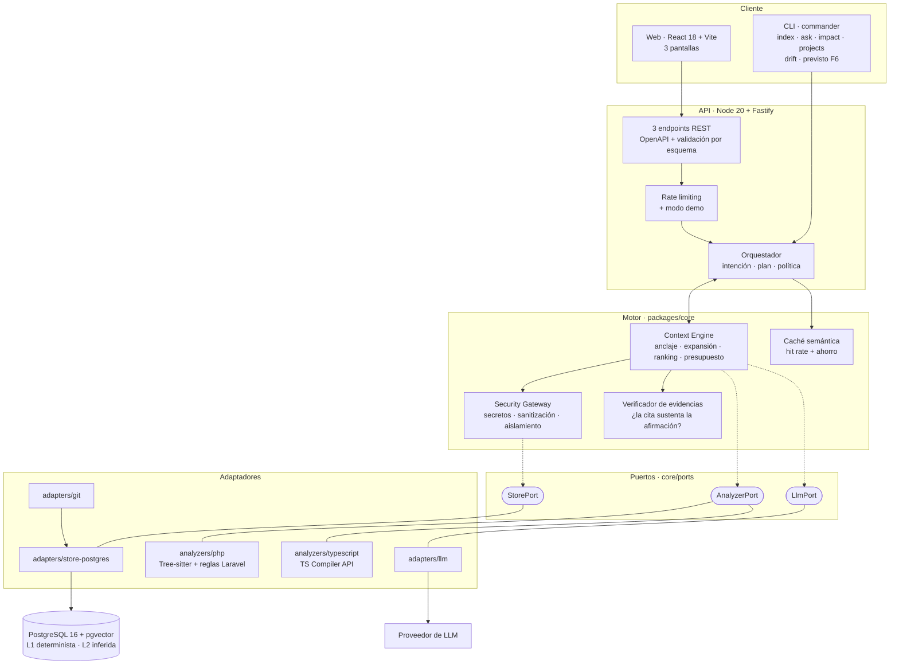
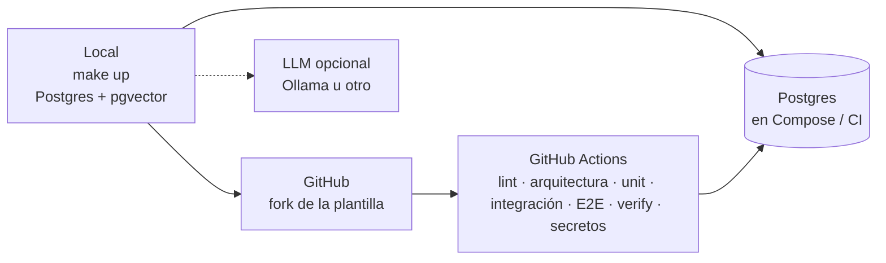

# CODEMIND

**Comprensión de repositorios de código con evidencia verificable**

Proyecto Final del Máster AI4Devs · Cristina Rodríguez Núñez

---

> **Estado de la entrega**
>
> Este documento corresponde a la **Entrega 1 — Documentación técnica** (24 de septiembre de 2026), que es documentación sin código. Describe el sistema tal como está diseñado para construirse.
>
> - **Entrega 2** (22 de octubre): código funcional con el flujo principal operativo.
> - **Entrega 3** (12 de noviembre): funcionalidades completas, tests, despliegue reproducible (Compose + CI + `verify`) y `prompts.md`.
>
> Las secciones marcadas con *(pendiente)* se completarán en las entregas correspondientes. La sección 7 (Pull Requests) queda necesariamente vacía en esta entrega, ya que aún no hay código.
>
> **Sobre la evidencia de funcionamiento:** el repositorio levantable en local en tres comandos (`make up`), el guion `docs/DEMO.md` y `npm run verify`. Los wireframes de las tres pantallas principales están en [1.3](#13-diseño-y-experiencia-de-usuario).
>
> **Decisión (5 sep 2026).** Antes: evidencia = demo alojada + local. Ahora: **solo local**. Motivo: sin coste de hosting/dominio y un único entorno fiable el día de la revisión. Detalle en `proposal-codemind/05-propuesta-v4-evidencia-local-hibrido-ollama.md`.

---

## Índice

0. [Ficha del proyecto](#0-ficha-del-proyecto)
1. [Descripción general del producto](#1-descripción-general-del-producto)
2. [Arquitectura del sistema](#2-arquitectura-del-sistema)
3. [Modelo de datos](#3-modelo-de-datos)
4. [Especificación de la API](#4-especificación-de-la-api)
5. [Historias de usuario](#5-historias-de-usuario)
6. [Tickets de trabajo](#6-tickets-de-trabajo)
7. [Pull requests](#7-pull-requests)

---

## 0. Ficha del proyecto

### **0.1. Tu nombre completo:**

Cristina Rodríguez Núñez

### **0.2. Nombre del proyecto:**

CODEMIND

### **0.3. Descripción breve del proyecto:**

CODEMIND indexa un repositorio de código —PHP/Laravel o TypeScript— y construye un grafo de conocimiento a partir de cuatro fuentes que normalmente nadie mantiene relacionadas: el código, el historial de Git, los tests y la documentación. Sobre ese grafo responde dos preguntas: **cómo funciona una parte del proyecto** y **qué se rompería al cambiarla**.

Se diferencia de un asistente de código convencional en tres comportamientos verificables: **verifica que cada cita sustenta realmente lo que afirma** en lugar de limitarse a adjuntarla; **distingue explícitamente lo observado de lo inferido**; y **responde que no lo sabe** cuando no hay evidencia suficiente, en lugar de generar una explicación plausible. Además envía al modelo solo los fragmentos necesarios en lugar del repositorio completo, lo que reduce coste y latencia de forma medida.

### **0.4. URL del proyecto:**

La evidencia ejecutable es el propio repositorio público, levantado en local:

https://github.com/DisTinta/AI4Devs-finalproject — clonar y seguir [1.4](#14-instrucciones-de-instalación) (`make up`).

No hay URL de servicio web alojado: quien evalúa prueba en su máquina con Docker y Node.

> **Decisión (5 sep 2026).** Antes: §0.4 apuntaba a una demo alojada en servidor propio (pendiente Entrega 3). Ahora: la “URL del proyecto” es el **repo + arranque local**. Motivo: eliminar dependencia de un servidor el día de la revisión y evitar coste de hosting/dominio.

### 0.5. URL o archivo comprimido del repositorio

https://github.com/DisTinta/AI4Devs-finalproject — **público**. Fork de `LIDR-academy/AI4Devs-finalproject`.

En el proyecto intervienen **tres repositorios distintos**, y conviene no confundirlos:

| | Repositorio | Visibilidad | Papel |
|---|---|---|---|
| **1** | Este — `AI4Devs-finalproject` | Público | **Es la entrega:** CODEMIND, la herramienta que se evalúa |
| **2** | Un proyecto Laravel propio, ya existente | Privado | Se usa durante el desarrollo para comprobar que el analizador aguanta código real. Es **material de entrada** —como el fichero que se le pasa a un programa— y no forma parte de la entrega |
| **3** | `acme-shop` y `task-api` | Públicos, **incluidos dentro del 1** | Repositorios de muestra pequeños, con su grafo ya construido, en `fixtures/`. Son lo que permite reproducir la demo sin credenciales de nadie |

Que el número 2 sea privado **no obliga a que CODEMIND sea público o privado**: el repositorio analizado es dato de entrada, no el producto entregado. Pero tiene una consecuencia de diseño, y es la que explica el número 3: nadie ajeno puede abrir el número 2, así que no sirve para demostrar nada. Los repositorios de muestra existen para que la evaluación sea reproducible por cualquiera, y por eso viajan dentro de la entrega en lugar de enlazarse desde fuera.

---

## 1. Descripción general del producto

### **1.1. Objetivo:**

#### El problema

Cuando alguien se incorpora a un proyecto que no escribió —o vuelve a uno que no toca desde hace meses— la información que necesita existe, pero está repartida en cuatro sitios que nadie mantiene sincronizados:

- el **código** dice *qué* hace el sistema;
- los **tests** dicen *qué comportamiento se garantiza*;
- el **historial de Git** dice *por qué* se cambió algo;
- la **documentación** dice lo que alguien creyó cierto en su momento.

Los asistentes de código actuales recuperan fragmentos por similitud semántica. Eso funciona bien para «escríbeme una función parecida a esta» y falla para «explícame por qué este descuento se aplica antes de los impuestos», porque la respuesta no está en ningún fragmento: está en la **relación** entre un método, un test y un pull request de hace dos años.

Y falla de una forma concreta y difícil de detectar: cuando no encuentra la respuesta, la genera. Con una cita que parece válida.

#### Qué aporta CODEMIND

Cuatro comportamientos que un asistente convencional no tiene:

1. **Relaciona las cuatro fuentes** en un grafo consultable, en lugar de tratarlas como texto indiferenciado.
2. **Verifica sus propias citas.** No basta con adjuntar `PriceCalculator.php:42`: el sistema comprueba que ese fragmento sustenta la afirmación, y elimina o degrada lo que no pasa la comprobación.
3. **Sabe callarse.** Si no hay evidencia suficiente, responde `UNKNOWN` en lugar de producir una explicación plausible.
4. **Envía solo lo necesario.** Selecciona fragmentos guiándose por el grafo, no ficheros completos, y muestra cuánto contexto ha ahorrado.

#### Independencia del lenguaje

El núcleo no conoce ningún lenguaje: los analizadores son adaptadores que implementan un puerto. Para **demostrarlo y no solo afirmarlo**, el proyecto incluye dos analizadores completos —PHP/Laravel y TypeScript— y el criterio de aceptación del segundo es que su pull request **no modifique una sola línea del núcleo**. Es una afirmación comprobable con `git diff`, no una promesa de diseño.

#### Para quién

Desarrolladores que trabajan sobre código que no escribieron: incorporaciones a un equipo, mantenimiento de sistemas heredados, revisión de un módulo antes de modificarlo.

### **1.2. Características y funcionalidades principales:**

| # | Funcionalidad | Prioridad |
|---|---|---|
| **F1** | Indexar un repositorio **PHP/Laravel o TypeScript** y construir su grafo de conocimiento | must |
| **F2** | Explicar cómo funciona una parte del proyecto, con evidencia verificada por afirmación | must |
| **F3** | Analizar qué se vería afectado por un cambio, separando grafo determinista de señal histórica | must |
| **F4** | **Probar el sistema sin configurar nada**: dos repositorios de muestra ya indexados | must |
| **F5** | Mostrar tokens consumidos, coste y ahorro frente a enviar contexto bruto | must |
| **F6** | Detectar contradicciones entre la documentación y el código | should |
| **F7** | Caché semántica de consultas con métrica de acierto | should |

**F4 merece una nota**. Los wireframes de [1.3](#13-diseño-y-experiencia-de-usuario) muestran el diseño; F4 es la evidencia de que el sistema **funciona realmente**. Se concreta en un único camino garantizado:

- **Local, en tres comandos.** Se clona el repositorio, se copia `.env.example` a `.env` (sin obligar a una API key) y se levanta con `make up`. Los dos proyectos de muestra quedan consultables. **Sin PHP instalado, sin clonar repositorios ajenos, sin esperar ningún indexado**, porque los grafos y las respuestas de evaluación van versionados como semillas SQL / caché.

**Modo híbrido LLM (parte de F4):**

| Situación | Qué puede hacer quien evalúa |
|---|---|
| Sin endpoint LLM (`LLM_BASE_URL` y `LLM_API_KEY` vacías) | Preguntas sugeridas y `npm run verify` desde caché/golden (**0 $**, sin cuenta de proveedor) |
| Con LLM (p. ej. Ollama local o API cloud) | Pregunta libre e indexado de un repositorio propio |

> **Decisión (5 sep 2026).** Antes: Camino A (demo alojada) + Camino B (local). Ahora: solo el local, con evaluación sin key. Motivo: fricción cero para el evaluador y sin servidor propio.

#### Lo que el producto no hace

Declarado desde el principio: **no modifica código, no genera pull requests, no ejecuta comandos y no sustituye al IDE.** Es un sistema de solo lectura, y eso es una decisión de seguridad antes que una limitación de alcance — ver [2.5](#25-seguridad).

### **1.3. Diseño y experiencia de usuario:**

#### Evidencia de esta sección

Los wireframes de las tres pantallas muestran el flujo completo del producto. La evidencia ejecutable complementa las imágenes:

1. **El repositorio levantable en local** en tres comandos (ver [1.4](#14-instrucciones-de-instalación)).
2. **`docs/DEMO.md`**: guion de demostración con los comandos exactos y **la salida real de terminal** que producen. Se puede copiar, ejecutar y comparar con lo que uno obtiene.
3. **`npm run verify`**: prueba de humo ejecutable que consulta cada repositorio de muestra y compara con la salida esperada (**sin llamar al LLM**: golden/caché versionada).

> **Decisión (5 sep 2026).** Se eliminó la demo alojada de esta lista. La evidencia queda acotada a local + DEMO.md + verify.

#### Las tres pantallas

El principio de diseño es que **la fiabilidad y el coste sean legibles en la propia respuesta**, no un detalle escondido en un log.

**Pantalla 1 — Selección de proyecto**


```
┌────────────────────────────────────────────────────────────┐
│  CODEMIND                                                  │
├────────────────────────────────────────────────────────────┤
│  Elige un proyecto para explorar:                          │
│                                                            │
│  ┌──────────────────────────┐  ┌──────────────────────────┐│
│  │ 🐘 acme-shop             │  │ 📘 task-api              ││
│  │ PHP 8.2 / Laravel 11     │  │ TypeScript / Fastify     ││
│  │ 47 ficheros · 312 símb.  │  │ 38 ficheros · 264 símb.  ││
│  │ 1 840 aristas · 62 commits│  │ 2 110 aristas · 51 commits││
│  │ ✓ indexado · listo       │  │ ✓ indexado · listo       ││
│  └──────────────────────────┘  └──────────────────────────┘│
│                                                            │
│  + Indexar mi propio repositorio                           │
└────────────────────────────────────────────────────────────┘
```

**Pantalla 2 — Consulta**


```
┌────────────────────────────────────────────────────────────┐
│  ← acme-shop        PHP/Laravel  ·  1 840 aristas  ·  ⟳    │
├────────────────────────────────────────────────────────────┤
│  ¿Cómo se calcula el precio final de un pedido?      [→]   │
│                                                            │
│  Prueba:  · ¿Cómo se validan los cupones?                  │
│           · ¿Qué hace OrderObserver?                       │
│           · ¿Por qué existe el campo legacy_ref?           │
├────────────────────────────────────────────────────────────┤
│  RESPUESTA                                                 │
│                                                            │
│  El precio final se calcula en PriceCalculator::compute().  │
│                                                            │
│  1. Se obtiene el precio base del artículo.     ✓ verificado│
│  2. Se aplica el descuento del cliente.         ✓ verificado│
│  3. Se calculan los impuestos sobre el subtotal.✓ verificado│
│                                                            │
│  ⚠ El orden descuento-antes-de-impuestos no está           │
│    documentado. Se deduce del test y del PR #381. INFERIDO  │
│                                                            │
│  EVIDENCIA                                                 │
│  ▸ app/Services/PriceCalculator.php:42-58    entailed      │
│  ▸ tests/Unit/PricingTest.php:91-104         entailed      │
│  ▸ PR #381                                    entailed      │
│                                                            │
│  Confianza 0.71                                            │
│  4 812 tokens · $0.014 · 2.1 s · ahorro 88 % vs contexto   │
│  bruto (41 200 tokens)                          [caché ✓]  │
└────────────────────────────────────────────────────────────┘
```

El valor de confianza que aparece al pie de la respuesta **no lo autoinforma el modelo**: se calcula a partir de señales del grafo y del verificador, y se presenta como indicador ordinal, no como probabilidad. El cálculo está en [3.2](#32-descripción-de-entidades-principales).

**Pantalla 3 — Impacto**


```
┌────────────────────────────────────────────────────────────┐
│  IMPACTO DE: "cambiar el cálculo de descuentos"            │
├────────────────────────────────────────────────────────────┤
│  DIRECTO       PriceCalculator · DiscountService   [grafo] │
│  INDIRECTO     OrderService · OrdersController     [grafo] │
│  TESTS         PricingTest · OrderPricingTest      [grafo] │
│  DOCUMENTACIÓN docs/pricing.md         ⚠ desactualizada    │
│  HISTORIAL     PR #381 · PR #402 (co-cambian 80 %) [git]   │
│                                                            │
│  RIESGO  MEDIO                                             │
│  4 ficheros afectados, 2 tests que cubren el cambio,       │
│  1 documento desalineado desde el commit a3f9c21.          │
│                                                            │
│  3 140 tokens · $0.009                                     │
└────────────────────────────────────────────────────────────┘
```

Cada elemento del informe de impacto indica su **origen**: `[grafo]` para lo derivado del análisis determinista, `[git]` para la señal histórica de co-cambio. Mezclarlos sin distinguir haría el informe imposible de calibrar — quien lo lee no sabría cuánto confiar en cada línea y acabaría desconfiando de todas.

#### Recorrido de demostración

`docs/DEMO.md` lleva en unos cinco minutos a los momentos que definen el producto:

| Paso | Acción | Qué demuestra |
|---|---|---|
| 1 | Elegir `acme-shop` y preguntar por el cálculo del precio | Respuesta con evidencia verificada y ahorro de tokens visible |
| 2 | Pulsar una evidencia | La cita resuelve a un fragmento real del código |
| 3 | Preguntar algo que el repositorio no puede responder | **El sistema responde `UNKNOWN` en lugar de inventar** |
| 4 | Pedir el impacto de cambiar los descuentos | Separación entre grafo determinista y señal histórica |
| 5 | Repetir el paso 1 reformulando la pregunta | Acierto de caché por similitud, coste 0 |
| 6 | Cambiar a `task-api` y repetir el paso 1 | **El mismo núcleo sobre TypeScript**, con grafo más preciso |

El paso 3 es el más característico: un sistema que sabe callarse.

### **1.4. Instrucciones de instalación:**

Al ser el arranque local **la única evidencia de que el sistema funciona ante quien evalúa**, esta sección se trata como crítica. El camino corto no requiere nada más que **Docker y Node 20+**: ni PHP instalado, ni clonar repositorios ajenos, ni esperar un indexado, **ni una API key de LLM**. Para indexar un repositorio hace falta además **Git 2.45.1 o posterior** (o las versiones de mantenimiento de mayo de 2024 2.43.4 y 2.44.1): las anteriores ignoran `GIT_NO_LAZY_FETCH`, que impide que un *partial clone* ejecute el programa de su remoto al leer un objeto que falta, o no leen `attr.tree`, que hace que los atributos salgan siempre del `.gitattributes` de `HEAD`.

#### Camino corto — sistema operativo en tres comandos

```bash
git clone https://github.com/DisTinta/AI4Devs-finalproject && cd AI4Devs-finalproject
cp .env.example .env               # DATABASE_URL del contenedor local; LLM opcional: ver variables abajo
make up
```

`make up` encapsula la secuencia completa:

```bash
docker compose up -d               # PostgreSQL 16 + pgvector
npm install
npm run db:migrate                 # esquema
npm run db:seed                    # ← los 2 repositorios de muestra YA indexados (+ caché de evaluación)
npm run dev                        # API en :3000 · web en :5173
```

`npm run dev` arranca la API desde `packages/api/src/server.ts` y necesita `DATABASE_URL` exportada (`make up` la exporta desde `.env`); sin ella la API imprime una sola línea `INVALID_CONFIG` en stderr y no arranca, mientras la web sigue en marcha. La API escucha en `127.0.0.1:3000` (no en todas las interfaces: no tiene autenticación); su documentación OpenAPI se abre en `http://localhost:3000/docs` (el documento en `/docs/json`). Conviene abrirla en `localhost` y no en `127.0.0.1`: el servidor declarado en el documento es `http://localhost:3000` y, desde otro origen, «Try it out» fallaría (no hay CORS). Si `localhost` resuelve a `::1` y no conecta, `HOST=::1` o `HOST=0.0.0.0` lo exponen de otra forma, como decisión explícita.

Salida esperada al terminar:

```text
✓ postgres        healthy on :5432 (pgvector 0.7)
✓ migrations      12 applied
✓ seed            2 projects loaded
                    acme-shop   php/laravel   53 files · ~312 symbols · ~1840 edges  [illustrative until analyzer runs]
                    task-api    typescript    38 files · ~264 symbols · ~2110 edges  [illustrative until analyzer runs]
✓ api             http://localhost:3000  (openapi at /docs)
✓ web             http://localhost:5173
✓ llm             evaluation mode (cache-only) — set LLM_* to enable free-form asks

Ready. No indexing required — sample graphs are pre-built.
```

#### El mismo flujo por CLI

Sin necesidad de abrir la web (`projects` y `ask` necesitan `DATABASE_URL`):

```bash
npm run cli -- projects
npm run cli -- ask acme-shop "¿Cómo se calcula el precio final de un pedido?"
npm run cli -- impact acme-shop "cambiar el cálculo de descuentos"
npm run cli -- ask task-api "¿Cómo se validan las peticiones entrantes?"
```

**Estado en Entrega 2:** la caché de preguntas de muestra llega con DIS-21, así que sin `LLM_*` (modo evaluación) `ask` responde a todas, también a las de muestra, con:

```text
UNKNOWN (llm-required)
evaluation mode (cache-only): set LLM_* to enable free-form asks
```

`impact` sigue siendo un stub, y `task-api` aún no está en la semilla: `ask task-api …` responde `PROJECT_NOT_FOUND` (exit `1`) hasta CM-HU-18.

#### Camino completo — indexar tu propio repositorio o pregunta libre

**Indexar no necesita LLM ni PHP**: el analizador PHP usa Tree-sitter (WebAssembly) y solo lee los objetos de Git del repositorio, sin ejecutar nada de él. Hacen falta `ALLOWED_REPOS_DIR`, `AUTHOR_HASH_SALT` y `DATABASE_URL`, y el repositorio tiene que estar **dentro** de `ALLOWED_REPOS_DIR` (la ruta puede ser absoluta dentro de él o relativa a él). Por ahora solo se indexa PHP (`--language php`); TypeScript responde «not available yet» hasta CM-HU-18. Preguntar (`ask`) sí requiere un LLM configurado (recomendado en desarrollo: **Ollama** local):

```bash
# Indexar: ALLOWED_REPOS_DIR=/ruta/a/repos  AUTHOR_HASH_SALT=…  DATABASE_URL=postgres://…
npm run cli -- index mi-repo --name mi-proyecto --language php            # informe en texto
npm run cli -- index mi-repo --name otro --language php --framework none --json   # informe en JSON

# Preguntar — Ollama (ejemplo, sin clave): DATABASE_URL=postgres://…  LLM_BASE_URL=http://localhost:11434/v1  LLM_MODEL=…
npm run cli -- ask mi-proyecto "¿Cómo funciona el módulo de pagos?"
```

`index` escribe el progreso por fase y los eventos de redacción de secretos (JSON por línea) en stderr, y solo el informe en stdout. Sale con `0` si todo va bien, `1` ante un error de dominio, configuración o ejecución (por ejemplo, ruta fuera de `ALLOWED_REPOS_DIR` o nombre de proyecto repetido) y `2` ante un uso incorrecto; el error es una línea `{"error":{"code","message","details"}}` en stderr.

`ask <proyecto> "<pregunta>"` busca el proyecto por su **nombre exacto** (sin recortar espacios ni ignorar mayúsculas) y escribe en stdout solo la respuesta: el texto del modelo, cada afirmación numerada y tipada (`[FACT]` o `[INFERENCE]`, más `[stale]` si está desactualizada) con sus evidencias `ruta:inicio-fin`, los extractos citados (como mucho 5 líneas cada uno), las afirmaciones previas sobre el mismo código si las hay y, al final, `note: claims not saved` si no pudieron guardarse. Por ejemplo:

```text
El precio final lo calcula PriceCalculator::compute.

statements:
1. [FACT] PriceCalculator::compute calcula el precio final.
   evidence: app/Services/PriceCalculator.php:16-44

evidence:
app/Services/PriceCalculator.php:16-44
    class PriceCalculator
    {
        public function __construct(
            private readonly DiscountService $discounts,
            private readonly TaxService $taxes,
    … (+24 lines)
```

Sin respuesta posible imprime `UNKNOWN (<reason>)` (`no-anchor`, `llm-required`, `over-budget`, `invalid-model-output` o `no-evidence`). Los eventos (JSON por línea) y los errores van a stderr y nunca contienen la pregunta. Sale con `0` ante una respuesta o un `UNKNOWN`, `1` ante un error de configuración, conexión o dominio (por ejemplo `PROJECT_NOT_FOUND`, `LLM_UNAVAILABLE`, `BUDGET_EXHAUSTED`) y `2` ante un uso incorrecto o una pregunta inválida.

#### Verificación de la instalación

```bash
npm run verify
```

Ejecuta una consulta contra cada repositorio de muestra y compara la salida con la esperada (**determinista: no llama al LLM**). Sirve como prueba de humo para quien evalúa y como test de integración en CI.

#### Variables de entorno

| Variable | Obligatoria | Descripción |
|---|---|---|
| `LLM_API_KEY` | no | Credencial del endpoint LLM; si está, se envía como `Authorization: Bearer …`. Opcional en modo vivo: con Ollama se deja **vacía**. Con clave pero sin `LLM_BASE_URL`, el arranque falla |
| `LLM_BASE_URL` | no | Base URL compatible OpenAI (`http`/`https`); **decide el modo**: con URL → modo vivo; sin URL ni clave → **modo evaluación** (solo caché / verify). En desarrollo: Ollama (`http://localhost:11434/v1`) |
| `LLM_MODEL` | sí en modo vivo | Modelo para generación; con `LLM_BASE_URL` y sin `LLM_MODEL`, el arranque falla |
| `LLM_MODEL_VERIFY` | no | Modelo económico para la verificación de evidencias en vivo; sin él se usa `LLM_MODEL` |
| `LLM_EMBED_MODEL` | no | Modelo de embeddings; sin él, los embeddings no están disponibles (sin usar `LLM_MODEL`). Sus vectores deben tener 1536 dimensiones, las de `vector(1536)` del esquema: `nomic-embed-text` (768) falla hasta que CM-HU-19 elija el modelo |
| `LLM_TIMEOUT_MS` | no | Tiempo máximo por petición al LLM, en ms (entero de 1 a 300000: por encima, el `fetch` de Node corta la petición por su cuenta a los 300 s). Por defecto `120000`, para el arranque en frío de Ollama |
| `DATABASE_URL` | **sí** (scripts `db:*`, `index` y la API) | Cadena de conexión de PostgreSQL. La API no arranca sin ella (`INVALID_CONFIG`). `.env.example` trae la del contenedor local; `make up` la toma de `.env` (el Makefile carga y exporta `.env`). Si ejecutas `npm run db:migrate` / `db:rollback` a mano, expórtala antes: sin ella salen con error |
| `PORT` | no | Puerto de la API: solo dígitos, de 1 a 65535. Por defecto `3000` |
| `HOST` | no | Dirección en la que escucha la API. Por defecto `127.0.0.1` (solo local); `0.0.0.0` la expone a la red, y la API no tiene autenticación |
| `RATE_LIMIT_MAX` | no | Peticiones por IP dentro de la ventana: solo dígitos, de 1 a 1000000. Por defecto `30` |
| `RATE_LIMIT_WINDOW_MS` | no | Longitud de la ventana del límite, en ms: solo dígitos, de 1 a 86400000. Por defecto `60000` |
| `ALLOWED_REPOS_DIR` | no (sí para indexar) | Directorio raíz permitido para indexar (ver [2.5](#25-seguridad)); vacío = indexado deshabilitado. Solo debe poder escribir en él el usuario que ejecuta Codemind, y solo debe contener repositorios de confianza (ver `docs/DEPLOYMENT.md`) |
| `AUTHOR_HASH_SALT` | **sí** (para indexar) | Clave del seudónimo de los autores de commits (`author_hash`). No se versiona; cambiarla cambia todos los `author_hash` |
| `DAILY_BUDGET_USD` | no | Techo de gasto diario en USD si se usa un proveedor cloud de pago: decimal positivo (`2.5`), solo en modo vivo; vacía = sin techo (lo normal con Ollama local). El gasto del día es la suma de `query_log.cost_usd` desde las 00:00 UTC; al alcanzarlo, el LLM deja de llamarse hasta el día UTC siguiente. Con techo, `LLM_MODEL`, `LLM_MODEL_VERIFY` y `LLM_EMBED_MODEL` deben tener precio en `COST_TABLE` (`packages/core/src/llm/cost-table.ts`); si no, la configuración del LLM es inválida. *Estado:* `ask` envuelve el modelo con el techo cuando hay `DAILY_BUDGET_USD`, y desde DIS-74 cada `explain` escribe su `cost_usd` en `query_log`, verificación incluida. El gasto de un `ask` en curso solo se ve al escribir su fila, así que cada `ask` en curso puede pasarse del techo como mucho en una llamada `answer` y `MAX_VERIFY_CALLS_PER_ANSWER` (20) llamadas `verify` (N ejecuciones simultáneas, N veces eso) |

> **Decisión (5 sep 2026).** Antes: `LLM_API_KEY` obligatoria. Ahora: **opcional**; evaluación sin key; desarrollo libre con Ollama. Motivo: 0 € y 0 fricción para quien evalúa.

Las semillas se regeneran con `npm run seed:build`, que indexa los dos repositorios de muestra y volca el grafo a `seeds/graph-dump.sql`, versionado en el repositorio. Así la instalación es determinista y no depende de que el indexado se comporte igual en otra máquina. La caché/golden de evaluación se genera en desarrollo (con Ollama u otro LLM) y viaja versionada para que `verify` no necesite modelo.

---

## 2. Arquitectura del Sistema

### **2.1. Diagrama de arquitectura:**



#### Patrón: arquitectura hexagonal (puertos y adaptadores) con extracción offline

**Justificación de cada decisión:**

- **El núcleo no conoce ni el lenguaje analizado ni el proveedor de LLM.** Ambos son adaptadores detrás de un puerto. Esto es lo que hace *comprobable* la independencia del lenguaje: el criterio de aceptación del analizador de TypeScript es que su pull request **no toque `packages/core`**. Una afirmación falsable con `git diff`, no una promesa.
- **La extracción es offline y separada de la consulta.** Indexar es lento y determinista; consultar es rápido. Mezclarlas obligaría a reanalizar el repositorio en cada pregunta.
- **El verificador es un paso posterior obligatorio**, no una instrucción dentro del prompt. Pedirle al modelo «cita tus fuentes» produce citas; comprobarlas mecánicamente produce citas válidas. Es la diferencia que justifica el producto. Su mitad sintáctica (DIS-68, `packages/core/src/verify/`) ya corre en `explain` tras tipar las afirmaciones: relee de git, en el commit y la raíz que leyó el paquete de contexto, los ficheros citados (una sola lectura en lote) y exige que cada `excerpt` sea exactamente el texto de su rango; una cita rota se quita de la afirmación, la afirmación que se queda sin citas desaparece y, si no queda ninguna, la respuesta es `UNKNOWN (broken-evidence)`. Su mitad semántica (DIS-70) corre a continuación sobre cada par (afirmación, cita) que queda: una llamada con propósito `verify` (el modelo de `LLM_MODEL_VERIFY`) por par distinto, en secuencia, que solo recibe la afirmación y el fragmento envueltos como dato no confiable y solo puede responder `{"entails": true|false}`. Una afirmación es `FACT` solo si su cadena de evidencia lo permite **y** todas sus citas quedan `entailed`; si alguna queda `cited`, es `INFERENCE`, nunca se elimina. Si el verificador responde otra cosa, no está disponible o se agota el presupuesto, la cita se queda en `cited` (falla cerrado) con un evento `entailment_unverified`. Los veredictos se cachean en memoria por par durante el proceso, y la respuesta lleva en `usage.verification` las llamadas, aciertos de caché, tokens y coste del verificador.
- **Repository Pattern en la persistencia.** El dominio habla con `StorePort`, no con PostgreSQL. Como efecto secundario útil, las semillas precargadas del arranque local no necesitan ninguna lógica especial.
- **Flujo de control en bucle, no en cascada.** El orquestador y el Context Engine se invocan mutuamente: el agente solicita información de forma incremental en lugar de recibir todo el contexto de una vez. Es lo que permite el presupuesto de tokens.

**Beneficios principales:** sustituibilidad del LLM y de los analizadores; un único grafo reutilizado por las tres capacidades; coste de contexto medible en un solo punto; y un arranque local sin dependencias externas.

#### Sacrificios y déficits

**1. El grafo de llamadas nunca será completo en PHP/Laravel.** Las facades, el contenedor de servicios, `__call`, los atributos mágicos de Eloquent y las rutas resueltas por *string* hacen que parte del grafo real sea invisible para un analizador estático. En TypeScript, en cambio, el compilador resuelve referencias con precisión, así que el mismo núcleo producirá un grafo notablemente mejor. **Ese contraste se mide y se publica** ([2.6](#26-tests)) en lugar de disimularse. Consecuencia práctica: en PHP el sistema depende más de la señal histórica de co-cambio, que no requiere análisis estático.

**2. Indexar cuesta tiempo y dinero por adelantado.** Un asistente basado solo en recuperación semántica no tiene ese coste inicial. La apuesta es que se amortiza en consultas repetidas; las mediciones de [2.6](#26-tests) permiten juzgarlo con datos.

**3. La capa inferida depende del LLM** y hereda su falibilidad. Se acota con procedencia obligatoria y con la regla —impuesta en la base de datos, no solo en el código— de que una inferencia nunca se etiquete como hecho.

**4. La extracción offline implica desfase.** El grafo refleja el último indexado, no el estado actual del repositorio. El indexado incremental lo reduce; no lo elimina.

**5. Tres pantallas no son un producto terminado.** La web es evidencia de funcionamiento y superficie para probar, no una interfaz completa.

**6. El repositorio de validación real es privado**, así que las cifras obtenidas sobre él no son reproducibles por terceros. Por eso las mediciones publicables se hacen sobre los dos repositorios de muestra públicos, y las del privado se reportan aparte como observación.

### **2.2. Descripción de componentes principales:**

| Componente | Tecnología | Responsabilidad |
|---|---|---|
| CLI | TypeScript + `commander` | `index`, `ask`, `impact`, `projects`; `drift` **previsto** (F6) |
| API | Node 20 + **Fastify** + Zod | 3 endpoints REST, validación por esquema, OpenAPI generado |
| Web | React 18 + TypeScript + **Vite** | Selección de proyecto, consulta, impacto |
| Orquestador | TypeScript | Clasifica intención, coordina el bucle, aplica política de seguridad |
| **Analizador PHP** | **Tree-sitter** (`tree-sitter-php`) + reglas Laravel | Ficheros, clases, métodos, rutas, spans, llamadas |
| **Analizador TypeScript** | **TypeScript Compiler API** / `ts-morph` | Lo mismo, con referencias resueltas por el compilador |
| Extractor de Git | `simple-git` | Commits, ficheros modificados, co-cambio, número de PR |
| Context Engine | TypeScript | Anclaje de entidades, expansión por grafo, ranking híbrido, presupuesto de tokens. El texto de los spans se lee de git en el commit indexado (la base de datos no guarda contenido), todos los ficheros del paquete en una sola lectura por lotes con un número fijo de procesos git (DIS-39), y los tokens se estiman en local como `ceil(caracteres / 4)`, declarado como `chars-div-4` |
| Verificador de evidencias | TypeScript + LLM acotado | Validación sintáctica (git en el commit del paquete) y semántica (*entailment* con `LLM_MODEL_VERIFY`, salida `{"entails": boolean}`, caché en memoria por par) de cada cita |
| Caché semántica | TypeScript + pgvector | Reutiliza respuestas de preguntas equivalentes; sostiene el modo demo |
| Security Gateway | Reglas propias en proceso + `gitleaks` en CI | Secretos antes de indexar, sanitización, aislamiento por proyecto; escaneo de secretos del repositorio en cada PR y cada push a `main` |
| Persistencia | **PostgreSQL 16 + pgvector** | Nodos, aristas, embeddings, afirmaciones, evidencias, uso |

**Caso de uso `explain` (DIS-39).** Responde una pregunta sobre un proyecto indexado en **una sola pasada** Context Engine → modelo, en este orden: valida la entrada (pregunta de 1 a 1 000 code points que no sea solo espacios; un error, no un `UNKNOWN`), ancla la pregunta una vez, y responde `UNKNOWN` sin construir el paquete si no hay ancla (`no-anchor`) o si el modelo está en modo evaluación (`llm-required`, con el mensaje PH-08; la caché de DIS-21 irá entre los dos). Después construye el paquete (`over-budget` si no cabe ningún span), lee las afirmaciones ya guardadas que se solapan con sus spans (como mucho las 20 más recientes, antes de llamar al modelo), llama al modelo una vez, pasa su salida por la cuarentena (`invalid-model-output`) y, si no trae ninguna afirmación, responde `UNKNOWN` con `no-evidence` en lugar de devolver el texto del modelo. Cada afirmación se tipa `FACT` o `INFERENCE` por las citas y se guarda como `CLAIM` con su evidencia y su procedencia, todo en una transacción. Si el proyecto se reindexó a otro commit mientras se respondía, las afirmaciones se guardan `stale` y la respuesta las muestra con aviso, nunca como `FACT`. Si la escritura falla, la respuesta se devuelve igual, con `persisted: false` y un evento `claims_not_persisted` que no lleva ningún texto. Core devuelve los eventos y no escribe en ningún log.

**Sobre `drift`.** Es el comando de la funcionalidad F6, que es *should-have* y vive en la reserva del calendario: puede no entrar en esta versión. Aparece ya en el diagrama, en la CLI y en el enum `capability` de `QUERY_LOG` porque el punto de extensión conviene diseñarlo ahora —añadir un valor a un enum con datos dentro es una migración, no un cambio de código— pero se documenta como **previsto, no entregado**. La distinción no es cosmética: un README que anuncia un comando que el código no tiene es exactamente la divergencia entre documentación y código que F6 existe para detectar.

**Por qué Fastify y no NestJS.** Con tres endpoints y el dominio ya aislado en `packages/core`, la estructura de módulos y la inyección de dependencias de NestJS resuelven un problema que este proyecto no tiene. Fastify aporta validación por esquema y generación de OpenAPI, que es exactamente lo que se necesita.

**Por qué dos tecnologías de análisis distintas.** Tree-sitter da estructura sintáctica pero no resuelve tipos, lo que en PHP obliga a añadir reglas heurísticas para las convenciones de Laravel. En TypeScript, la API del compilador ya devuelve referencias resueltas, así que usarla es más simple *y* más preciso. Que los dos analizadores tengan perfiles de precisión distintos detrás del mismo puerto es justamente lo que valida la arquitectura.

### **2.3. Descripción de alto nivel del proyecto y estructura de ficheros**

```
AI4Devs-finalproject/
├── packages/
│   ├── core/                       # dominio — CERO dependencias de infraestructura
│   │   ├── knowledge/              #   entidades L1/L2, afirmaciones, evidencia, reglas de tipado
│   │   ├── index/                  #   caso de uso de indexado, gateway de seguridad, detección de framework
│   │   ├── context/                #   Context Engine, ranking, presupuesto de tokens
│   │   ├── verify/                 #   verificador de evidencias
│   │   ├── cache/                  #   caché semántica
│   │   └── ports/                  #   AnalyzerPort · LlmPort · StorePort · GitPort · SourceTreePort
│   │
│   ├── analyzers/                  # adaptadores de lenguaje
│   │   ├── php/                    #   Tree-sitter + reglas Laravel
│   │   └── typescript/             #   TS Compiler API
│   │
│   ├── adapters/                   # adaptadores de infraestructura
│   │   ├── store-postgres/
│   │   ├── llm/
│   │   └── git/
│   │
│   ├── api/                        # Fastify, rutas, esquemas, rate limiting, modo demo
│   ├── cli/                        # comandos (`index` real; raíz de composición del indexado)
│   └── web/                        # React + Vite
│
├── fixtures/                       # los 2 repositorios de muestra
│   ├── acme-shop/                  #   Laravel 11, ~47 ficheros, con drift plantado
│   └── task-api/                   #   TypeScript + Fastify, ~38 ficheros
│
├── seeds/
│   └── graph-dump.sql              # grafos ya construidos, versionados
│
├── docs/                           # ── del proyecto ──
│   ├── DEMO.md                     # guion reproducible: comandos + salida real
│   ├── CONFIDENCE.md               # fórmula, señales, los 6 pesos (+ saturación) con valor y motivo, límites
│   ├── TESTING.md
│   ├── DEPLOYMENT.md
│   ├── adr/                        # decisiones de arquitectura
│   ├── ai-sessions/                # transcripciones de las sesiones citadas en prompts.md
│   │                               # ── del harness: se reemplazan al actualizarlo ──
│   ├── base-standards.md
│   ├── documentation-standards.md
│   ├── openspec-tasks-mandatory-steps.md
│   ├── backend-standards.md        #   capas y convenciones del adaptador de stack
│   ├── frontend-standards.md
│   └── project-context.md          #   el único que se escribe a mano y sobrevive
│
├── ai-specs/                       # harness: skills, subagentes y plantillas
├── openspec/                       # especificaciones y cambios (OpenSpec)
├── .claude/ · .cursor/             # referencias al harness + 9 hooks del ciclo de vida
├── .mcp.json                       # MCP del proyecto: Context7 y Playwright
├── CLAUDE.md · AGENTS.md · GEMINI.md · codex.md    # punteros a la doctrina
│
├── images/                         # los 3 wireframes de 1.3, en SVG
│
├── tests/
│   ├── unit/
│   ├── integration/
│   └── e2e/
│
├── .github/workflows/ci.yml
├── docker-compose.yml
├── Makefile
├── .gitignore · .gitattributes · .gitleaks.toml · .gitleaksignore
├── readme.md
└── prompts.md
```

**Monorepo con workspaces de npm.** La regla de dependencias es unidireccional y **se comprueba en CI**: `core` no importa nada de `adapters`, `analyzers` ni `api`; solo define los puertos que ellos implementan. Un test de arquitectura con `dependency-cruiser` falla el build si alguien la rompe, de modo que la afirmación de independencia del lenguaje está protegida por el pipeline y no por la buena voluntad.

**Parte del árbol es un harness de desarrollo, no código del producto.** `ai-specs/`, `openspec/`, `.claude/hooks/`, los estándares de `docs/` y los cuatro ficheros de memoria son el andamiaje de trabajo con IA. Se instala desde [`sdd-harness-kit`](https://github.com/DisTinta/sdd-harness-kit), un kit propio de Spec-Driven Development cuya procedencia y uso en este proyecto están en `prompts.md` §0.2. Ya forma parte del árbol de la Entrega 2; omitirlo dejaría esta sección incompleta.

Tiene dos consecuencias que conviene declarar. La primera es operativa: los ficheros de `docs/` que instala el harness **se reemplazan cuando el harness se actualiza**, así que la documentación del proyecto no puede compartir nombre con ellos — de ahí que estén separados en dos grupos en el árbol. La segunda es de diseño, y es deliberada: uno de los hooks comprueba, al guardar un fichero de `packages/core`, que no mencione `adapters/` ni `analyzers/`. Es la **misma** regla que `dependency-cruiser` impone en CI. La redundancia es intencionada: el hook es rápido y local y avisa mientras escribes; el CI es la autoridad y no se puede saltar.

**`docs/` no duplica este README.** Guarda solo lo que aquí no cabe: el guion de demostración con salidas reales, los pesos de la fórmula de confianza, las guías de tests y despliegue, y las transcripciones de las sesiones con IA que `prompts.md` cita.

El Ejemplo 1 oficial reparte las secciones de la plantilla en ocho documentos numerados que la espejan. Aquí se ha evitado a propósito: **cada copia de un contenido es un sitio más donde puede quedar desincronizado**, y detectar exactamente eso es la funcionalidad F6 de este producto. Documentar de una forma que genere el problema que el sistema pretende resolver sería una mala señal sobre el criterio con el que está hecho.

### **2.4. Infraestructura y despliegue**

En este proyecto, **«despliegue» (Entrega 3) significa artefacto reproducible**: el mismo `docker-compose` que usa quien evalúa, más CI que comprueba que sigue funcionando. No hay servicio web público permanente.



> **Decisión (5 sep 2026).** Antes: el diagrama incluía registro de imágenes → servidor propio + proxy TLS + API LLM obligatoria. Ese destino de hosting se **descartó para la evaluación** (coste, dominio, punto único de fallo). El Compose local sigue siendo el artefacto único de ejecución.

#### Proceso de verificación continua

Push a la rama → CI ejecuta lint, test de arquitectura, unitarios, integración (con PostgreSQL en contenedor), E2E y **`npm run verify`** (golden/caché, sin LLM) → el mismo `docker-compose` que documenta [1.4](#14-instrucciones-de-instalación) es lo que corre en local.

#### Dos entornos de ejecución

| Entorno | Cómo se levanta | Para qué sirve | Garantía |
|---|---|---|---|
| **Local** | `make up` — Docker y Node | Que quien evalúe pruebe el sistema y la CLI | **Única vía de evidencia.** No depende de un servidor de la autora |
| **CI** | GitHub Actions con Postgres en contenedor | Que el artefacto no se rompa en cada push | Automatizada; misma semilla / verify |

**Que local y CI usen el mismo Compose (o el mismo servicio Postgres + las mismas migraciones/semillas) es deliberado**: elimina la clase de fallo «en mi máquina funciona».

#### Modo evaluación / híbrido LLM

| Tipo de consulta | Comportamiento | Coste |
|---|---|---|
| Una de las ~12 preguntas sugeridas (sin LLM) | Se sirve desde caché precalculada en semillas | **0 $** |
| Pregunta libre semánticamente equivalente a una cacheada | Acierto de caché por similitud de embedding (si el índice de caché está sembrado) | **0 $** |
| Pregunta libre nueva | Requiere LLM configurado (Ollama u otro); opcionalmente con presupuesto si el proveedor es de pago | 0 $ con Ollama; acotado con cloud |
| Sin LLM y pregunta no cacheada | Aviso claro: modo solo-caché / configurar `LLM_*` | 0 $ |

Así la evaluación es siempre utilizable sin cuenta de proveedor. La métrica de acierto de caché se muestra en la propia interfaz cuando aplica. Con Ollama, F5 puede mostrar tokens y ahorro frente a contexto bruto; el coste en USD puede ser 0.

#### Secretos

Solo por variables de entorno. `.env` en `.gitignore`, `.env.example` sin valores reales. Ninguna clave en el repositorio ni en la imagen. No hay gestor de secretos de hosting porque no hay despliegue público.

### **2.5. Seguridad**

Referencias normativas: **OWASP Top 10 for LLM Applications (2025)** y **OWASP Top 10 for Agentic Applications (edición 2026)**.

#### 1. El sistema es de solo lectura, por diseño

No existe ninguna herramienta con efectos secundarios: ni escritura de ficheros, ni ejecución de comandos, ni peticiones de red arbitrarias. Es la mitigación más eficaz de la inyección indirecta de prompt, porque **elimina la clase de ataque** en lugar de intentar detectarla. Que CODEMIND no modifique código es una decisión de seguridad antes que una limitación de alcance.

#### 2. Agente en cuarentena

El contenido del repositorio no es de confianza: un comentario, un mensaje de commit o el cuerpo de un issue puede contener instrucciones dirigidas al modelo. El componente que procesa ese contenido **no puede invocar herramientas** y solo devuelve datos conformes a esquema.

La cuarentena está en core (`packages/core/src/explain/statement-schema.ts`, DIS-38). La salida del modelo se comprueba, nunca se interpreta, y cualquier fallo la descarta **entera**:

```ts
const result = parseModelOutput(llmText, knownEvidenceIds); // ids E1…En que el prompt dio al modelo
if (!result.ok) {
  logger.warn(result.event);       // lo escribe el transporte; core no escribe en ningún log
  return unknown('invalid-model-output'); // política UNKNOWN: DIS-39
}
```

1. Tamaño: más de 64 KiB en UTF-8 se rechaza sin llegar a `JSON.parse` (`output_too_large`).
2. JSON válido (`invalid_json`): la salida entera, o el contenido de **una única** valla Markdown (```` ``` ```` o ```` ```json ````) que la envuelva por completo, con solo espacios JSON alrededor (espacio, tabulador, CR, LF), porque algunos modelos envuelven así su JSON (DIS-72). Cualquier texto fuera de la valla, dos vallas o una valla sin cerrar siguen siendo `invalid_json`; el tamaño y el evento de auditoría usan la salida tal como llega.
3. Esquema estricto en todos los niveles (`z.strictObject`): `answer` y `statements[{ text, evidenceIds }]`, sin campo `type`, porque el tipo de cada afirmación lo decide la regla hecho/inferencia y no el modelo. Una clave extra da `invalid_shape`; un `evidenceIds` vacío, `empty_evidence`; superar un límite (`answer` 2000, 20 afirmaciones, `text` 500, 10 citas; longitudes en code points), `limit_exceeded`.
4. Ningún id citado dos veces en una afirmación (`duplicate_evidence_id`) y ninguno que el prompt no diera (`unknown_evidence_id`).

El evento `schema_violation` (`stage: 'l2_inference'`) lleva el subcódigo, el tamaño en bytes, el SHA-256 de la salida (para correlacionar, no para anonimizar) y, de cada fallo, solo su ruta y su código: como mucho 20 issues, con `issueCount` para el total, de modo que el tamaño del evento no depende de la salida. **Nunca** lleva la salida ni ningún fragmento suyo: ni valores, ni mensajes del validador, ni nombres de claves inesperadas, que los habría escrito el modelo.

Una afirmación es `FACT` solo si todas las evidencias que cita llegaron al contexto como ancla o por aristas `exact`; una sola `heuristic` la convierte en `INFERENCE` (`typing-rules.ts`).

A la entrada, la pregunta y cada span del pack se sanean antes del prompt (`packages/core/src/explain/sanitize.ts`, DIS-41), sin bloquear nada:

- **Delimitación.** Cada texto va entre marcadores fijos, `<<<UNTRUSTED_DATA E1>>>` … `<<<END_UNTRUSTED_DATA E1>>>` (o `question`), y el system prompt declara que lo delimitado es dato y nunca instrucción. Una secuencia de marcador dentro del texto, de la pregunta o de la ruta del fichero (que también viene del repositorio y va junto a los marcadores) se neutraliza en el prompt insertando U+200B tras su primer `<`, de modo que el texto no puede cerrar su marcador; lo mismo con un `[TRUNCATED:` escrito en el repositorio, para que no pase por la marca real. Ningún otro carácter cambia (un heredoc de PHP o un `>>>` llegan intactos). Los marcadores son deterministas: la misma pregunta y el mismo pack dan el mismo `promptHash`.
- **Tamaño.** Un span de más de 8000 code points (`MAX_EVIDENCE_TEXT_CHARS`, provisional) se recorta en la última línea completa que cabe, o en code points si la primera línea sola no cabe; el prompt lleva la marca `[TRUNCATED: …]`. El span recortado es el span en todo lo que sigue: un claim nunca cita líneas que el modelo no vio.
- **Patrones.** Cuatro patrones burdos, por línea (también partida en `\r`, U+2028 y U+2029) y sobre el texto conservado y la ruta: `ignore-instructions`, `role-override`, `system-impersonation` y `delimiter-spoof`. Una coincidencia no cambia el texto: añade `flags` (o `questionFlags`) a la entrada del prompt. Se aceptan falsos positivos, como claves YAML `system:` o comentarios `// ignore all lint rules`, y falsos negativos.
- **Eventos.** `untrusted_content_flagged` (origen, id de evidencia, ruta, línea, código) y `untrusted_content_truncated` (id, ruta, última línea original y conservada) van primero en los eventos de toda respuesta que llegó al prompt, y el CLI los escribe en stderr. Nunca llevan el texto, un prefijo ni un hash.

#### 3. Los secretos no entran en el índice

La detección se ejecuta **antes de indexar**, no antes de enviar al modelo. Un secreto que nunca entra en la base de datos no puede filtrarse por una consulta posterior.

Core aplica cuatro reglas por prioridad (`private-key`, `jwt`, `aws-access-key-id`, `generic-high-entropy`) y sustituye solo el tramo del secreto, sin cambiar el número de líneas. Los eventos se devuelven como datos; core no escribe en ningún log, eso lo hace el transporte (CLI o API) con su logger estructurado.

```ts
const { file: safe, redacted, events } = redactSecrets(file); // contenido con '[REDACTED: possible secret]'
// events: [{ type: 'secret_redacted', file, line, column, rule }] — nunca el valor, un prefijo ni un hash
for (const event of events) logger.info(event);
```

#### 4. Validación de entrada y prevención de *path traversal*

Todos los endpoints validan con Zod antes de que los datos lleguen al dominio. Las rutas de repositorio se normalizan y se comprueba que resuelven dentro del directorio permitido.

La comprobación usa `path.relative`, no `startsWith`: con `startsWith`, `/repos-evil` pasaría por estar dentro de `/repos`. `ALLOWED_REPOS_DIR` lo lee solo la raíz de composición; si está vacío, el indexado queda deshabilitado.

```ts
// core: confinePath(requested, allowedRoot)
const root = path.resolve(allowedRoot);          // IndexingDisabled si allowedRoot está vacío
const resolved = path.resolve(root, requested);
const rel = path.relative(root, resolved);
if (rel !== '' && (rel === '..' || rel.startsWith('..' + path.sep) || path.isAbsolute(rel))) {
  throw new ForbiddenPathError(requested);
}
```

#### 5. Aislamiento por proyecto

Cada consulta lleva su `project_id` y toda consulta al almacén lo filtra. Ninguna respuesta puede mezclar información de dos repositorios distintos — relevante cuando uno de ellos es privado.

#### 6. Límite de uso y protección de la cuota

*Rate limiting* por IP y, si el LLM es un proveedor cloud de pago, presupuesto diario global de gasto, para que un uso intensivo en local (o una futura exposición) no agote la cuota. Al alcanzar el techo, el sistema degrada a modo solo-caché con aviso, en lugar de fallar: `POST /ask` responde `429 BUDGET_EXHAUSTED` con `details.cacheOnly: true` (DIS-78), y lo que no necesita llamar al modelo sigue contestando. Con Ollama local el presupuesto en USD no aplica.

El límite (DIS-76) cuenta, en memoria, las peticiones de cada IP —la del socket: `X-Forwarded-For` y similares se ignoran— dentro de una ventana: **30 peticiones cada 60 s** por defecto (`RATE_LIMIT_MAX`, `RATE_LIMIT_WINDOW_MS`). La petición que lo supera recibe `429 RATE_LIMITED` con `details.retryAfterSeconds` y la cabecera `Retry-After`, sin llegar al dominio. Cuenta toda petición a una ruta limitada, también las rechazadas por validación; `/health`, `/docs` y todo lo que cuelga de `/docs/` no se limitan ni se cuentan, y tampoco una petición a una ruta que no existe (`404`). Los contadores se reinician al reiniciar la API (un único proceso local); el techo de gasto, en cambio, vive en la base de datos.

#### Riesgos aceptados, declarados

La sanitización de contenido no confiable es **defensa en profundidad, no una barrera**: en un LLM no existe separación real entre datos e instrucciones dentro del prompt, y cualquier detector de inyecciones tiene falsos negativos (la de CODEMIND, descrita en la práctica 2, solo delimita, recorta y marca). Lo que protege de verdad es que el agente no disponga de herramientas con efectos secundarios (práctica 1) y que su salida se valide por esquema (práctica 2).

#### Protección de datos (RGPD)

El historial de Git contiene nombres y direcciones de correo de contribuidores, que son **datos personales**. Medidas adoptadas:

- El autor de un commit se almacena **seudonimizado** (hash con sal). No se indexan nombres ni correos.
- **No se realiza ningún análisis por individuo.** Una funcionalidad candidata —detectar qué personas concentran el conocimiento de un módulo— se descartó por este motivo y porque es sensible en el plano laboral.
- Los repositorios de muestra se generan con autores ficticios.
- El repositorio privado que se usa como validación es un **proyecto personal de la autora**, así que no hay datos de contribuidores ajenos que tratar. La seudonimización se aplica igualmente: es el comportamiento por defecto del sistema, no una excepción concedida a este caso.

### **2.6. Tests**

Los tests forman parte de la **definición de hecho de cada ticket**, no de una fase final.

| Nivel | Herramienta | Qué cubre |
|---|---|---|
| **Arquitectura** | `dependency-cruiser` en CI | Que `core` no importe de `adapters`, `analyzers` ni `api`. **Falla el build si se rompe** |
| Unitarios | **Vitest** | Context Engine (presupuesto respetado, ranking), verificador de evidencias, reglas de tipado hecho/inferencia, caché |
| Integración | Vitest + PostgreSQL en contenedor | Indexado de los dos repositorios de muestra, travesía del grafo, los 3 endpoints, migraciones reversibles |
| **E2E** | **Playwright** | Flujo principal: elegir proyecto → preguntar → respuesta con evidencia verificada y coste. Y el caso `UNKNOWN` |
| **Prueba de humo** | `npm run verify` | Consulta contra cada repositorio de muestra comparada con la salida esperada |
| Estáticos | ESLint + `tsc --noEmit` | En CI |

**`npm run verify` cumple una función doble:** es un test de integración en CI **y** el mecanismo por el que alguien externo comprueba que su instalación local reproduce lo documentado. Los wireframes de [1.3](#13-diseño-y-experiencia-de-usuario) muestran el diseño de las pantallas, no el sistema en marcha, y no se aporta vídeo: **la evidencia de funcionamiento es ejecutable**, y esta es la pieza que la hace comprobable en un solo comando.

**Los dos repositorios de muestra son también el arnés de pruebas.** Uso cuádruple: tests deterministas, arranque local sin dependencias de LLM, caso de la funcionalidad F6, y material de `npm run verify` / `docs/DEMO.md`. `acme-shop` incluye a propósito una divergencia entre documentación y código, y una regla de negocio implementada y cubierta por tests pero sin documentar.

**Objetivo de cobertura:** >80 % en `packages/core`, >70 % en `analyzers`. No se persigue cobertura alta en adaptadores de infraestructura.

#### Mediciones que se publicarán

**Tabla 1 — Ahorro de contexto** (~20 preguntas por repositorio, revisión manual)

| Repositorio | Contexto bruto | CODEMIND | Ahorro | Correctas (de 20) |
|---|---|---|---|---|
| `acme-shop` (PHP/Laravel) | *(pendiente)* | *(pendiente)* | *(pendiente)* | *(pendiente)* |
| `task-api` (TypeScript) | *(pendiente)* | *(pendiente)* | *(pendiente)* | *(pendiente)* |

**Tabla 2 — Calidad del grafo por analizador** (50 sitios de llamada anotados a mano por lenguaje)

| Analizador | Cobertura | Precisión | Aristas `exact` | Aristas `heuristic` |
|---|---|---|---|---|
| PHP/Laravel | *(pendiente)* | *(pendiente)* | *(pendiente)* | *(pendiente)* |
| TypeScript | *(pendiente)* | *(pendiente)* | *(pendiente)* | *(pendiente)* |

La Tabla 2 es la medición más interesante del proyecto: se espera que TypeScript salga claramente mejor porque el compilador resuelve referencias, mientras PHP depende de heurísticas sobre las convenciones de Laravel. **Medir el límite del propio sistema y explicar por qué existe es mejor material que ocultarlo**, y da contenido concreto al primer sacrificio de [2.1](#21-diagrama-de-arquitectura).

**Limitaciones a declarar junto a las tablas:** una sola ejecución, sin repeticiones; preguntas y anotación realizadas por la autora; repositorios de muestra pequeños y creados a propósito. No son resultados de investigación, son mediciones de producto.

---

## 3. Modelo de Datos

### **3.1. Diagrama del modelo de datos:**


### **3.2. Descripción de entidades principales:**

#### PROJECT

Un repositorio indexado. `indexed_commit` es la clave de la incrementalidad: al reindexar se calcula el diff desde ese SHA y solo se reprocesa lo afectado. `language` selecciona el analizador a través de `AnalyzerPort`. `is_sample` distingue los repositorios de muestra, que se cargan por semilla y se ofrecen en la pantalla de selección. Cada guardado del grafo (`StorePort.saveGraph`, DIS-23) fija `indexed_commit`, `indexed_at`, `node_count` (ficheros + símbolos) y `edge_count` (aristas), y no toca nada más: `framework` se fija al crear el proyecto.

#### FILE

`content_hash` (SHA-256 del contenido ya redactado, para que el hash nunca dependa de un secreto) permite saltarse ficheros sin cambios en un reindexado, y es el disparador de la invalidación de afirmaciones. `kind` distingue fuente, test, documentación y configuración porque el Context Engine los pondera de forma distinta: para una pregunta de comportamiento, un test pesa más que un README. `redacted` marca ficheros de los que se eliminó un secreto. El grafo se guarda como una foto completa del proyecto: cada fichero se actualiza en su sitio por `(project_id, path)` y conserva su `id`, con lo que se mantienen su historial y las evidencias que lo citan; los ficheros que ya no están en la foto se borran (DIS-23).

#### SYMBOL

Clase, interfaz, método, función o ruta. `start_line` y `end_line` delimitan el **span**, que es la unidad de contexto del sistema: nunca se envía un fichero completo si basta un span. Es el mecanismo concreto del ahorro de tokens. La base de datos no guarda el texto: el Context Engine lo lee de git en el `indexed_commit` del proyecto, así que `start_line` y `end_line` siempre casan con el contenido (DIS-28, ADR `docs/adr/20261011-span-text-read-from-git-at-indexed-commit.md`).

#### EDGE

La tabla central del grafo. Dos campos la hacen especial:

- **`resolution`** (`exact` | `heuristic`) es obligatorio y decisivo. Solo las aristas `exact` pueden sustentar una afirmación de tipo `FACT`. Una llamada resuelta por convención de Laravel —una facade, un binding del contenedor— es `heuristic` y degrada la afirmación a `INFERENCE`. Es la traducción a esquema de la honestidad epistémica del producto. Se eligió un enum de dos valores en lugar de una puntuación continua porque una puntuación obligaría a fijar umbrales que no se pueden justificar con datos y daría una precisión aparente que el sistema no tiene.
- **`extractor`** permite auditar el origen de cada arista, y es lo que hace comparables los dos analizadores en la Tabla 2 de [2.6](#26-tests).

Cada extremo de la arista apunta a un `SYMBOL` **o** a un `FILE` (una importación o un `describes` desde un documento no tienen símbolo). En lugar de una columna polimórfica sin clave foránea, cada extremo tiene dos claves foráneas anulables —`source_symbol_id` / `source_file_id` y `target_symbol_id` / `target_file_id`— y un `CHECK (num_nonnulls(...) = 1)` exige exactamente una por extremo. Así la integridad referencial y el borrado en cascada los garantiza la base de datos. La base de datos **no** comprueba que los extremos pertenezcan al mismo proyecto que `edge.project_id`: es un riesgo aceptado en L1 y la coherencia es responsabilidad de los analizadores que escriben el grafo ([ADR](docs/adr/20260928-edge-endpoints-as-fk-pairs.md)).

#### COMMIT

`author_hash` almacena el autor **seudonimizado**, no su nombre ni su correo: el historial de Git contiene datos personales y el producto no necesita identidades para funcionar. Es un HMAC-SHA256, con la sal `AUTHOR_HASH_SALT` como clave, del correo normalizado (sin espacios y en minúsculas; del nombre si el correo está vacío). Sin sal, el extractor no arranca. El mensaje se guarda sin los tráileres que identifican a personas (`Co-authored-by:`, `Signed-off-by:`…); el resto del texto libre del mensaje se guarda tal cual. `pr_number` se extrae del asunto del commit cuando está presente: el último `(#N)`, o `Merge pull request #N`, y solo entre 0 y 2147483647, el rango de la columna (DIS-35).

#### FILE_COMMIT

Tabla de unión entre `FILE` y `COMMIT`, con clave primaria compuesta. Parece un detalle de normalización y no lo es: **es de donde sale el `weight` de las aristas `co_changed`.** Dos ficheros que aparecen juntos en 8 de los 10 commits que tocan a cualquiera de los dos tienen una relación que ningún analizador estático puede ver, y esa señal es la que sostiene el informe de impacto en PHP/Laravel, donde las facades y el contenedor de servicios dejan huecos en el grafo de llamadas (ver el primer sacrificio de [2.1](#21-diagrama-de-arquitectura)).

`lines_added` y `lines_removed` permitirían ponderar: un commit que toca dos ficheros con 200 líneas cada uno es una señal más fuerte que uno que corrige una errata en ambos. La versión actual (DIS-36) no lo hace: el `weight` es el Jaccard de commits (commits compartidos entre commits que tocan a cualquiera de los dos), con al menos 2 commits compartidos y sin contar los commits de más de 100 ficheros. La ponderación por líneas queda para más adelante.

**Borrado en cascada.** Todas las claves foráneas de `COMMIT`, `FILE_COMMIT`, `CLAIM`, `EVIDENCE`, `QUERY_LOG` y `CACHE_ENTRY` usan `on delete cascade`, igual que las tablas del grafo L1: borrar un proyecto elimina su historial, sus afirmaciones, su registro de uso y su caché; borrar un fichero elimina sus filas de `FILE_COMMIT` y las evidencias que lo citan. Como en `EDGE`, la base de datos no comprueba que el fichero y el commit de `FILE_COMMIT`, ni el fichero citado por una `EVIDENCE`, pertenezcan al mismo proyecto; esa coherencia es responsabilidad de quien escribe.

#### CLAIM

Unidad de afirmación. `layer` y `type` son campos distintos a propósito: **`layer` dice de dónde salió la afirmación, `type` dice qué garantía tiene.** Fusionarlos impediría la restricción siguiente.

Dos restricciones se imponen **en la base de datos**, no solo en el código, para que un principio de diseño no se erosione con las prisas:

```sql
-- Una afirmación no puede ser un hecho si procede de la capa inferida
ALTER TABLE claim ADD CONSTRAINT fact_only_from_l1
  CHECK (type <> 'FACT' OR layer = 'L1');

-- Toda inferencia debe declarar su procedencia
ALTER TABLE claim ADD CONSTRAINT l2_requires_provenance
  CHECK (layer <> 'L2' OR provenance IS NOT NULL);
```

`provenance` registra modelo, hash del prompt, evidencias de entrada y marca temporal. `l2_requires_provenance` solo rechaza el `NULL` de SQL: un `null` JSON o cualquier otra forma de JSON pasa la restricción. La forma la valida en core `provenanceSchema` (DIS-38): `{ model, promptHash, inputSpans: [{ fileId, startLine, endLine }], createdAt }`, con el hash del prompt en SHA-256 hexadecimal, al menos un span de entrada y la marca temporal en ISO 8601 con zona; este esquema SQL no la comprueba. Los tipos de dominio (`claimSchema`) replican los dos `CHECK`, así que un `FACT` de capa `L2` ni compila ni pasa la validación. Una afirmación del modelo que la regla tipa `FACT` se guarda como `L2` `INFERENCE` y conserva su tipo en `provenance.statementType` (`FACT` o `INFERENCE`); la respuesta la sigue mostrando como `FACT` ([ADR](docs/adr/20261013-fact-statements-stored-as-l2-inference.md), DIS-39). `statementType` es obligatorio en `L2` `INFERENCE` y está prohibido en `L2` `UNKNOWN` y en `L1`; lo comprueba `claimSchema`, no la base de datos. Ningún texto de una afirmación o de una evidencia (sujeto, predicado, objeto, extracto, nombre del modelo) puede contener U+0000, que Postgres rechaza en `text` y `jsonb`: los registros lo rechazan antes de escribir, igual que la cuarentena de la salida del modelo. `created_at` y `updated_at` toman `now()` al insertar. `status = 'stale'` marca las afirmaciones cuya evidencia ha cambiado; se recalculan de forma perezosa la primera vez que la recuperación las alcanza.

**Invalidación en la base de datos.** Cuando cambia el `content_hash` de un fichero (`IS DISTINCT FROM`: reescribir el mismo valor no cuenta; poner el primer hash sobre un `NULL` sí cuenta, y **vaciarlo a `NULL` también**, porque el contenido deja de conocerse), el trigger `file_content_hash_marks_claims_stale` pasa a `stale`, en la misma sentencia, todas las afirmaciones `current` con alguna evidencia que cite ese fichero, y les fija `updated_at = now()`. Las que ya estaban `stale` no se tocan, y el trigger nunca devuelve una afirmación a `current`: eso es trabajo del recálculo perezoso (CM-HU-09.4). `updated_at` tiene por tanto dos dueños: el trigger en el paso `current` → `stale`, y quien escribe en cualquier otra modificación. La invalidación es gruesa a propósito: cualquier cambio del fichero invalida todas sus citas, aunque el span citado no haya cambiado. Dispara igual con un `UPDATE` directo que con la rama `DO UPDATE` de un `INSERT … ON CONFLICT (project_id, path)`, el camino previsto para el reindexado. Borrar el fichero y volver a insertarlo, en cambio, no invalida nada: el borrado arrastra la evidencia (DIS-23). El trigger tampoco dispara al borrar: por eso `saveGraph`, cuando un fichero sale del snapshot, pasa antes a `stale` las afirmaciones `current` con evidencia sobre él, en la misma transacción, y solo después lo borra (DIS-23). La garantía cubre solo la evidencia que la sentencia del cambio puede ver: la ya confirmada, o la escrita antes en la misma transacción. No cubre la evidencia de otra transacción aún sin confirmar, ni la que se infirió del contenido anterior y se escribe tarde. Por eso, quien escribe evidencia debe bloquear el fichero (`SELECT … FOR UPDATE`) y comprobar que su hash sigue siendo el que leyó la inferencia (DIS-23, DIS-10).

##### Cómo se calcula `confidence`

El comentario del esquema dice *«calculado, no autoinformado»*, y conviene explicar por qué y cómo. **La confianza no la produce el modelo.** Un valor pedido al LLM está mal calibrado por defecto (referencia 4) y no es defendible: parece una medida y es una opinión, con el agravante de que su forma numérica invita a confiar en ella. Aquí se calcula a partir de señales observables del grafo y del verificador:

```text
confidence = σ( w₁·evidencias_norm         # nº de evidencias que superan la verificación
              + w₂·diversidad_de_fuentes   # tipos distintos: código / test / historial / doc
              + w₃·confirmacion_cruzada    # ¿código y test concuerdan?
              + w₄·calidad_de_resolucion   # proporción de aristas 'exact' en la cadena
              + w₅·entailment              # salida del verificador de evidencias
              − w₆·contradiccion )         # existe evidencia contraria
```

σ es una sigmoide, que acota el resultado al intervalo (0, 1). Los pesos se fijan **una sola vez**, a mano, sobre las preguntas de desarrollo de los repositorios de muestra, y se publican con su valor y su motivo en `docs/CONFIDENCE.md`. No se reajustan después contra las preguntas con las que se mide.

**Dónde vive el valor (DIS-72).** Es una sola función, `packages/core/src/knowledge/confidence.ts`, aplicada a un conjunto de afirmaciones. Aplicada a cada afirmación por separado da el `confidence` que se guarda en su `CLAIM`; aplicada a todas las afirmaciones de la respuesta da `answer.confidence`, presente en toda respuesta con afirmaciones (guardada o no). Una respuesta `UNKNOWN` no lleva confianza. `ask` no la imprime todavía. Hoy dos términos valen siempre 0: `contradiccion`, hasta que DIS-71 produzca evidencia contraria, y la parte de `historial` de la diversidad, porque ninguna evidencia cita aún commits; por eso la diversidad llega como mucho a 0,75. Sin ninguna señal el valor es exactamente 0,5. Los seis términos, sus definiciones exactas y los límites están en `docs/CONFIDENCE.md`, y un test comprueba que la tabla de pesos del documento y la del código coinciden.

**Lo que este número no es.** No está calibrado: no se afirma que `0.71` signifique «acierta el 71 % de las veces». Demostrar eso exigiría curva de fiabilidad y error de calibración esperado sobre un conjunto de test suficiente, que está deliberadamente fuera del alcance de este proyecto. Es un **indicador ordinal**: sirve para comparar dos respuestas del mismo sistema, no como probabilidad. La interfaz lo presenta siempre junto a las evidencias, que son lo que de verdad se puede comprobar.

La propiedad que sí se garantiza es la **reproducibilidad**: la función es pura y no depende del orden de las afirmaciones ni de las citas, así que las mismas citas con los mismos veredictos dan siempre el mismo valor. Ojo: `entailment` sale del verificador, que es una llamada al modelo; dos ejecuciones sobre el mismo grafo y la misma pregunta dan el mismo valor solo si obtienen los mismos veredictos (por ejemplo, gracias a la caché por par afirmación × cita). Los otros cinco términos solo leen metadatos del grafo.

#### EVIDENCE

Cita concreta con span exacto y `excerpt` congelado, para poder detectar después que el código cambió. El span cumple las mismas restricciones que el de `SYMBOL` (`start_line > 0`, `end_line >= start_line`). Borrar el fichero citado borra la evidencia pero **no** la afirmación, que puede quedar sin evidencias (consecuencia del borrado en cascada). La base de datos no impone nada sobre ese caso; tratar una afirmación sin evidencias como no sustentada es una nota para CM-HU-09/10, no una regla de este esquema. `verification` guarda el resultado del verificador:

| Valor | Significado |
|---|---|
| `entailed` | El fragmento sustenta la afirmación: el verificador semántico respondió `{"entails": true}` (DIS-70). Una afirmación solo se muestra `FACT` si todas sus citas son `entailed` |
| `cited` | La cita existe, pero el verificador no confirmó que sustente la afirmación: respondió `false`, su salida no era válida, no estaba disponible o se agotó el presupuesto (estos tres últimos casos dejan un evento `entailment_unverified`). `explain` escribe `entailed` o `cited` en cada evidencia que guarda |
| `broken` | La cita no resuelve — **es un fallo del sistema** y se registra como tal: `explain` no la guarda ni la muestra ([ADR 20261014](docs/adr/20261014-broken-citations-not-stored.md)) y deja un evento `evidence_broken` que `ask` escribe en stderr con nivel `error` |
| `none` | Sin verificar (filas escritas antes de DIS-68) |

#### QUERY_LOG

Sostiene la funcionalidad F5 y la Tabla 1 de [2.6](#26-tests). `baseline_tokens` es lo que hace posible mostrar el ahorro en la propia interfaz: se calcula qué habría costado enviar los ficheros completos en lugar de los spans seleccionados, y el dato viaja con la respuesta en lugar de recalcularse en el cliente. Es una estimación local, no el conteo del proveedor: `ceil(caracteres / 4)` sobre el contenido ya redactado, y cada paquete de contexto la declara como `estimator: 'chars-div-4'` (DIS-28, PH-16). La desviación frente al conteo real se mide en la Tabla 1 (CM-HU-22.2).

Desde DIS-74 `explain` escribe **una fila por llamada**: en toda respuesta, también en las `UNKNOWN` (con los contadores a 0 si no hubo llamada al modelo y `baseline_tokens` vacío si no se construyó paquete), y en todo rechazo posterior a una llamada al modelo resuelta, con el gasto hasta el error. No hay fila cuando falla antes de cualquier llamada (petición inválida, proyecto inexistente, presupuesto agotado en la llamada `answer`). Los totales (`input_tokens`, `output_tokens`, `cost_usd`) incluyen la verificación, y las columnas `verify_*` la desglosan: tokens y coste del verificador (PH-27), `verify_calls` (llamadas resueltas; un par servido desde la caché no cuenta) y `verify_latency_ms` (el tiempo de pared del chequeo semántico, que la revisión de la Entrega 1 pidió medir por consulta). Así el techo diario ve todo el gasto. La pregunta se guarda **tal cual** (decisión D3: la base de datos es local y la Tabla 1 tiene que casar cada fila con su pregunta), nunca se escribe en un log ni en un evento. Si la fila no se puede escribir, la respuesta se devuelve igualmente con un evento `query_not_logged`. Cada `db:seed` / `make up` borra en cascada las filas de los proyectos de ejemplo y, con ellas, el gasto registrado de ese día para ellos.

#### CACHE_ENTRY

Sostiene F7 y el modo demo. El acierto **no es por texto exacto sino por similitud de embedding**, de modo que «¿cómo se calcula el precio?» y «explícame el cálculo del precio final» comparten entrada. `hit_count` alimenta la métrica de acierto que se muestra en la interfaz.

#### Índices

```sql
-- Travesía: un índice parcial por columna de extremo (cada extremo son dos FK, ver el ADR)
CREATE INDEX ON edge (source_symbol_id, kind) WHERE source_symbol_id IS NOT NULL;
CREATE INDEX ON edge (source_file_id, kind)   WHERE source_file_id IS NOT NULL;
CREATE INDEX ON edge (target_symbol_id, kind) WHERE target_symbol_id IS NOT NULL;
CREATE INDEX ON edge (target_file_id, kind)   WHERE target_file_id IS NOT NULL;

-- FK con borrado en cascada que ninguna PK o UNIQUE encabeza
CREATE INDEX ON edge (project_id);
CREATE INDEX ON symbol (file_id);
CREATE INDEX ON claim (project_id);
CREATE INDEX ON evidence (claim_id);
CREATE INDEX ON evidence (file_id);               -- también lo usa el trigger de invalidación
CREATE INDEX ON query_log (project_id);
CREATE INDEX ON cache_entry (project_id);

CREATE INDEX ON file (project_id, content_hash);
CREATE INDEX ON file_commit (commit_id);          -- co-cambio: ficheros de un commit
CREATE INDEX ON claim (project_id, status) WHERE status = 'stale';
CREATE INDEX ON file        USING hnsw (embedding vector_cosine_ops);
CREATE INDEX ON symbol      USING hnsw (embedding vector_cosine_ops);
CREATE INDEX ON cache_entry USING hnsw (question_embedding vector_cosine_ops);
```

Los índices de travesía **empiezan por el extremo, no por `project_id`**: un id de símbolo o de fichero pertenece a un único proyecto, así que anteponer `project_id` no filtra nada más, y un índice que empieza por el extremo sirve además al borrado en cascada desde `symbol` o `file`. Son parciales porque cada columna de extremo solo está rellena en las aristas que la usan. El resto de índices de claves foráneas existe para que borrar un proyecto, un fichero o una afirmación no recorra tablas enteras: PostgreSQL no indexa las claves foráneas por su cuenta. Las que ya encabezan una PK o una restricción UNIQUE (`file.project_id`, `commit.project_id`, `file_commit.file_id`) no necesitan índice propio.

---

## 4. Especificación de la API

Tres endpoints, el máximo que permite la plantilla, elegidos para cubrir las tres historias de usuario *must-have* sin dejar ninguna a medias.

```yaml
openapi: 3.0.3
info:
  title: CODEMIND API
  version: 1.0.0
  description: |
    Comprensión de repositorios con evidencia verificable.
    Soporta proyectos PHP/Laravel y TypeScript.

servers:
  - url: http://localhost:3000
    description: Local

paths:
  /api/projects/{projectId}/index:
    post:
      summary: Indexa o reindexa un repositorio
      description: |
        El analizador se selecciona según el lenguaje declarado. Por defecto el
        indexado es incremental: solo se reprocesan los ficheros cuyo hash ha
        cambiado, y sus dependientes directos.
      parameters:
        - name: projectId
          in: path
          required: true
          schema: {type: string, format: uuid}
      requestBody:
        required: true
        content:
          application/json:
            schema:
              type: object
              required: [rootPath, language]
              properties:
                rootPath:    {type: string, example: "/repos/acme-shop"}
                language:    {type: string, enum: [php, typescript]}
                incremental: {type: boolean, default: true}
      responses:
        '202':
          description: Indexado iniciado
          content:
            application/json:
              example:
                jobId: "8f3c1e2a-4b71-4c0e-9a12-5d6e7f801234"
                mode: "incremental"
                analyzer: "php-treesitter-laravel"
                filesQueued: 34
                filesSkipped: 13
        '400': {description: Lenguaje no soportado o ruta inválida}
        '403': {description: Ruta fuera del directorio permitido}

  /api/projects/{projectId}/ask:
    post:
      summary: Explica cómo funciona una parte del proyecto
      description: |
        Devuelve una explicación descompuesta en afirmaciones, cada una con su
        tipo (FACT / INFERENCE) y el resultado de la verificación de su
        evidencia. Si no hay evidencia suficiente devuelve UNKNOWN en lugar de
        generar una explicación sin fundamento.
      parameters:
        - name: projectId
          in: path
          required: true
          schema: {type: string, format: uuid}
      requestBody:
        required: true
        content:
          application/json:
            schema:
              type: object
              required: [question]
              additionalProperties: false
              properties:
                question:    {type: string, minLength: 5, maxLength: 500}
                tokenBudget: {type: integer, default: 8000, minimum: 1000, maximum: 32000}
                useCache:    {type: boolean, default: true}
            example:
              question: "¿Cómo se calcula el precio final de un pedido?"
              tokenBudget: 8000
      responses:
        '200':
          description: Respuesta con evidencia verificada, o UNKNOWN con su motivo
          content:
            application/json:
              examples:
                answered:
                  value:
                    answer: "El precio final se calcula en PriceCalculator::compute()."
                    statements:
                      - text: "Se aplica el descuento del cliente antes de los impuestos."
                        type: "INFERENCE"
                        verification: "cited"
                        evidenceIds: ["ev-1", "ev-2"]
                      - text: "El método devuelve el importe redondeado a 2 decimales."
                        type: "FACT"
                        verification: "entailed"
                        evidenceIds: ["ev-1"]
                    evidence:
                      - id: "ev-1"
                        file: "app/Services/PriceCalculator.php"
                        startLine: 42
                        endLine: 58
                        excerpt: "public function compute(Order $order): Money {"
                      - id: "ev-2"
                        file: "tests/Unit/PricingTest.php"
                        startLine: 91
                        endLine: 104
                        excerpt: "$this->assertEquals(90.75, $result->amount());"
                    confidence: 0.71
                    usage:
                      inputTokens: 4812
                      outputTokens: 380
                      baselineTokens: 41200
                      baselineEstimator: "chars-div-4"
                      savingsPct: 88.3
                      costUsd: 0.014
                      latencyMs: 2100
                      cacheHit: false
                      generation: {inputTokens: 4212, outputTokens: 340, costUsd: 0.0116}
                      verification: {calls: 4, cacheHits: 1, inputTokens: 600, outputTokens: 40, costUsd: 0.0024, latencyMs: 900}
                unknown:
                  value:
                    answer: "UNKNOWN"
                    reason: "llm-required"
                    message: "evaluation mode (cache-only): set LLM_* to enable free-form asks"
                    statements: []
                    evidence: []
        '400': {description: "VALIDATION_ERROR (petición fuera de esquema) o INVALID_EXPLAIN_REQUEST"}
        '404': {description: "PROJECT_NOT_FOUND"}
        '429': {description: "RATE_LIMITED, o BUDGET_EXHAUSTED con details.cacheOnly: true"}
        '500': {description: "INTERNAL"}
        '503': {description: "LLM_UNAVAILABLE o SOURCE_UNAVAILABLE"}
      # Implementado en DIS-78 (CM-HU-12.2); el documento generado desde los esquemas Zod está en
      # /docs/json. `question` se cuenta en code points, no puede ser solo espacios ni contener
      # U+0000; `projectId` acepta mayúsculas y minúsculas (8-4-4-4-12 hexadecimal); `hops` u otra
      # clave responde 400. Sin `tokenBudget` se aplica el valor por defecto (8000); `useCache` se
      # acepta y no tiene efecto hasta la caché de respuestas (CM-HU-13). Los ids de evidencia son
      # públicos (`ev-1`, `ev-2`… en el orden de `evidence`) y la verificación va en cada
      # afirmación: `entailed` si el chequeo semántico confirma todas sus citas, `cited` si no. La
      # respuesta nunca lleva ids de base de datos, `provenance`, reclamaciones previas ni eventos
      # (estos van al log del servidor). Una respuesta UNKNOWN lleva `reason`, uno de seis valores
      # (DIS-39, DIS-68): no-anchor, llm-required, over-budget, invalid-model-output, no-evidence,
      # broken-evidence; `message` solo con llm-required, y sin `confidence` ni `usage`. Los
      # totales de `usage` incluyen la verificación (DIS-74).

  /api/projects/{projectId}/impact:
    post:
      summary: Analiza qué se vería afectado por un cambio
      description: |
        Separa explícitamente lo derivado del grafo determinista de lo derivado
        de la señal histórica de co-cambio, indicando el origen y la fiabilidad
        de cada elemento.
      parameters:
        - name: projectId
          in: path
          required: true
          schema: {type: string, format: uuid}
      requestBody:
        required: true
        content:
          application/json:
            schema:
              type: object
              required: [change]
              properties:
                change:  {type: string, minLength: 5, maxLength: 500}
                maxHops: {type: integer, default: 2, minimum: 1, maximum: 3}
            example:
              change: "cambiar la forma en que se calculan los descuentos"
              maxHops: 2
      responses:
        '200':
          description: Informe de impacto
          content:
            application/json:
              example:
                direct:
                  - {symbol: "PriceCalculator", origin: "graph", resolution: "exact"}
                  - {symbol: "DiscountService", origin: "graph", resolution: "exact"}
                indirect:
                  - {symbol: "OrderService", origin: "graph", resolution: "heuristic", hops: 2}
                  - {symbol: "OrdersController", origin: "graph", resolution: "exact", hops: 2}
                tests:
                  - {symbol: "PricingTest", origin: "graph"}
                  - {symbol: "OrderPricingTest", origin: "graph"}
                docs:
                  - {path: "docs/pricing.md", stale: true, staleSince: "a3f9c21"}
                history:
                  - {pr: 381, coChangeRate: 0.8, origin: "git"}
                  - {pr: 402, coChangeRate: 0.8, origin: "git"}
                risk:
                  level: "MEDIUM"
                  rationale: "4 ficheros afectados, 2 cubiertos por tests, 1 documento desalineado."
                usage: {inputTokens: 3140, costUsd: 0.009, cacheHit: false}

components:
  schemas:
    Error:
      type: object
      properties:
        error:
          type: object
          properties:
            code:    {type: string}
            message: {type: string}
            details: {type: object}
```

Todos los errores usan el formato `Error`. Todos los cuerpos de petición se validan por esquema antes de llegar al dominio.

La base HTTP (DIS-76) fija los códigos de error comunes a todos los endpoints. `message` es siempre el texto fijo del código: una respuesta de error nunca repite un valor recibido, el mensaje de la excepción que la causó, una URL de base de datos ni un mensaje del driver. El cuerpo de una petición tiene un máximo de 64 KiB.

| Situación | Estado | `code` | `details` |
|---|---|---|---|
| La petición no cumple el esquema de su ruta | 400 | `VALIDATION_ERROR` | `{ issues: [{ path, code, message }] }` |
| Cuerpo JSON mal formado o vacío | 400 | `VALIDATION_ERROR` | `{}` |
| Ninguna ruta coincide | 404 | `NOT_FOUND` | `{}` |
| Cuerpo de más de 64 KiB | 413 | `PAYLOAD_TOO_LARGE` | `{}` |
| Tipo de contenido sin parser | 415 | `UNSUPPORTED_MEDIA_TYPE` | `{}` |
| Cualquier otro error 4xx | su estado | `BAD_REQUEST` | `{}` |
| Límite de peticiones superado | 429 | `RATE_LIMITED` | `{ retryAfterSeconds }` (y cabecera `Retry-After`) |
| Presupuesto diario del LLM agotado | 429 | `BUDGET_EXHAUSTED` | `{ spentUsd, dailyBudgetUsd, resetsAt }` |
| Cualquier otro error | 500 | `INTERNAL` | `{}` (el error completo solo va al log del servidor) |

Una ruta puede declarar su propia tabla de errores de dominio, que se consulta antes que la global y solo para sus peticiones (DIS-78). La de `POST /api/projects/{projectId}/ask` añade:

| Situación | Estado | `code` | `message` | `details` |
|---|---|---|---|---|
| El proyecto no existe | 404 | `PROJECT_NOT_FOUND` | `project not found` | `{}` |
| El caso de uso rechaza la petición | 400 | `INVALID_EXPLAIN_REQUEST` | `invalid request` | `{ field }` |
| El modelo no está disponible | 503 | `LLM_UNAVAILABLE` | `the language model is unavailable` | `{ reason }` y, si los trae, `status`, `expected`, `received`, `systemCode` |
| El código del proyecto no se puede leer | 503 | `SOURCE_UNAVAILABLE` | `the project's source cannot be read` | `{ reason }` y, si la trae, `path` (relativa al repositorio) |
| Presupuesto diario del LLM agotado | 429 | `BUDGET_EXHAUSTED` | `the daily LLM budget is exhausted` | `{ spentUsd, dailyBudgetUsd, resetsAt, cacheOnly: true }` |

Fuera de `/ask`, `PROJECT_NOT_FOUND` sigue respondiendo `500 INTERNAL`: solo es un `404` donde se recibe un `projectId`.

Si la API no puede arrancar, escribe una sola línea `{"error":{code,message,details}}` en stderr y sale con `1`: `INVALID_CONFIG` (`details.variable`: `DATABASE_URL`, `PORT`, `HOST`, `RATE_LIMIT_MAX` o `RATE_LIMIT_WINDOW_MS`, ausente o inválida), `LLM_CONFIG_INVALID` (`details.variable` y, si falta el precio de un modelo, `details.modelVariable`), `DATABASE_UNAVAILABLE` (la base de datos no acepta la conexión) o `STARTUP_FAILED` (por ejemplo, el puerto ocupado: `details.systemCode` `EADDRINUSE`). Ojo: para `DATABASE_URL` ausente la API responde `INVALID_CONFIG`, mientras que el CLI responde `MISSING_CONFIG`. La línea nunca contiene el valor de una variable.

---

> **Nota — backlog de ejemplo vs backlog vivo.**
>
> Las secciones [5. Historias de usuario](#5-historias-de-usuario) y [6. Tickets de trabajo](#6-tickets-de-trabajo) pertenecen al **estado inicial** exigido por la Entrega 1 (documentación con un recorte acotado de historias y tickets). Se conservan en este `readme` como **referencia histórica**; **no** son la cola de trabajo vigente.
>
> El backlog real del producto —historias INVEST y sus cortes de trabajo en jerarquía *issue padre / sub-issues*, preparada para Linear— se elabora y queda registrado en [`docs/ai-sessions/03-planificacion-historias-de-usuario.md`](docs/ai-sessions/03-planificacion-historias-de-usuario.md) en el momento de su creación. El prompt que generó ese registro está en [`docs/ai-sessions/03-prompt-planificacion-historias-de-usuario.md`](docs/ai-sessions/03-prompt-planificacion-historias-de-usuario.md). Cuando ese backlog exista en Linear, Linear será la fuente viva; el archivo de planificación conserva el snapshot previo a la importación.

## 5. Historias de Usuario

El proyecto tiene cinco historias *must-have* y dos *should-have*. Se documentan aquí las tres principales; el resto figura al final de la sección.

### **Historia de Usuario 1**

> **Como** desarrollador que se incorpora a un proyecto que no conozco,
> **quiero** indexar el repositorio con un solo comando, sea PHP/Laravel o TypeScript,
> **para** poder empezar a hacer preguntas sobre él sin leerlo entero primero.

**Criterios de aceptación**

- **Dado** un repositorio Laravel válido, **cuando** ejecuto `codemind index <ruta> --language php`, **entonces** se construye el grafo y se informa del número de ficheros, símbolos, aristas y commits procesados.
- **Dado** un repositorio TypeScript válido, **cuando** ejecuto el mismo comando con `--language typescript`, **entonces** obtengo un grafo equivalente **sin que el núcleo haya cambiado** (verificable con `git diff` sobre `packages/core`).
- **Dado** un repositorio ya indexado, **cuando** lo reindexo, **entonces** solo se reprocesan los ficheros cuyo hash ha cambiado y sus dependientes directos, y se informa de cuántos se han saltado.
- **Dado** un fichero que contiene un secreto detectable, **cuando** se indexa, **entonces** el fragmento se almacena redactado y queda registrado en la auditoría.
- **Dado** un repositorio de más de 200 000 líneas, **cuando** lo indexo, **entonces** se advierte de que excede el tamaño soportado en esta versión.
- **Dadas** aristas que el analizador no puede resolver con certeza, **entonces** se marcan como `heuristic` y no como `exact`.
- El progreso es visible durante el proceso.

**Prioridad:** must · **Estimación:** 13 puntos

### **Historia de Usuario 2**

> **Como** desarrollador que va a modificar un módulo,
> **quiero** preguntar en lenguaje natural cómo funciona,
> **para** entender su comportamiento real y poder comprobar cada afirmación en el código.

**Criterios de aceptación**

- **Dada** una pregunta sobre una parte indexada, **cuando** la envío, **entonces** recibo una explicación en la que cada afirmación lleva su tipo (`FACT` / `INFERENCE`) y su estado de verificación.
- **Dada** una afirmación cuya cita no sustenta lo afirmado, **cuando** se genera la respuesta, **entonces** esa afirmación se elimina o se degrada explícitamente, y **no aparece nunca como hecho**.
- **Dada** cualquier evidencia, **entonces** incluye fichero y rango de líneas, y el rango **existe realmente** en el commit indexado. Una cita que no resuelve se registra como fallo del sistema.
- **Dada** una pregunta sin evidencia suficiente en el repositorio, **entonces** el sistema responde que no lo sabe, **en lugar de generar una explicación plausible**.
- **Entonces** se muestran los tokens consumidos, el coste y el ahorro frente a enviar contexto bruto.
- **Dada** una pregunta semánticamente equivalente a otra ya respondida, **entonces** se sirve desde caché y se indica.
- La respuesta llega en menos de 10 segundos para un repositorio de hasta 200 000 líneas.

**Prioridad:** must · **Estimación:** 21 puntos

> El cuarto criterio es el que más carácter da al producto: **un sistema que sabe callarse.** Es también el criterio de mayor riesgo de implementación, junto con el de latencia, ya que la verificación de evidencias añade una llamada al modelo por consulta.

### **Historia de Usuario 3**

> **Como** desarrollador a punto de modificar un componente,
> **quiero** saber qué más se vería afectado,
> **para** no romper nada que no había considerado.

**Criterios de aceptación**

- **Dada** la descripción de un cambio, **entonces** recibo un informe con impacto directo, indirecto, tests afectados y documentación relacionada.
- **Entonces** el informe **separa** lo derivado del grafo determinista de lo derivado del historial de co-cambio, indicando el origen y la resolución de cada elemento.
- **Dado** un documento relacionado que no se ha editado desde que cambió el código que describe, **entonces** se marca como posiblemente desactualizado, indicando desde qué commit.
- **Entonces** se indica un nivel de riesgo **con su justificación**, no solo la etiqueta.
- **Entonces** los elementos se ordenan por relevancia, no alfabéticamente.
- El número de saltos del grafo es configurable, con un máximo de 3.

**Prioridad:** must · **Estimación:** 13 puntos

### Resto del backlog

| HU | Título | Prioridad | Estimación |
|---|---|---|---|
| HU4 | Probar el sistema sin configurar nada: repositorios de muestra precargados y demo de coste cero | must | 8 |
| HU5 | Ver tokens, coste y ahorro frente a contexto bruto | must | 5 |
| HU6 | Detectar contradicciones entre documentación y código | should | 8 |
| HU7 | Caché semántica con métrica de acierto | should | 5 |

---

## 6. Tickets de Trabajo

Uno de backend, uno de frontend y uno de base de datos.

### **Ticket 1** · BACKEND — Verificador de evidencias

**Descripción**

Implementar el componente que valida, para cada afirmación de una respuesta generada, si sus citas la sustentan realmente. Es el diferenciador del producto: sin él, el sistema produce citas bien formadas que pueden ser falsas, que es el modo de fallo más difícil de detectar para el usuario.

**Tareas**

1. Descomponer la respuesta del LLM en afirmaciones atómicas, con guía de descomposición documentada.
2. Validación sintáctica: comprobar que el fichero existe, que el rango existe y que corresponde al `indexed_commit` del proyecto.
3. Validación semántica: comprobar por *entailment* si el span sustenta la afirmación, usando el modelo económico configurado en `LLM_MODEL_VERIFY`.
4. Etiquetar cada afirmación como `entailed`, `cited` o `broken`.
5. Aplicar la política de salida: eliminar lo no sustentado o degradarlo a `INFERENCE` / `UNKNOWN`.
6. Persistir el resultado en `EVIDENCE.verification`; registrar los `broken` como fallo del sistema con alerta en el log.
7. Cachear resultados por par (afirmación, span) para contener el coste.

**Criterios de aceptación**

- Una cita a un fichero o rango inexistente produce `broken` y queda registrada.
- Una cita válida pero irrelevante produce `cited`, nunca `entailed`.
- Ninguna afirmación sin soporte válido llega a la respuesta final como `FACT`.
- El coste añadido por la verificación no supera el **25 %** del coste de la consulta.
- Tests unitarios con los tres casos: cita válida, rota e irrelevante.

**Definición de hecho:** tests en verde, cobertura >80 % del módulo, documentado en [2.2](#22-descripción-de-componentes-principales), coste medido y registrado en `QUERY_LOG`.

**Dependencias:** Context Engine, adaptador de LLM · **Estimación:** 4 días

### **Ticket 2** · FRONTEND — Pantalla de consulta con evidencia y coste

**Descripción**

Implementar la pantalla principal de la web: selección de proyecto, caja de pregunta con sugerencias, respuesta con el tipo y la verificación de cada afirmación, lista de evidencias navegable y panel de coste con el ahorro frente a contexto bruto.

El objetivo de diseño no es que sea bonita: es que **la fiabilidad de la respuesta sea legible de un vistazo**.

**Tareas**

1. `ProjectPicker`: tarjetas de los repositorios de muestra con sus estadísticas, más entrada para repositorio propio.
2. `QueryBox` con preguntas sugeridas (las cacheadas, de coste cero), validación y estado de carga.
3. `AnswerView` que renderiza afirmaciones con distintivo por tipo (`FACT` / `INFERENCE`) y por verificación.
4. `EvidenceList` con fichero, rango y fragmento expandible.
5. `UsagePanel` con tokens, coste, latencia, ahorro porcentual e indicador de acierto de caché.
6. Estado `UNKNOWN` con mensaje explícito de que no hay evidencia suficiente, no una respuesta vacía.
7. Manejo de errores de la API, incluido el 429 de presupuesto agotado, con mensaje comprensible.
8. Accesibilidad: roles ARIA, gestión de foco, contraste suficiente.

**Criterios de aceptación**

- Una afirmación `INFERENCE` se distingue de un `FACT` **sin necesidad de leer texto adicional**, mediante color **más icono más etiqueta**. No solo por color: depender del color excluiría a quien no lo distingue, y sería contradictorio en un sistema cuyo argumento central es la fiabilidad de la información.
- Al pulsar una evidencia se muestra el fragmento exacto citado.
- Con respuesta `UNKNOWN`, la interfaz explica por qué no hay respuesta.
- El ahorro de tokens es visible sin abrir ningún panel adicional.
- Responsive a 1280 px y 768 px.
- Test E2E con Playwright del flujo: elegir proyecto → preguntar → expandir evidencia → ver coste.

**Definición de hecho:** E2E en verde, recorrido documentado en `docs/DEMO.md` con la salida real de cada paso, revisión de accesibilidad básica. Los wireframes de [1.3](#13-diseño-y-experiencia-de-usuario) son la referencia visual; la evidencia ejecutable es el arranque local y `npm run verify`.

**Dependencias:** endpoint `/ask` · **Estimación:** 4 días

### **Ticket 3** · BASE DE DATOS — Esquema del grafo, índices e invalidación

**Descripción**

Crear el esquema de PostgreSQL con pgvector, los índices para travesía del grafo y búsqueda semántica, las restricciones que protegen la distinción hecho/inferencia, y el mecanismo de invalidación que sostiene el indexado incremental.

**Tareas**

1. Migraciones para las 10 tablas del modelo de [3.1](#31-diagrama-del-modelo-de-datos), incluida la tabla de unión `FILE_COMMIT` con clave primaria compuesta.
2. Habilitar `pgvector` e índices HNSW sobre `FILE.embedding`, `SYMBOL.embedding` y `CACHE_ENTRY.question_embedding`.
3. Índices de travesía sobre `EDGE`: uno parcial por columna de extremo (`source_symbol_id`, `source_file_id`, `target_symbol_id`, `target_file_id`, cada uno con `kind`), porque desde DIS-11 cada extremo son dos FK (ver el [ADR](docs/adr/20260928-edge-endpoints-as-fk-pairs.md) y §3.2 → Índices).
4. Restricción `fact_only_from_l1`: impide `type = 'FACT'` cuando `layer = 'L2'`.
5. Restricción `l2_requires_provenance`: exige `provenance` no nulo en la capa inferida.
6. Consulta recursiva (`WITH RECURSIVE`) de travesía a N saltos, con límite de profundidad y detección de ciclos. Implementada en DIS-24 como `StorePort.neighbors`: una sola sentencia, siempre filtrada por proyecto, que sigue las aristas de origen a destino y devuelve cada nodo (símbolo o fichero) una vez con su distancia mínima. La travesía inversa queda para DIS-89.
7. Trigger que marca `status = 'stale'` en las afirmaciones cuya evidencia apunta a un fichero cuyo `content_hash` ha cambiado.
8. Índice parcial sobre afirmaciones `stale` para que la re-inferencia perezosa sea eficiente.
9. Script `seed:build` que indexa los dos repositorios de muestra y genera `seeds/graph-dump.sql`, versionado en el repositorio.

**Criterios de aceptación**

- La travesía a 2 saltos sobre un grafo de 100 000 aristas responde en menos de 200 ms.
- Intentar insertar un `FACT` con `layer = 'L2'` **falla a nivel de base de datos**, no solo en la aplicación. Hay un test de integración que lo comprueba.
- Al cambiar el `content_hash` de un fichero, sus afirmaciones quedan `stale` automáticamente.
- `npm run db:seed` deja el sistema operativo con los dos proyectos de muestra consultables, **sin necesidad de tener PHP instalado ni de clonar repositorios ajenos**.
- Migraciones reversibles, con test de integración que las aplica y las revierte.

**Definición de hecho:** migraciones en CI, tests de integración en verde, diagrama de [3.1](#31-diagrama-del-modelo-de-datos) actualizado, semillas reproducibles.

**Dependencias:** ninguna — puede empezar primero · **Estimación:** 4 días

---

## 7. Pull Requests

*(pendiente — se completará en la Entrega 3)*

En esta primera entrega no hay código, así que no hay pull requests de desarrollo que documentar. Las tres que pide la plantilla se documentarán al final del proyecto.

**Esta entrega se somete desde la rama `feature/entrega-1-CRN`**, en una pull request que contiene únicamente los dos documentos y los wireframes. Queda anotada aquí por trazabilidad, pero **no cuenta como una de las tres**: esta sección documenta pull requests de código, y una que solo añade documentación no muestra nada del proceso de desarrollo.

Las ramas de entrega, con las iniciales que exige la mecánica del máster, son `feature/entrega-1-CRN`, `feature/entrega-2-CRN` y `final-project-CRN`.

Candidatas previstas:

| PR | Contenido | Entrega |
|---|---|---|
| **PR 1** | Esquema de base de datos, analizador PHP y extractor de Git | 2 |
| **PR 2** | Context Engine, verificador de evidencias y web mínima — flujo `explain` completo | 2 |
| **PR 3** | **Analizador TypeScript.** El diff no toca `packages/core`, lo que demuestra la independencia del lenguaje afirmada en [2.1](#21-diagrama-de-arquitectura) | 3 |

**PR 3 es la más relevante de documentar**: su valor está precisamente en lo que *no* cambia. Su descripción incluirá la salida de `git diff --stat` como prueba, y la Tabla 2 de [2.6](#26-tests), que solo se puede construir cuando existen los dos analizadores.

**Habrá más de tres.** La disciplina de trabajo del proyecto pide pull requests pequeñas y de un solo objetivo, así que el número real será bastante mayor que tres. Las tres de la tabla son una **selección** —la que cierra cada fase, y entre las tres cubren backend, base de datos y frontend—, no el inventario completo. Lo que describe cada fila es el alcance de su fase, no el de un único commit.

---

## Referencias

Limitadas a las que sostienen decisiones concretas de arquitectura o seguridad.

1. Greshake, K. et al. (2023). *Not What You've Signed Up For: Compromising Real-World LLM-Integrated Applications with Indirect Prompt Injection*. AISec '23. https://arxiv.org/abs/2302.12173
2. Beurer-Kellner, L. et al. (2025). *Design Patterns for Securing LLM Agents against Prompt Injections*. https://arxiv.org/abs/2506.08837
3. Debenedetti, E. et al. (2025). *Defeating Prompt Injections by Design* (CaMeL). https://arxiv.org/abs/2503.18813
4. Tian, K. et al. (2023). *Just Ask for Calibration: Strategies for Eliciting Calibrated Confidence Scores from Language Models Fine-Tuned with Human Feedback*. EMNLP 2023. https://aclanthology.org/2023.emnlp-main.330/
5. OWASP GenAI Security Project. *Top 10 for LLM Applications (2025)*. https://genai.owasp.org/llm-top-10/
6. OWASP GenAI Security Project. *Top 10 for Agentic Applications* (edición 2026). https://genai.owasp.org/resource/owasp-top-10-for-agentic-applications-for-2026/
7. Bohner, S. A., Arnold, R. S. (1996). *Software Change Impact Analysis*. IEEE Computer Society Press.

---

El registro del uso de IA en el proyecto está en [`prompts.md`](./prompts.md).
